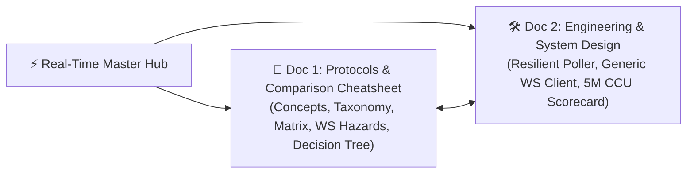

# ⚡ Real-Time Backend-to-Frontend Communication: Master Hub

Welcome to the comprehensive system design reference for real-time BE-to-FE communication. To make this guide easy to read, navigate, and study, it has been split into two dedicated, cross-referenced documents:

---

## 📚 The Two Master Documents

---

### 📘 [Document 1: Real-Time Protocols Cheatsheet](./RealTime_Protocols_Cheatsheet.md)

**Focus:** Concepts, Protocol Comparison, Efficiency Boundaries & Decision Frameworks.

1. **Executive Taxonomy & The Real-Time Continuum:** Pull vs. Push vs. Hybrid.
2. **Deep-Dive into All 9 Real-Time Techniques:**
   - Short Polling, Adaptive & Conditional Polling (ETags / 304), Long Polling (Hanging GET), Chunked HTTP Streaming, Server-Sent Events (SSE), WebSockets (RFC 6455), WebTransport (HTTP/3 over QUIC), WebRTC Data Channels, and Web Push API.
   - Sequence diagrams and production usage for each.
3. **The Architect's Master Comparison Matrix:** 9 protocols evaluated across 11 architectural dimensions (overhead, latency, connection limits, firewall traversal, CDN caching, complexity).
4. **When WebSockets are Truly Efficient vs. An Anti-Pattern:**
   - High-throughput / bidirectional sweet spots vs. unidirectional / low-frequency traps.
   - **Operational Hazards:** Kernel socket memory math (5M CCU = 75GB–250GB RAM), Backpressure & Slow Consumer OOM crashes (`ws.bufferedAmount`), and `permessage-deflate` CPU/RAM hazards.
5. **Architectural Decision Framework:** Visual flowchart and clear rules of thumb.

👉 **[Read Document 1: Protocols & Comparison Cheatsheet](./RealTime_Protocols_Cheatsheet.md)**

---

### 🛠️ [Document 2: Real-Time Engineering & Scorecard System Design](./RealTime_Scorecard_And_WebSocket_Implementation.md)

**Focus:** Production Code, Client Wrappers & 5M CCU Live Scorecard Case Study.

1. **The Art of Polling: Zero-Waste Strategies:**
   - Conditional Polling via ETag & 304 Not Modified.
   - Complete TypeScript implementation: `ResilientVisibilityPoller` (tab focus throttling, `AbortController` race condition guard, full-jitter exponential backoff).
   - Long polling timeout budgeting (25–30s) and backend `singleflight` request coalescing.
2. **Production-Ready Generic WebSocket Client (TypeScript):**
   - `RealtimeClient<TInbound, TOutbound>` featuring heartbeat watchdog (detects dead half-open TCP sockets), full-jitter reconnection, bounded offline queue, correlation ID RPC, and dynamic auth URL providers.
3. **System Design Case Study: Real-Time Dynamic Scorecard (5M CCU):**
   - High-scale fanout architecture (Scorer $\rightarrow$ DB $\rightarrow$ Redis Cluster $\rightarrow$ Multi-Gateway cluster for live push deltas + CDN for cached initial snapshots $\rightarrow$ 5M clients).
   - **Snapshot + Delta Log Reconciliation Pattern.**
   - **Reconnection Catch-up & Desync Protocol:** Redis Streams `XRANGE` replay with `STATE_DESYNC` buffer overflow fallback.
   - **End-to-End Source Code:**
     - Multi-Gateway Node.js Hub with Redis Pub/Sub, Lua script atomic sequencing, room indexing, and backpressure shedding.
     - Frontend TypeScript Reducer with out-of-order gap buffering and hydration locking.
     - The SSE Alternative snippet.

👉 **[Read Document 2: Engineering & Scorecard System Design](./RealTime_Scorecard_And_WebSocket_Implementation.md)**

---

## 🚀 Quick Navigation Cheat Sheet

| I Want To...                                         | Jump Directly To                                                                                                                                          |
| :--------------------------------------------------- | :-------------------------------------------------------------------------------------------------------------------------------------------------------- |
| Compare overhead and latency across all protocols    | [Doc 1: Master Comparison Matrix](./RealTime_Protocols_Cheatsheet.md#3-the-architects-master-comparison-matrix)                                           |
| Know whether to use WebSockets or SSE                | [Doc 1: When WebSockets are an Anti-Pattern](./RealTime_Protocols_Cheatsheet.md#4-when-websockets-are-truly-efficient-vs-an-anti-pattern)                 |
| Copy a production-ready TypeScript WebSocket client  | [Doc 2: Generic WebSocket Client](./RealTime_Scorecard_And_WebSocket_Implementation.md#2-production-ready-generic-websocket-client-typescript)            |
| Optimize short polling with tab visibility & backoff | [Doc 2: Resilient Visibility Poller](./RealTime_Scorecard_And_WebSocket_Implementation.md#12-resilient-visibility-aware-poller-implementation-typescript) |
| Design a high-scale sports/gaming live scorecard     | [Doc 2: Scorecard Case Study](./RealTime_Scorecard_And_WebSocket_Implementation.md#3-system-design-case-study-real-time-dynamic-scorecard)                |
| Review the protocol selection flowchart              | [Doc 1: Decision Framework](./RealTime_Protocols_Cheatsheet.md#5-decision-framework-which-technique-to-pick)                                              |
