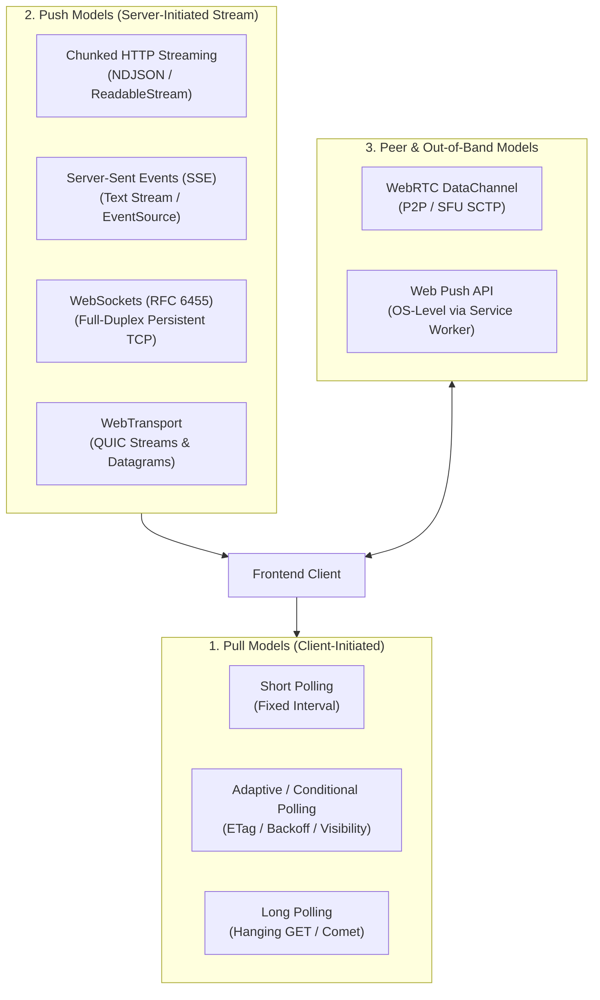
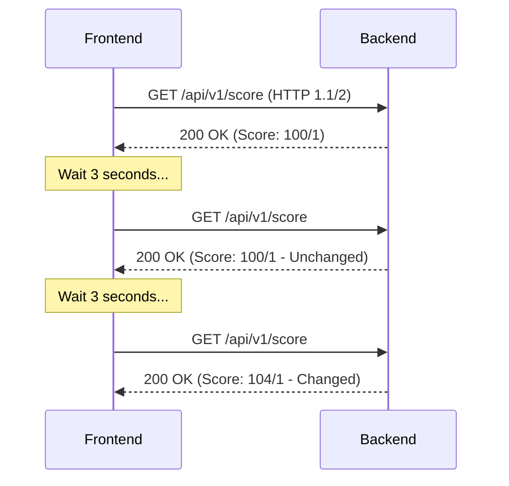
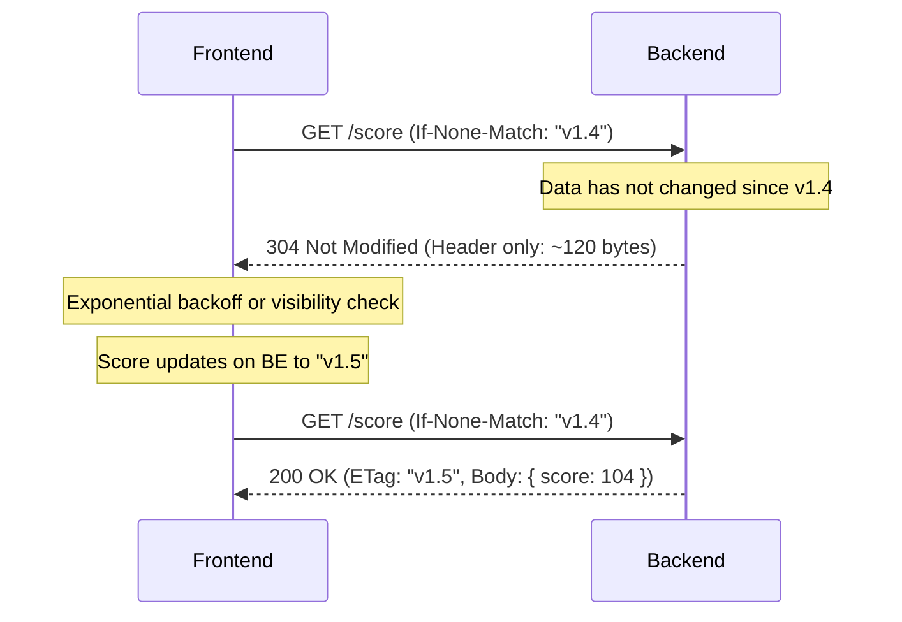
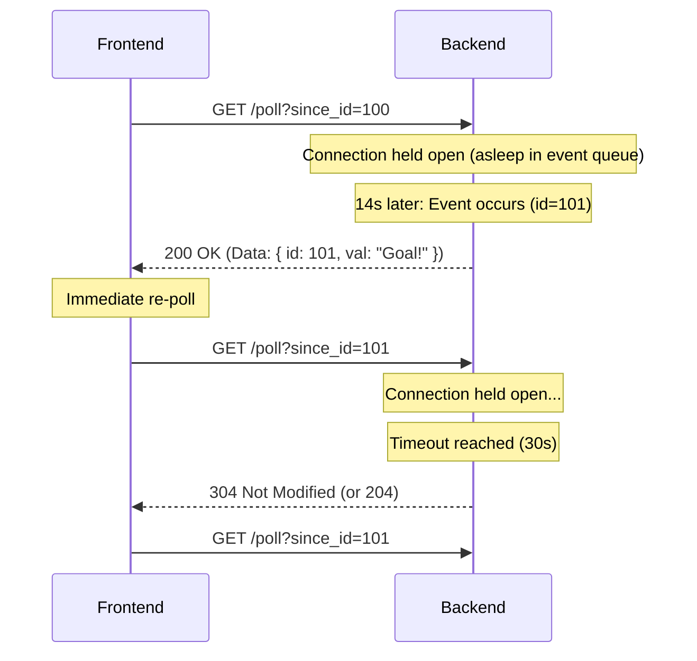
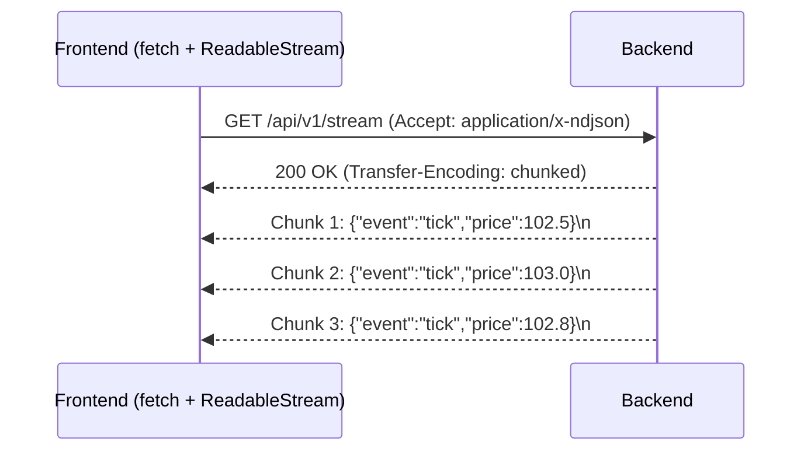
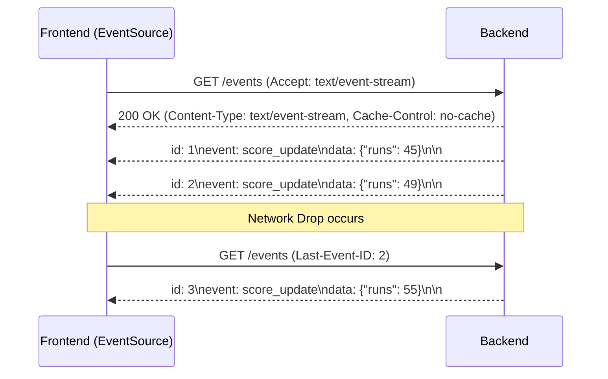
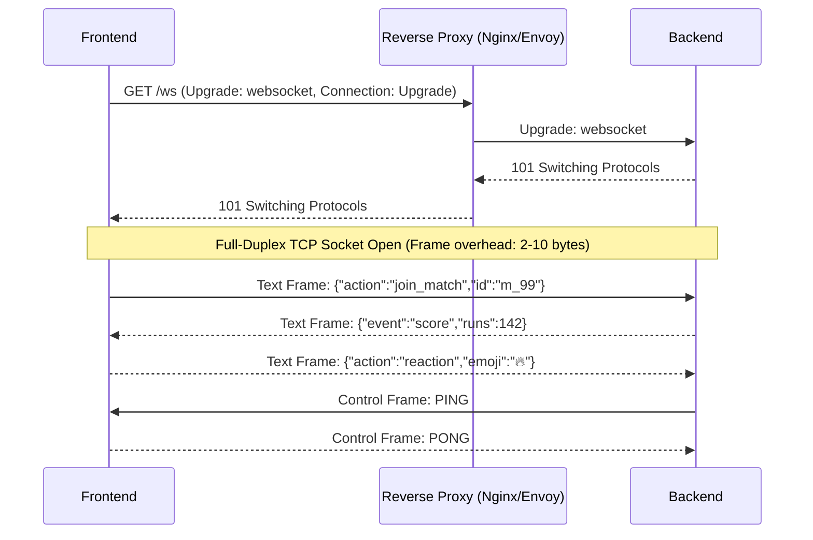
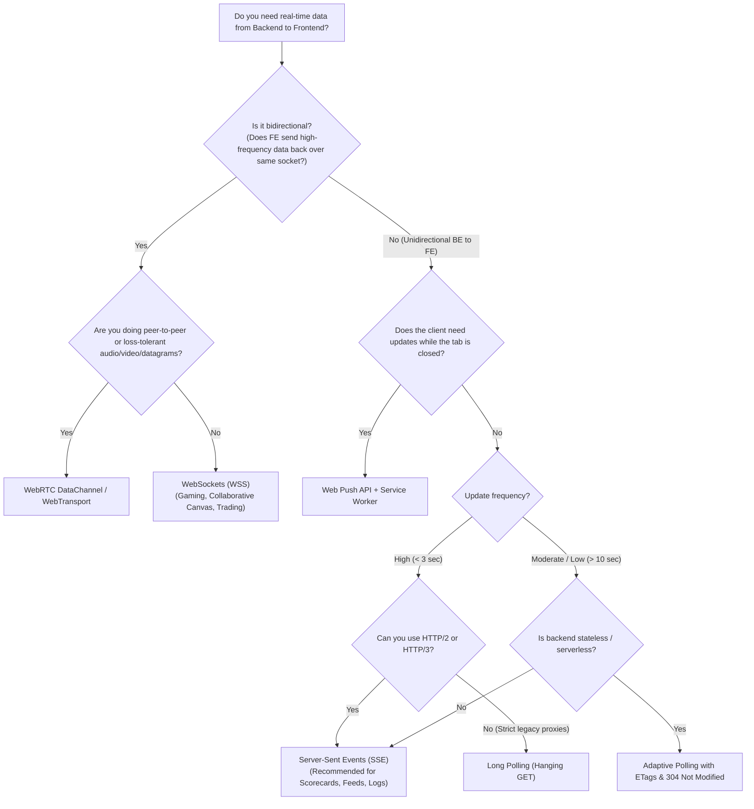

# 🌐 Real-Time Communication Protocols: Master Comparison Cheatsheet

> 🔗 **Companion Document:** For complete production code implementations, resilient polling classes, the generic TypeScript WebSocket client, and the 5M CCU Live Scorecard system design, see the **[Real-Time Engineering & Scorecard System Design Guide](./RealTime_Scorecard_And_WebSocket_Implementation.md)**.
> ⚡ **Master Hub:** For the unified directory across both guides, see the **[Real-Time Master Hub](./RealTime_BE_to_FE_Master_Cheatsheet.md)**.

---

## 📑 Table of Contents

- [🌐 Real-Time Communication Protocols: Master Comparison Cheatsheet](#-real-time-communication-protocols-master-comparison-cheatsheet)
  - [📑 Table of Contents](#-table-of-contents)
  - [1. Executive Taxonomy \& The Real-Time Continuum](#1-executive-taxonomy--the-real-time-continuum)
  - [2. Deep-Dive into All 9 Real-Time Techniques](#2-deep-dive-into-all-9-real-time-techniques)
    - [2.1 Traditional Short Polling](#21-traditional-short-polling)
    - [2.2 Adaptive \& Conditional Polling (ETags / 304 / Exponential Jitter)](#22-adaptive--conditional-polling-etags--304--exponential-jitter)
    - [2.3 Long Polling (Hanging GET / Comet)](#23-long-polling-hanging-get--comet)
    - [2.4 HTTP Streaming \& Chunked Transfer Encoding](#24-http-streaming--chunked-transfer-encoding)
    - [2.5 Server-Sent Events (SSE)](#25-server-sent-events-sse)
    - [2.6 WebSockets (RFC 6455)](#26-websockets-rfc-6455)
    - [2.7 WebTransport (HTTP/3 over QUIC)](#27-webtransport-http3-over-quic)
    - [2.8 WebRTC Data Channels (SCTP over DTLS)](#28-webrtc-data-channels-sctp-over-dtls)
    - [2.9 Push Notifications (Web Push API \& Service Workers)](#29-push-notifications-web-push-api--service-workers)
  - [3. The Architect's Master Comparison Matrix](#3-the-architects-master-comparison-matrix)
  - [4. When WebSockets are Truly Efficient vs. An Anti-Pattern](#4-when-websockets-are-truly-efficient-vs-an-anti-pattern)
    - [4.1 When WebSockets Excel](#41-when-websockets-excel)
    - [4.2 When WebSockets are an Anti-Pattern](#42-when-websockets-are-an-anti-pattern)
    - [4.3 Operational WebSocket Hazards: Memory, Backpressure \& Compression Pitfalls](#43-operational-websocket-hazards-memory-backpressure--compression-pitfalls)
      - [1. Memory \& File Descriptor (`ulimit`) Scaling](#1-memory--file-descriptor-ulimit-scaling)
      - [2. Backpressure \& Slow Consumers (`ws.bufferedAmount`)](#2-backpressure--slow-consumers-wsbufferedamount)
      - [3. `permessage-deflate` Compression Pitfalls (RFC 7692)](#3-permessage-deflate-compression-pitfalls-rfc-7692)
  - [5. Decision Framework: Which Technique to Pick?](#5-decision-framework-which-technique-to-pick)
    - [The "Rules of Thumb":](#the-rules-of-thumb)

---

## 1. Executive Taxonomy & The Real-Time Continuum

Data transfer models between Backend (BE) and Frontend (FE) fall into three paradigms:

---

## 2. Deep-Dive into All 9 Real-Time Techniques

### 2.1 Traditional Short Polling

The client triggers a standard HTTP request at a hardcoded timer interval (e.g., `setInterval(fetchData, 3000)`).

- **Pros:** Trivial to write; 100% firewall/proxy friendly; completely stateless on server (ideal for Serverless / AWS Lambda).
- **Cons:** Massive network overhead (redundant HTTP headers 500-1000 bytes per request); empty payload waste; high latency floor ($O(T_{\text{interval}})$); mobile battery drain due to waking up cellular radio basebands.
- **Where Used in Production:** Low-frequency telemetry (e.g., polling build status on GitHub Actions every 10s, batch processing job monitors).

---

### 2.2 Adaptive & Conditional Polling (ETags / 304 / Exponential Jitter)

An optimized pull pattern that solves empty payload overhead and handles variable activity rates.

- **Core Techniques:**
  1. **HTTP 304 Not Modified:** Client passes `If-None-Match: "<etag>"` or `If-Modified-Since: "<timestamp>"`. If unchanged, server sends an empty body (`304`), saving 95% bandwidth.
  2. **Page Visibility API:** If `document.visibilityState === 'hidden'`, slow polling from 3s down to 60s or pause altogether.
  3. **Activity Backoff:** If consecutive polls return `304`, back off the interval ($T_{next} = \min(T_{max}, T_{base} \times 2^n)$).
- **Where Used in Production:** RSS/feed aggregators, document status polling, deployment status screens.
- **Code Implementation:** See [ResilientVisibilityPoller in Doc 2](./RealTime_Scorecard_And_WebSocket_Implementation.md#12-resilient-visibility-aware-poller-implementation-typescript).

---

### 2.3 Long Polling (Hanging GET / Comet)

Client sends an HTTP request. If no new data is present, the server does **not** return an empty response; it holds the request open on an async event queue until:

1. New data arrives $\rightarrow$ Server responds with `200 OK` and closes connection.
2. A timeout expires (e.g., 25–30s) $\rightarrow$ Server responds with `204 No Content` or `304 Not Modified`.
   The client immediately issues another request upon receiving the response.

- **Pros:** Near-zero update latency; works on strict legacy proxies/firewalls where WebSockets are blocked.
- **Cons:** High connection churn (new TCP/TLS handshake if connection drops); requires non-blocking event-driven servers (Node.js, Go, Netty) rather than thread-per-request servers (standard Apache/PHP worker pool).
- **Where Used in Production:** Legacy chat systems, fallback transport for Socket.io and SignalR.

---

### 2.4 HTTP Streaming & Chunked Transfer Encoding

Client opens a single HTTP/1.1 or HTTP/2 request with `Transfer-Encoding: chunked`. The server keeps the HTTP connection open indefinitely and flushes delimited data blocks (e.g., NDJSON - Newline Delimited JSON).

- **Reverse Proxy Gotcha:** Upstream proxies like Nginx buffer HTTP responses by default. In Nginx, set header `X-Accel-Buffering: no` or configuration directive `proxy_buffering off` to ensure chunks reach the browser without delay.
- **Frontend Handling:** Processed via `fetch()` and `response.body.getReader()` with a custom stream decoder.
- **Where Used in Production:** LLM Token Streaming (OpenAI ChatGPT, Anthropic Claude, Gemini API streaming endpoints).

---

### 2.5 Server-Sent Events (SSE)

Standardized W3C specification (`EventSource` API) operating over standard HTTP (`Content-Type: text/event-stream`). Unidirectional from Backend to Frontend.

- **Built-in Superpowers:**
  1. **Automatic Reconnection:** Browser natively reconnects with configurable backoff (`retry: 5000\n\n`).
  2. **Event IDs & Message Tracking:** Browser tracks `Last-Event-ID` and automatically includes it in headers upon reconnecting, allowing server to replay missed messages.
  3. **Custom Event Routing:** Dispatches typed events directly to `addEventListener('score_update', ...)`.
  4. **HTTP/2 Multiplexing:** Completely eliminates the HTTP/1.1 limit of 6 connections per domain. Multiple SSE streams can share a single TCP connection.
- **Critical Caveats:**
  - **Browser `EventSource` Auth Limitations:** Native `EventSource` **does not support custom HTTP headers** (e.g., `Authorization: Bearer <token>`). It only supports cookies (`withCredentials: true`) or passing tokens via query parameters. If custom headers are mandatory, use `fetch()` with `ReadableStream` (or the `@microsoft/fetch-event-source` library).
  - **HTTP/1.1 Multi-Tab Bottleneck:** If an enterprise proxy forces HTTP/1.1 downgrade, opening 6 browser tabs consumes all 6 browser sockets to that origin, freezing other HTTP requests. Resolve this by sharing a single connection across tabs using `SharedWorker` or `BroadcastChannel`.
- **Where Used in Production:** Stock/crypto tickers, Twitter/X live notifications, real-time sports updates, CI/CD pipeline build logs.

---

### 2.6 WebSockets (RFC 6455)

A persistent, full-duplex, bidirectional communication channel over a single TCP connection. Starts with an HTTP Upgrade request (`101 Switching Protocols`), then switches to raw binary/text framing.

- **Pros:** Lowest overhead (2 bytes per frame vs 500+ bytes for HTTP); true bi-directional full-duplex communication; sub-millisecond data transmission once socket is established.
- **Cons:** Stateful server connections require connection tracking and pub/sub backplanes (Redis / NATS); load balancers must support WebSocket sticky sessions or connection draining; bypasses HTTP caching and CDNs.
- **Where Used in Production:** Multi-player web games, collaborative documents (Google Docs, Figma), live financial orderbook trading (Binance, Coinbase), interactive chat apps (Slack, WhatsApp Web).
- **Production Client:** See [Generic TypeScript Client in Doc 2](./RealTime_Scorecard_And_WebSocket_Implementation.md#2-production-ready-generic-websocket-client-typescript).

---

### 2.7 WebTransport (HTTP/3 over QUIC)

The modern successor to WebSockets for browser-to-server communication using HTTP/3 and QUIC (UDP-based).

- **Core Capabilities:**
  - **Unidirectional Streams:** Like SSE, but over QUIC.
  - **Bidirectional Streams:** Like WebSockets, but multiplexed without TCP head-of-line blocking.
  - **Datagrams:** Unreliable, out-of-order UDP-like packets for loss-tolerant, ultra-low latency data (e.g., cursor positions, voice packet samples, game coordinates).
- **Where Used in Production:** Cloud gaming, real-time audio/video streaming control, interactive spatial computing.

---

### 2.8 WebRTC Data Channels (SCTP over DTLS)

Peer-to-peer (or Client-to-SFU) encrypted communication designed for ultra-low latency interactive applications.

- **Characteristics:** Can be configured as reliable (TCP-like) or unreliable (UDP-like), ordered or unordered.
- **Where Used in Production:** Multiplayer gaming (mesh or client-server), file sharing (e.g., Snapdrop, BitTorrent web), video conferencing metadata (mute status, hand raises).

---

### 2.9 Push Notifications (Web Push API & Service Workers)

An out-of-band push mechanism delivered through the OS/browser vendor push service (Mozilla Autopush, Google FCM, Apple APNs).

- **Characteristics:** Does **not** require the web application tab to be open! The Service Worker wakes up in the background upon packet receipt.
- **Where Used in Production:** Breaking news alerts, e-commerce delivery updates, incoming calendar invites.

---

## 3. The Architect's Master Comparison Matrix

| Dimension               | Short Polling                        | Adaptive / 304 Polling | Long Polling      | HTTP Streaming     | Server-Sent Events (SSE)                        | WebSockets (WS)       | WebTransport               | WebRTC DataChannel      | Web Push API            |
| :---------------------- | :----------------------------------- | :--------------------- | :---------------- | :----------------- | :---------------------------------------------- | :-------------------- | :------------------------- | :---------------------- | :---------------------- |
| **Protocol**            | HTTP/1.1, H2, H3                     | HTTP/1.1, H2, H3       | HTTP/1.1, H2      | HTTP/1.1, H2       | HTTP/1.1, H2, H3                                | WS / WSS (TCP)        | HTTP/3 (QUIC/UDP)          | SCTP / DTLS / UDP       | HTTPS + VAPID / Push    |
| **Direction**           | Pull (Client)                        | Pull (Client)          | Pull (Hanging)    | Push (Server)      | Push (Server)                                   | Full Duplex (Both)    | Full Duplex (Both)         | Full Duplex (P2P/SFU)   | Push (Out-of-band)      |
| **Frame Overhead**      | 500B – 1KB (Headers)                 | ~120B on 304           | 500B – 1KB        | ~50B chunk framing | ~5–10 bytes framing                             | **2 – 10 bytes**      | **2 – 6 bytes**            | Minimal (UDP packet)    | Variable (Push payload) |
| **Latency**             | High ($O(T_{int})$)                  | Moderate               | Low (~RTT)        | Low (~RTT)         | **Ultra-Low (~RTT)**                            | **Ultra-Low (~RTT)**  | **Lowest (No HoL)**        | **Lowest (Direct P2P)** | High (Seconds, OS Push) |
| **Connection Lifespan** | Ephemeral                            | Ephemeral              | 20–30s bursts     | Long-lived         | Long-lived                                      | Persistent            | Persistent                 | Persistent              | Ephemeral wake-up       |
| **Browser Limit**       | 6 per host (H1.1) / Multiplexed (H2) | Same                   | 6 per host (H1.1) | 6 per host (H1.1)  | 6 (H1.1) / $\le 100$ concurrent streams (H2/H3) | **~255 per host**     | Multiplexed on 1 QUIC conn | N/A (Peer-based)        | N/A (Service Worker)    |
| **Auto Reconnect**      | App-managed                          | App-managed            | App-managed       | App-managed        | **Native in Browser**                           | App-managed           | App-managed                | ICE restart needed      | Handled by OS agent     |
| **CDN / Caching**       | High                                 | Excellent (ETag)       | None              | Low                | Partial (no-cache)                              | **None**              | None                       | None                    | Encrypted push service  |
| **Firewall / Proxy**    | 100% transparent                     | 100% transparent       | 99% transparent   | 95% friendly       | 98% friendly                                    | Can be blocked by DPI | Needs UDP allowed          | Needs STUN/TURN         | 100% transparent        |
| **Server State**        | Pure Stateless                       | Pure Stateless         | Semi-stateful     | Stateful socket    | Stateful socket                                 | Stateful TCP socket   | Stateful session           | Stateful peer           | Stateless to vendor     |
| **Complexity**          | 1 / 10                               | 3 / 10                 | 5 / 10            | 4 / 10             | **3 / 10**                                      | 7 / 10                | 8 / 10                     | 9 / 10                  | 4 / 10                  |

---

## 4. When WebSockets are Truly Efficient vs. An Anti-Pattern

A common architectural trap is reaching for WebSockets by default for _any_ real-time feature. Here is the operational reality:

### 4.1 When WebSockets Excel

1. **High Message Frequency:** Sending updates multiple times per second (e.g., live cursor positions, financial order book tickers, game ticks).
2. **Bi-directional High Throughput:** Client and Server both exchange data frequently (e.g., collaborative whiteboard where users draw while receiving other users' strokes).
3. **Strict Latency Budgets:** When sub-10ms delivery is required without TCP handshaking or HTTP header overhead.
4. **Binary Protocol Payloads:** Streaming binary formats (MessagePack, Protobuf, raw ArrayBuffers) directly to the UI.

### 4.2 When WebSockets are an Anti-Pattern

1. **Unidirectional Server Updates (Scorecards, Notifications, Stock Watchlists):**
   - _Why:_ If the client only listens and never sends messages over the socket, **Server-Sent Events (SSE)** is vastly superior. SSE works over standard HTTP/2 (sharing the existing TLS socket), automatically handles reconnection with missed message IDs, traverses corporate proxies without DPI firewall blocks, and uses standard HTTP authentication headers.
2. **Low-Frequency Events (e.g., 1 update every 2–5 minutes):**
   - _Why:_ Keeping a persistent TCP socket alive requires periodic ping/pong heartbeats. On mobile devices, heartbeats wake up the cellular radio (bringing it from low-power Idle to high-power DCH state), causing **severe battery drain**. Long polling or conditional polling is dramatically more battery-efficient for low-frequency events.
3. **Serverless / FaaS Infrastructure (AWS Lambda, Vercel, Cloudflare Workers):**
   - _Why:_ Lambdas are stateless and terminate execution. Maintaining persistent WebSocket connections requires costly API Gateway connection state tables or dedicated external connection brokers.
4. **Edge CDN Distribution & Edge Caching:**
   - _Why:_ WebSockets bypass CDNs entirely (Cloudflare/Fastly must proxy the raw TCP connection to origin). SSE or polling responses can be cached or aggregated at edge nodes.

### 4.3 Operational WebSocket Hazards: Memory, Backpressure & Compression Pitfalls

Running WebSockets at scale (e.g. 100k to 5M CCU) introduces three critical failure modes that take down production fleets:

#### 1. Memory & File Descriptor (`ulimit`) Scaling

- **The Math:** Every open WebSocket connection consumes a system file descriptor (`ulimit -n`, `fs.file-max`) and kernel memory for TCP receive (`rmem`) and send (`wmem`) buffers, plus application-level session structures (~15 KB to 50 KB+ RAM per idle connection).
- **Scale Impact:** At 5 Million CCU, holding idle sockets requires **75 GB to 250 GB of RAM** purely for TCP and socket tracking.
- **Solution:** Horizontal sharding across a WebSocket Gateway fleet (~50k to 100k active connections per node), OS kernel tuning (`sysctl.conf`: `net.core.somaxconn=65535`, `net.ipv4.tcp_max_syn_backlog=65535`, `fs.file-max=2097152`), and ephemeral port reuse via multiple virtual IP addresses on reverse proxies.

#### 2. Backpressure & Slow Consumers (`ws.bufferedAmount`)

- **The Hazard:** In high-fanout broadcast scenarios (e.g., a sudden goal in soccer or boundary in cricket), the server pushes data to thousands of clients at 50 msg/sec. If a client is on a poor 3G mobile network or high-latency link, the client's TCP ACK flow slows down.
- **The Crash:** The server-side WebSocket library buffers outgoing frames in user-space RAM waiting for the socket buffer to drain. If 50,000 clients stall simultaneously, the server gateway runs out of memory (OOM crash) within seconds.
- **Production Solution:**
  1. Monitor `ws.bufferedAmount` before sending.
  2. If `ws.bufferedAmount > MAX_BUFFER_THRESHOLD` (e.g., 512 KB–1 MB), **drop non-critical transient frames** or **coalesce state deltas**.
  3. If the buffer continues to grow, forcibly terminate the socket so the slow consumer falls back to full hydration via CDN-cached snapshot upon reconnect.

#### 3. `permessage-deflate` Compression Pitfalls (RFC 7692)

- **The Hazard:** Enabling `permessage-deflate` compresses WebSocket frames using zlib LZ77 sliding windows. While it reduces payload size by ~30–60%, it allocates a compression context (typically 64 KB to 256 KB) **per open connection**. For 100,000 connections, that is 6.4 GB to 25.6 GB of RAM dedicated exclusively to zlib sliding windows.
- **CPU Bottleneck:** On high-frequency broadcast events, the server must compress the exact same payload independently for every single connected client, spiking CPU to 100%.
- **Best Practice:** **Disable `permessage-deflate`** on high-fanout broadcast servers. Instead, serialize payloads with compact formats (MessagePack, Protobuf) or compress once at the application level before sending.

---

## 5. Decision Framework: Which Technique to Pick?

Use this rapid decision flowchart for any future system design:

### The "Rules of Thumb":

1. **Default for Live Updates (Scores, Tickers, Feeds, LLM Streaming):** Choose **Server-Sent Events (SSE)** or **HTTP Streaming**. It gives you HTTP/2 multiplexing, zero connection limit bottlenecks, native browser reconnection, and works seamlessly with proxies.
2. **Default for Bi-Directional Interactive Apps (Chat, Whiteboards, Multiplayer):** Choose **WebSockets**. Wrap it in a connection manager with heartbeat watchdog and exponential reconnect backoff. Monitor `ws.bufferedAmount` to prevent slow-consumer memory blowouts.
3. **Default for Infrequent Checks / Status Pages:** Choose **Conditional Polling (`If-None-Match` / ETag)** with the **Page Visibility API**.
4. **Default for Mobile Background Sync:** Choose **Web Push API**.

---

> ➡️ **Next Step:** To see complete TypeScript implementations of the generic WebSocket wrapper, the visibility poller, and the live 5M CCU scorecard system design, see the **[Real-Time Engineering & Scorecard System Design Guide](./RealTime_Scorecard_And_WebSocket_Implementation.md)**.
