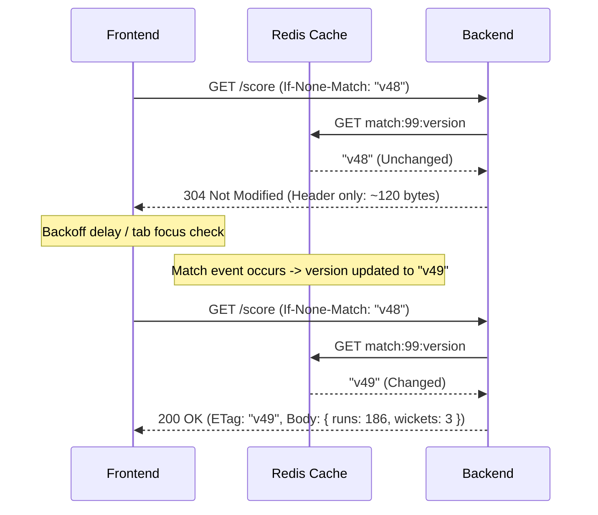
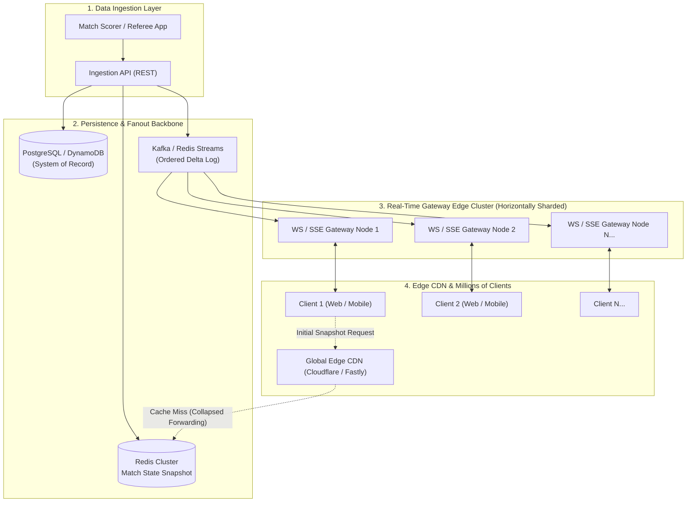
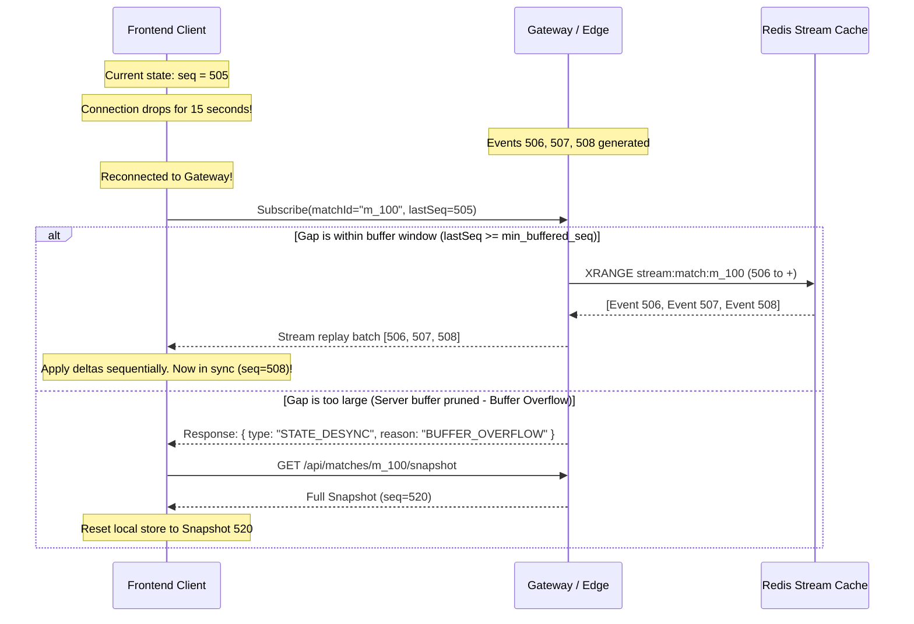

# 🛠️ Real-Time Engineering & System Design: Scorecard & WebSocket Architecture

> 🔗 **Companion Document:** For the protocol taxonomy, master comparison matrix across all 9 techniques, and the architectural decision flowchart, see the **[Real-Time Protocols Cheatsheet](./RealTime_Protocols_Cheatsheet.md)**.
> ⚡ **Master Hub:** For the unified directory across both guides, see the **[Real-Time Master Hub](./RealTime_BE_to_FE_Master_Cheatsheet.md)**.

---

## 📑 Table of Contents

- [🛠️ Real-Time Engineering \& System Design: Scorecard \& WebSocket Architecture](#️-real-time-engineering--system-design-scorecard--websocket-architecture)
  - [📑 Table of Contents](#-table-of-contents)
  - [1. The Art of Polling: Modern Strategies \& Zero-Waste Polling](#1-the-art-of-polling-modern-strategies--zero-waste-polling)
    - [1.1 Conditional Polling via ETag \& 304 Not Modified](#11-conditional-polling-via-etag--304-not-modified)
    - [1.2 Resilient Visibility-Aware Poller Implementation (TypeScript)](#12-resilient-visibility-aware-poller-implementation-typescript)
    - [1.3 Full-Jitter Exponential Backoff](#13-full-jitter-exponential-backoff)
    - [1.4 Long Polling Timeout Budgeting \& Singleflight Coalescing](#14-long-polling-timeout-budgeting--singleflight-coalescing)
  - [2. Production-Ready Generic WebSocket Client (TypeScript)](#2-production-ready-generic-websocket-client-typescript)
    - [2.1 Key Design Principles](#21-key-design-principles)
    - [2.2 Complete Implementation (`RealtimeClient<TInbound, TOutbound>`)](#22-complete-implementation-realtimeclienttinbound-toutbound)
  - [3. System Design Case Study: Real-Time Dynamic Scorecard](#3-system-design-case-study-real-time-dynamic-scorecard)
    - [3.1 Requirements \& Scale Estimates (5M Concurrent Users)](#31-requirements--scale-estimates-5m-concurrent-users)
    - [3.2 Data Flow Architecture \& Fanout Backbone](#32-data-flow-architecture--fanout-backbone)
    - [3.3 Snapshot + Delta Log Reconciliation Pattern](#33-snapshot--delta-log-reconciliation-pattern)
    - [3.4 Reconnection Catch-up, Gap Detection \& Desync Protocol](#34-reconnection-catch-up-gap-detection--desync-protocol)
    - [3.5 Multi-Gateway Node.js Hub (WS + Redis Pub/Sub + Streams)](#35-multi-gateway-nodejs-hub-ws--redis-pubsub--streams)
    - [3.6 Frontend Reducer \& Gap Manager (TypeScript)](#36-frontend-reducer--gap-manager-typescript)
    - [3.7 The SSE Alternative: When to Prefer SSE for Scorecards](#37-the-sse-alternative-when-to-prefer-sse-for-scorecards)

---

## 1. The Art of Polling: Modern Strategies & Zero-Waste Polling

When polling is selected (simplicity, stateless backends, or legacy compatibility), follow these 4 architectural optimizations to prevent backend collapse:

### 1.1 Conditional Polling via ETag & 304 Not Modified

Instead of computing and transferring complete payloads, the backend maintains a version counter or hash in Redis.

- **Backend check:** Read version key `match:99:version` (e.g., `"v48"`). If header `If-None-Match == "v48"`, immediately return `res.status(304).end()`.
- **Database Load:** Reduced by 99% (no DB queries; only a sub-millisecond Redis `GET`).
- **Bandwidth:** Reduced from 15 KB to ~120 bytes.



---

### 1.2 Resilient Visibility-Aware Poller Implementation (TypeScript)

A robust, production-tested poller that:

1. Throttles or pauses when the browser tab is hidden (`document.visibilityState === 'hidden'`).
2. Resumes immediately upon regaining focus.
3. Guards against overlapping requests and race conditions using `AbortController`.
4. Incorporates exponential backoff with full jitter on network errors.

```typescript
export interface PollerOptions {
  activeIntervalMs: number;
  backgroundIntervalMs: number;
  maxBackoffMs: number;
}

export class ResilientVisibilityPoller {
  private timer: ReturnType<typeof setTimeout> | null = null;
  private inFlightController: AbortController | null = null;
  private consecutiveErrors = 0;
  private isRunning = false;
  private runId = 0;

  constructor(
    private pollFn: (signal: AbortSignal) => Promise<void>,
    private options: PollerOptions = {
      activeIntervalMs: 3000,
      backgroundIntervalMs: 30000,
      maxBackoffMs: 30000,
    },
  ) {
    this.handleVisibilityChange = this.handleVisibilityChange.bind(this);
  }

  public start(): void {
    if (this.isRunning) return;
    this.isRunning = true;
    this.runId++;
    document.addEventListener('visibilitychange', this.handleVisibilityChange);
    this.executePoll();
  }

  public stop(): void {
    if (!this.isRunning) return;
    this.isRunning = false;
    this.runId++; // Invalidate any in-flight execution callbacks
    document.removeEventListener('visibilitychange', this.handleVisibilityChange);
    this.clearTimer();
    if (this.inFlightController) {
      this.inFlightController.abort();
      this.inFlightController = null;
    }
  }

  private handleVisibilityChange(): void {
    if (!this.isRunning) return;

    if (!document.hidden) {
      // Tab gained focus: poll immediately only if not in-flight and not in an active error backoff
      if (!this.inFlightController && this.consecutiveErrors === 0) {
        this.clearTimer();
        this.executePoll();
      }
    } else {
      // Tab hidden: if next poll is scheduled at high active rate, reschedule to background rate
      if (this.timer && this.consecutiveErrors === 0) {
        this.clearTimer();
        this.timer = setTimeout(() => this.executePoll(), this.options.backgroundIntervalMs);
      }
    }
  }

  private async executePoll(): Promise<void> {
    if (!this.isRunning) return;

    const currentRunId = this.runId;
    const controller = new AbortController();
    this.inFlightController = controller;

    try {
      await this.pollFn(controller.signal);
      if (this.runId === currentRunId && this.isRunning) {
        this.consecutiveErrors = 0; // Reset error backoff on successful completion
      }
    } catch (err: unknown) {
      if (this.runId === currentRunId && this.isRunning) {
        const isAbort = controller.signal.aborted || (err as any)?.name === 'AbortError';
        if (!isAbort) {
          this.consecutiveErrors++;
          console.warn(`[Poller] Poll failed (attempt ${this.consecutiveErrors}):`, err);
        }
      }
    } finally {
      if (this.inFlightController === controller) {
        this.inFlightController = null;
      }
      if (this.runId === currentRunId && this.isRunning) {
        this.scheduleNext();
      }
    }
  }

  private scheduleNext(): void {
    if (!this.isRunning) return;
    this.clearTimer();

    let delay: number;
    if (this.consecutiveErrors > 0) {
      // Exponential backoff with full jitter on errors
      const exponential = Math.min(
        this.options.maxBackoffMs,
        this.options.activeIntervalMs * Math.pow(2, this.consecutiveErrors),
      );
      delay = Math.floor(Math.random() * exponential);
    } else {
      delay = document.hidden ? this.options.backgroundIntervalMs : this.options.activeIntervalMs;
    }

    this.timer = setTimeout(() => this.executePoll(), delay);
  }

  private clearTimer(): void {
    if (this.timer) {
      clearTimeout(this.timer);
      this.timer = null;
    }
  }
}
```

---

### 1.3 Full-Jitter Exponential Backoff

To avoid the **Thundering Herd Problem** when a server recovers from a brief outage:
$$\text{Delay} = \text{random}(0, \min(M, B \times 2^{\text{attempt}}))$$

```typescript
export function calculateJitterBackoff(attempt: number, baseMs = 1000, maxMs = 30000): number {
  const exponential = Math.min(maxMs, baseMs * Math.pow(2, attempt));
  return Math.floor(Math.random() * exponential);
}
```

---

### 1.4 Long Polling Timeout Budgeting & Singleflight Coalescing

1. **Always set server timeout to 25s–30s:** Most cloud load balancers (AWS ALB, GCP Cloud Load Balancing) have a default idle connection timeout of 60 seconds. Closing the hanging request at 25–30s prevents 504 Gateway Timeout errors.
2. **Always use cursor sequencing (`?since_seq=42`):** When the client disconnects and reconnects, passing the last acknowledged sequence number prevents event loss during the reconnection gap.
3. **Backend Request Coalescing (`singleflight`):** When thousands of long-polling clients wake up simultaneously upon a score change, use an in-memory lock or singleflight deduplicator on the backend so only one worker queries the database/Redis, broadcasting the result to all awaiting client requests.
4. **Server-Driven Dynamic Intervals:** Return headers like `X-Poll-Interval: 15000` or `Retry-After: 30` during match breaks or low-activity periods so the backend controls client polling rates dynamically.

---

## 2. Production-Ready Generic WebSocket Client (TypeScript)

### 2.1 Key Design Principles

1. **Generic Message Typing** (`TInbound`, `TOutbound`).
2. **Automatic Reconnection with Exponential Backoff & Jitter**.
3. **Heartbeat / Watchdog Timer** to detect silent half-open TCP connections (dead TCP sockets that fail to fire `onclose`).
4. **Offline Outgoing Message Queue** (bounded, buffers messages while disconnected, flushes on reconnect).
5. **Request-Response RPC Pattern** with correlation IDs (`sendRequest()`) with timeout cleanup.
6. **Dynamic URL / Token Provider** to refresh expired JWTs before reconnection.
7. **Connection State Observer**.

### 2.2 Complete Implementation (`RealtimeClient<TInbound, TOutbound>`)

```typescript
export type ConnectionState = 'DISCONNECTED' | 'CONNECTING' | 'CONNECTED' | 'RECONNECTING';

export interface BaseMessage {
  type: string;
  correlationId?: string;
}

export interface WebSocketOptions {
  url: string | (() => Promise<string>);
  protocols?: string | string[];
  heartbeatIntervalMs?: number;
  heartbeatTimeoutMs?: number;
  baseReconnectDelayMs?: number;
  maxReconnectDelayMs?: number;
  maxReconnectAttempts?: number;
  maxQueueSize?: number;
}

export class RealtimeClient<TInbound extends BaseMessage, TOutbound extends BaseMessage> {
  private ws: WebSocket | null = null;
  private state: ConnectionState = 'DISCONNECTED';
  private reconnectAttempts = 0;
  private reconnectTimer: ReturnType<typeof setTimeout> | null = null;
  private heartbeatTimer: ReturnType<typeof setInterval> | null = null;
  private heartbeatWatchdog: ReturnType<typeof setTimeout> | null = null;
  private messageQueue: TOutbound[] = [];
  private connectToken = 0;
  private isManuallyDisconnected = false;

  // Pending RPC requests awaiting responses
  private pendingRequests = new Map<
    string,
    {
      resolve: (val: any) => void;
      reject: (err: Error) => void;
      timer: ReturnType<typeof setTimeout>;
    }
  >();

  // Event handlers
  private listeners = new Map<string, Set<(payload: any) => void>>();
  private stateListeners = new Set<(state: ConnectionState) => void>();

  private readonly config: Required<WebSocketOptions>;

  constructor(options: WebSocketOptions) {
    this.config = {
      url: options.url,
      protocols: options.protocols ?? [],
      heartbeatIntervalMs: options.heartbeatIntervalMs ?? 15000,
      heartbeatTimeoutMs: options.heartbeatTimeoutMs ?? 5000,
      baseReconnectDelayMs: options.baseReconnectDelayMs ?? 1000,
      maxReconnectDelayMs: options.maxReconnectDelayMs ?? 30000,
      maxReconnectAttempts: options.maxReconnectAttempts ?? Infinity,
      maxQueueSize: options.maxQueueSize ?? 1000,
    };
  }

  public async connect(): Promise<void> {
    if (this.ws && (this.ws.readyState === WebSocket.OPEN || this.ws.readyState === WebSocket.CONNECTING)) {
      return;
    }

    if (this.reconnectTimer) {
      clearTimeout(this.reconnectTimer);
      this.reconnectTimer = null;
    }

    // Reset attempts on explicit manual connect
    if (this.state === 'DISCONNECTED') {
      this.reconnectAttempts = 0;
    }

    this.isManuallyDisconnected = false;
    const currentToken = ++this.connectToken;

    this.setState(this.reconnectAttempts > 0 ? 'RECONNECTING' : 'CONNECTING');

    try {
      // Resolve dynamic URL or token refresh if a factory was provided
      const resolvedUrl = typeof this.config.url === 'function' ? await this.config.url() : this.config.url;

      // Abort if disconnect() was called or another connect() started during async await
      if (this.connectToken !== currentToken || this.isManuallyDisconnected) {
        return;
      }

      this.ws = new WebSocket(resolvedUrl, this.config.protocols);
      this.ws.onopen = this.handleOpen.bind(this);
      this.ws.onmessage = this.handleMessage.bind(this);
      this.ws.onclose = this.handleClose.bind(this);
      this.ws.onerror = this.handleError.bind(this);
    } catch (err) {
      console.error('[WebSocket] Initialization error:', err);
      if (this.connectToken === currentToken && !this.isManuallyDisconnected) {
        this.scheduleReconnect();
      }
    }
  }

  public send(message: TOutbound): void {
    if (this.state === 'CONNECTED' && this.ws?.readyState === WebSocket.OPEN) {
      try {
        this.ws.send(JSON.stringify(message));
      } catch (err) {
        console.warn('[WebSocket] Send failed, buffering:', err);
        this.enqueue(message);
      }
    } else {
      this.enqueue(message);
    }
  }

  private enqueue(message: TOutbound): void {
    if (this.messageQueue.length >= this.config.maxQueueSize) {
      const dropped = this.messageQueue.shift();
      // If dropped message was an active RPC request, reject it
      if (dropped?.correlationId && this.pendingRequests.has(dropped.correlationId)) {
        const req = this.pendingRequests.get(dropped.correlationId)!;
        clearTimeout(req.timer);
        this.pendingRequests.delete(dropped.correlationId);
        req.reject(new Error(`Outgoing queue buffer overflow; message dropped.`));
      }
    }
    this.messageQueue.push(message);
  }

  /**
   * Request-Response (RPC) over WebSocket with correlation ID
   */
  public sendRequest<TResponse = any>(message: Omit<TOutbound, 'correlationId'>, timeoutMs = 8000): Promise<TResponse> {
    const correlationId = `${Date.now()}_${Math.random().toString(36).substring(2, 9)}`;
    const payloadWithId = { ...message, correlationId } as TOutbound;

    return new Promise<TResponse>((resolve, reject) => {
      const timer = setTimeout(() => {
        this.pendingRequests.delete(correlationId);
        // Also remove from messageQueue if it timed out while queued offline
        const idx = this.messageQueue.findIndex((m) => m.correlationId === correlationId);
        if (idx !== -1) this.messageQueue.splice(idx, 1);
        reject(new Error(`WebSocket RPC timeout for correlationId: ${correlationId}`));
      }, timeoutMs);

      this.pendingRequests.set(correlationId, { resolve, reject, timer });
      this.send(payloadWithId);
    });
  }

  public on<K extends TInbound['type']>(
    eventType: K,
    handler: (data: Extract<TInbound, { type: K }>) => void,
  ): () => void {
    if (!this.listeners.has(eventType)) {
      this.listeners.set(eventType, new Set());
    }
    this.listeners.get(eventType)!.add(handler);
    return () => this.listeners.get(eventType)?.delete(handler);
  }

  public onStateChange(listener: (state: ConnectionState) => void): () => void {
    this.stateListeners.add(listener);
    listener(this.state);
    return () => this.stateListeners.delete(listener);
  }

  public disconnect(): void {
    this.isManuallyDisconnected = true;
    this.connectToken++;
    this.clearTimers();
    this.reconnectAttempts = 0;
    this.messageQueue = [];

    // Reject all pending in-flight RPC promises
    this.pendingRequests.forEach(({ reject, timer }) => {
      clearTimeout(timer);
      reject(new Error('WebSocket manually disconnected'));
    });
    this.pendingRequests.clear();

    if (this.ws) {
      this.ws.onclose = null; // Prevent reconnect on explicit disconnect
      try {
        this.ws.close();
      } catch (_) {}
      this.ws = null;
    }
    this.setState('DISCONNECTED');
  }

  // --- Internal Handlers ---

  private handleOpen(): void {
    this.setState('CONNECTED');
    this.reconnectAttempts = 0;
    this.startHeartbeat();
    this.flushMessageQueue();
  }

  private handleMessage(event: MessageEvent): void {
    try {
      const raw = JSON.parse(event.data);

      // Handle application heartbeat response
      if (raw.type === '__pong__') {
        this.resetHeartbeatWatchdog();
        return;
      }

      // Check if this is an RPC response
      if (raw.correlationId && this.pendingRequests.has(raw.correlationId)) {
        const { resolve, timer } = this.pendingRequests.get(raw.correlationId)!;
        clearTimeout(timer);
        this.pendingRequests.delete(raw.correlationId);
        resolve(raw);
        return;
      }

      // Dispatch to typed event listeners
      const handlers = this.listeners.get(raw.type);
      if (handlers) {
        handlers.forEach((fn) => fn(raw));
      }
    } catch (e) {
      console.error('[WebSocket] Failed to parse inbound frame:', e);
    }
  }

  private handleClose(): void {
    this.cleanupSocket();
    if (!this.isManuallyDisconnected) {
      this.scheduleReconnect();
    }
  }

  private handleError(err: Event): void {
    console.warn('[WebSocket] Transport error:', err);
  }

  private flushMessageQueue(): void {
    while (this.messageQueue.length > 0 && this.ws?.readyState === WebSocket.OPEN) {
      const msg = this.messageQueue.shift();
      if (msg) {
        try {
          this.ws.send(JSON.stringify(msg));
        } catch (err) {
          console.warn('[WebSocket] Error flushing queued message:', err);
          this.messageQueue.unshift(msg);
          break;
        }
      }
    }
  }

  private startHeartbeat(): void {
    this.clearTimers();
    this.heartbeatTimer = setInterval(() => {
      if (this.ws?.readyState === WebSocket.OPEN) {
        try {
          // Send application-layer ping
          this.ws.send(JSON.stringify({ type: '__ping__' }));
        } catch (_) {
          return;
        }

        // Clear existing watchdog before starting a new one
        this.resetHeartbeatWatchdog();

        // Watchdog: If pong is not received within heartbeatTimeoutMs, socket is dead/half-open
        this.heartbeatWatchdog = setTimeout(() => {
          console.warn('[WebSocket] Heartbeat watchdog timed out. Aggressively tearing down half-open socket.');
          this.cleanupSocket();
          if (!this.isManuallyDisconnected) {
            this.scheduleReconnect();
          }
        }, this.config.heartbeatTimeoutMs);
      }
    }, this.config.heartbeatIntervalMs);
  }

  private resetHeartbeatWatchdog(): void {
    if (this.heartbeatWatchdog) {
      clearTimeout(this.heartbeatWatchdog);
      this.heartbeatWatchdog = null;
    }
  }

  private scheduleReconnect(): void {
    if (this.isManuallyDisconnected || this.reconnectAttempts >= this.config.maxReconnectAttempts) {
      this.setState('DISCONNECTED');
      return;
    }

    this.setState('RECONNECTING');

    // Exponential backoff with Full Jitter
    const delay = Math.floor(
      Math.random() *
        Math.min(
          this.config.maxReconnectDelayMs,
          this.config.baseReconnectDelayMs * Math.pow(2, this.reconnectAttempts),
        ),
    );

    this.reconnectAttempts++;
    this.reconnectTimer = setTimeout(() => {
      this.connect();
    }, delay);
  }

  private cleanupSocket(): void {
    this.clearTimers();
    if (this.ws) {
      this.ws.onopen = null;
      this.ws.onmessage = null;
      this.ws.onclose = null;
      this.ws.onerror = null;
      try {
        this.ws.close();
      } catch (_) {}
      this.ws = null;
    }
  }

  private clearTimers(): void {
    if (this.heartbeatTimer) clearInterval(this.heartbeatTimer);
    if (this.heartbeatWatchdog) clearTimeout(this.heartbeatWatchdog);
    if (this.reconnectTimer) clearTimeout(this.reconnectTimer);
    this.heartbeatTimer = null;
    this.heartbeatWatchdog = null;
    this.reconnectTimer = null;
  }

  private setState(newState: ConnectionState): void {
    if (this.state !== newState) {
      this.state = newState;
      this.stateListeners.forEach((listener) => listener(newState));
    }
  }
}
```

---

## 3. System Design Case Study: Real-Time Dynamic Scorecard

### 3.1 Requirements & Scale Estimates (5M Concurrent Users)

- **Scenario:** Live Sports Match Scorecard (Cricket / Football / Basketball) viewed by **5 Million Concurrent Users (CCU)**.
- **Dynamic Updates:** Ball-by-ball updates, commentary, score changes, player statistics, match clock.
- **Traffic Pattern:** Read-heavy (1 publisher writing live scores, 5,000,000 clients listening).
- **Latency Requirement:** $\le 200\text{ ms}$ global delivery.
- **Resilience:** Mobile networks frequently drop connections. Client must seamlessly recover missed events without downloading the entire database state every time.

---

### 3.2 Data Flow Architecture & Fanout Backbone



---

### 3.3 Snapshot + Delta Log Reconciliation Pattern

Streaming full state snapshots on every single point or run wastes massive bandwidth. Instead, use the **Snapshot + Delta Log Pattern**:

1. **Hydration (Initial Load):** Client fetches the latest full state snapshot via standard cached HTTP GET:
   `GET /api/matches/m_100/snapshot` (Cached on CDN with 2-second TTL + request collapsing / collapsed forwarding).
   ```json
   {
     "matchId": "m_100",
     "sequenceNumber": 504,
     "runs": 182,
     "wickets": 3,
     "overs": 18.2,
     "recentCommentary": ["18.2: 1 run taken to third man."]
   }
   ```
2. **Real-Time Stream:** Client subscribes via WebSocket or SSE to match stream `/matches/m_100/live`.
3. **Delta Payloads:** The server emits lightweight JSON patches tagged with monotonically increasing `sequenceNumber` (`seq`):
   ```json
   {
     "type": "SCORE_DELTA",
     "matchId": "m_100",
     "seq": 505,
     "patch": {
       "runs": 188,
       "overs": 18.3,
       "commentary": "18.3: SIX runs over deep mid-wicket!"
     }
   }
   ```

---

### 3.4 Reconnection Catch-up, Gap Detection & Desync Protocol

When a mobile phone passes through a tunnel, the connection drops. What happens when it reconnects?



---

### 3.5 Multi-Gateway Node.js Hub (WS + Redis Pub/Sub + Streams)

> _Note:_ The live WebSocket gateway runs on port `8080` handling connection streaming, while the initial HTTP snapshot endpoint (`GET /api/matches/:id/snapshot`) is served separately via Express/Fastify behind the CDN cache.

```typescript
import { WebSocketServer, WebSocket } from 'ws';
import Redis from 'ioredis';

const redis = new Redis();
const redisSub = new Redis(); // Dedicated connection for Pub/Sub subscriptions

// Production hardening: disable permessageDeflate (RFC 7692 CPU hazard) & clamp max frame size
const wss = new WebSocketServer({
  port: 8080,
  permessageDeflate: false,
  maxPayload: 16 * 1024, // 16 KB max payload
});

redis.on('error', (err) => console.error('[Redis Client Error]:', err));
redisSub.on('error', (err) => console.error('[Redis Sub Error]:', err));
wss.on('error', (err) => console.error('[WSS Server Error]:', err));

interface ClientSession {
  ws: WebSocket;
  matchId: string;
  lastSeq: number;
  isReplaying: boolean;
  replayQueue: any[];
}

// Room indexing: matchId -> Set of ClientSessions (O(1) room dispatch)
const matchRooms = new Map<string, Set<ClientSession>>();

// 1. Subscribe to Redis Pub/Sub to receive broadcast events from other gateway nodes
redisSub.psubscribe('match:*:events', (err) => {
  if (err) console.error('Redis subscription failed:', err);
});

redisSub.on('pmessage', (_pattern, channel, message) => {
  try {
    const match = channel.match(/^match:(.+):events$/);
    if (!match) return;
    const matchId = match[1];
    const delta = JSON.parse(message);
    dispatchDeltaToLocalRoom(matchId, delta);
  } catch (err) {
    console.error('[Gateway] Malformed Pub/Sub message frame:', err);
  }
});

wss.on('connection', (ws) => {
  let currentSession: ClientSession | null = null;

  ws.on('error', (err) => {
    console.warn('[WS Client Transport Error]:', err);
  });

  ws.on('message', async (data) => {
    try {
      const msg = JSON.parse(data.toString());

      // Application-layer heartbeat response for RealtimeClient
      if (msg.type === '__ping__') {
        if (ws.readyState === WebSocket.OPEN) {
          ws.send(JSON.stringify({ type: '__pong__' }));
        }
        return;
      }

      if (msg.action === 'SUBSCRIBE') {
        const matchId = msg.matchId;
        const clientLastSeq = typeof msg.lastSeq === 'number' ? msg.lastSeq : 0;

        // Cleanup prior subscription on this socket if re-subscribing
        if (currentSession && matchRooms.has(currentSession.matchId)) {
          const prevRoom = matchRooms.get(currentSession.matchId)!;
          prevRoom.delete(currentSession);
          if (prevRoom.size === 0) matchRooms.delete(currentSession.matchId);
        }

        currentSession = {
          ws,
          matchId,
          lastSeq: clientLastSeq,
          isReplaying: true,
          replayQueue: [],
        };

        if (!matchRooms.has(matchId)) {
          matchRooms.set(matchId, new Set());
        }
        matchRooms.get(matchId)!.add(currentSession);

        await handleReplay(currentSession);
      }
    } catch (err) {
      console.error('[Gateway] Malformed client frame:', err);
    }
  });

  ws.on('close', () => {
    if (currentSession && matchRooms.has(currentSession.matchId)) {
      const room = matchRooms.get(currentSession.matchId)!;
      room.delete(currentSession);
      if (room.size === 0) {
        matchRooms.delete(currentSession.matchId);
      }
    }
  });
});

async function handleReplay(session: ClientSession) {
  const streamKey = `stream:match:${session.matchId}`;

  try {
    // Check oldest buffered sequence number in the Redis stream
    const oldestEntry = await redis.xrange(streamKey, '-', '+', 'COUNT', 1);

    if (oldestEntry.length > 0) {
      const oldestSeq = parseInt(oldestEntry[0][0], 10);

      // If client is missing events older than the buffer, trigger STATE_DESYNC
      if (oldestSeq > 1 && (session.lastSeq === 0 || session.lastSeq < oldestSeq - 1)) {
        if (session.ws.readyState === WebSocket.OPEN) {
          session.ws.send(
            JSON.stringify({
              type: 'STATE_DESYNC',
              matchId: session.matchId,
              reason: 'BUFFER_OVERFLOW',
            }),
          );
        }
        session.replayQueue = [];
        return;
      }
    }

    // Fetch missed events from (lastSeq + 1) to latest
    const missedEvents = await redis.xrange(streamKey, (session.lastSeq + 1).toString(), '+');

    for (const [id, fields] of missedEvents) {
      if (session.ws.readyState !== WebSocket.OPEN) break;
      const delta = JSON.parse(fields[1]);
      session.ws.send(JSON.stringify(delta));
      session.lastSeq = delta.seq;
    }

    // Flush any deltas that arrived concurrently during the async replay window
    while (session.replayQueue.length > 0) {
      const queuedDelta = session.replayQueue.shift();
      if (queuedDelta.seq > session.lastSeq && session.ws.readyState === WebSocket.OPEN) {
        session.ws.send(JSON.stringify(queuedDelta));
        session.lastSeq = queuedDelta.seq;
      }
    }
  } catch (err) {
    console.error('[Gateway] Replay failed:', err);
  } finally {
    session.isReplaying = false;
  }
}

function dispatchDeltaToLocalRoom(matchId: string, delta: any) {
  const room = matchRooms.get(matchId);
  if (!room) return;

  const raw = JSON.stringify(delta);

  for (const session of room) {
    if (session.ws.readyState !== WebSocket.OPEN) continue;

    if (session.isReplaying) {
      // Bounded queue: cap concurrent replay buffer to 100 deltas
      if (session.replayQueue.length < 100) {
        session.replayQueue.push(delta);
      }
    } else {
      // Backpressure protection (512 KB threshold)
      if (session.ws.bufferedAmount > 1024 * 512) {
        console.warn('Slow consumer detected; forcibly terminating socket to prevent OOM.');
        session.ws.terminate();
        room.delete(session);
        continue;
      }
      session.ws.send(raw);
      session.lastSeq = delta.seq;
    }
  }
}

/**
 * Atomic Score Delta Publishing using Redis Lua Script
 * Prevents race conditions between concurrent worker threads
 */
const publishLua = `
  local nextSeq = redis.call('INCR', KEYS[1])
  local payload = cjson.decode(ARGV[1])
  payload['seq'] = nextSeq
  local raw = cjson.encode(payload)

  -- Add to capped stream
  redis.call('XADD', KEYS[2], 'MAXLEN', '~', 500, nextSeq, 'data', raw)
  -- Publish to cluster pub/sub channel
  redis.call('PUBLISH', KEYS[3], raw)
  return nextSeq
`;

export async function broadcastScoreDelta(matchId: string, patch: Record<string, any>) {
  const payload = {
    type: 'SCORE_DELTA',
    matchId,
    timestamp: Date.now(),
    patch,
  };

  await redis.eval(
    publishLua,
    3,
    `seq:match:${matchId}`,
    `stream:match:${matchId}`,
    `match:${matchId}:events`,
    JSON.stringify(payload),
  );
}
```

---

### 3.6 Frontend Reducer & Gap Manager (TypeScript)

```typescript
export interface ScorecardState {
  matchId: string;
  lastSeq: number;
  runs: number;
  wickets: number;
  overs: number;
  recentCommentary: string[];
}

export interface ScoreDeltaMessage {
  type: 'SCORE_DELTA';
  matchId: string;
  seq: number;
  patch: Record<string, any>;
  timestamp?: number;
}

export interface StateDesyncMessage {
  type: 'STATE_DESYNC';
  matchId: string;
  reason: string;
}

export type InboundScorecardMessage = ScoreDeltaMessage | StateDesyncMessage;

export class ScorecardManager {
  private state: ScorecardState = {
    matchId: '',
    lastSeq: 0,
    runs: 0,
    wickets: 0,
    overs: 0,
    recentCommentary: [],
  };

  private pendingDeltas = new Map<number, any>(); // Out-of-order buffer
  private isHydrating = false;
  private resyncTimer: ReturnType<typeof setTimeout> | null = null;
  private hydrationEpoch = 0;
  private hydrationController: AbortController | null = null;

  constructor(
    private matchId: string,
    private onStateUpdate: (state: ScorecardState) => void,
  ) {}

  public async initialize(): Promise<void> {
    const currentEpoch = ++this.hydrationEpoch;
    this.isHydrating = true;

    if (this.hydrationController) {
      this.hydrationController.abort();
    }
    this.hydrationController = new AbortController();

    try {
      const res = await fetch(`/api/matches/${this.matchId}/snapshot`, {
        signal: this.hydrationController.signal,
      });
      if (!res.ok) throw new Error(`Snapshot failed: ${res.statusText}`);
      const snapshot = await res.json();

      // Guard against stale concurrent fetch responses
      if (this.hydrationEpoch !== currentEpoch) return;

      this.state = {
        matchId: snapshot.matchId,
        lastSeq: snapshot.sequenceNumber,
        runs: snapshot.runs,
        wickets: snapshot.wickets,
        overs: snapshot.overs,
        recentCommentary: snapshot.recentCommentary || [],
      };

      this.onStateUpdate(this.state);
    } catch (e: any) {
      if (e?.name !== 'AbortError') {
        console.error('[Scorecard] Failed to fetch snapshot:', e);
      }
    } finally {
      if (this.hydrationEpoch === currentEpoch) {
        this.isHydrating = false;
        this.drainPendingBuffer();
      }
    }
  }

  public handleInboundDelta(delta: InboundScorecardMessage): void {
    if (delta.type === 'STATE_DESYNC') {
      console.warn('[Scorecard] Buffer overflow detected on server. Hydrating full snapshot.');
      this.initialize();
      return;
    }

    // Buffer deltas while initial hydration fetch is in flight
    if (this.isHydrating) {
      this.pendingDeltas.set(delta.seq, delta.patch);
      return;
    }

    // Ignore duplicate/older frames
    if (delta.seq <= this.state.lastSeq) return;

    // In-order frame
    if (delta.seq === this.state.lastSeq + 1) {
      this.applyPatch(delta.patch, delta.seq);
      this.drainPendingBuffer();
    } else {
      // Gap detected (e.g. current is 10, arrived 12). Buffer 12.
      this.pendingDeltas.set(delta.seq, delta.patch);
      this.scheduleResyncTimer();
    }
  }

  private applyPatch(patch: any, newSeq: number): void {
    this.state = {
      ...this.state,
      lastSeq: newSeq,
      runs: patch.runs ?? this.state.runs,
      wickets: patch.wickets ?? this.state.wickets,
      overs: patch.overs ?? this.state.overs,
      recentCommentary: patch.commentary
        ? [patch.commentary, ...this.state.recentCommentary.slice(0, 19)]
        : this.state.recentCommentary,
    };
    this.onStateUpdate(this.state);
  }

  private drainPendingBuffer(): void {
    // 1. Purge stale buffered deltas older than current state
    for (const [seq] of this.pendingDeltas) {
      if (seq <= this.state.lastSeq) {
        this.pendingDeltas.delete(seq);
      }
    }

    // 2. Sequentially apply contiguous deltas
    let nextSeq = this.state.lastSeq + 1;
    while (this.pendingDeltas.has(nextSeq)) {
      const patch = this.pendingDeltas.get(nextSeq);
      this.pendingDeltas.delete(nextSeq);
      this.applyPatch(patch, nextSeq);
      nextSeq = this.state.lastSeq + 1;
    }

    // 3. Clear or re-arm resync timer if unresolved gaps remain
    if (this.pendingDeltas.size === 0) {
      if (this.resyncTimer) {
        clearTimeout(this.resyncTimer);
        this.resyncTimer = null;
      }
    } else {
      this.scheduleResyncTimer();
    }
  }

  private scheduleResyncTimer(): void {
    if (!this.resyncTimer) {
      this.resyncTimer = setTimeout(() => {
        this.resyncTimer = null;
        if (this.pendingDeltas.size > 0 && !this.isHydrating) {
          console.warn('[Scorecard] Unresolved gap timeout. Forcing snapshot resync.');
          this.initialize();
        }
      }, 2000);
    }
  }

  public destroy(): void {
    if (this.resyncTimer) {
      clearTimeout(this.resyncTimer);
      this.resyncTimer = null;
    }
    if (this.hydrationController) {
      this.hydrationController.abort();
      this.hydrationController = null;
    }
    this.pendingDeltas.clear();
  }
}
```

---

### 3.7 The SSE Alternative: When to Prefer SSE for Scorecards

While WebSockets was shown above to illustrate bidirectional multiplexing (e.g., subscribing and unsubscribing across different matches dynamically on a single socket), for purely read-only scorecards, **Server-Sent Events (SSE)** is simpler, highly robust, and requires less custom reconnection code:

```typescript
// Frontend SSE Subscriber with native Last-Event-ID catch-up
export function connectScorecardSSE(matchId: string, onUpdate: (delta: any) => void) {
  // Browser automatically passes Last-Event-ID header on reconnect
  const eventSource = new EventSource(`/api/matches/${matchId}/sse`);

  eventSource.addEventListener('score_delta', (event) => {
    const msgEvent = event as MessageEvent;
    const delta = JSON.parse(msgEvent.data);
    onUpdate(delta);
  });

  eventSource.onerror = (err) => {
    console.warn('[SSE] Connection error. Browser will automatically reconnect:', err);
  };

  return () => eventSource.close();
}
```

---

> ⬅️ **Previous Step:** For the conceptual comparison of all 9 protocols, when WebSockets are efficient vs an anti-pattern, and the master decision tree, see the **[Real-Time Protocols Cheatsheet](./RealTime_Protocols_Cheatsheet.md)**.
