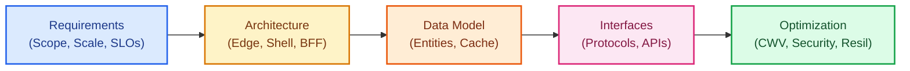
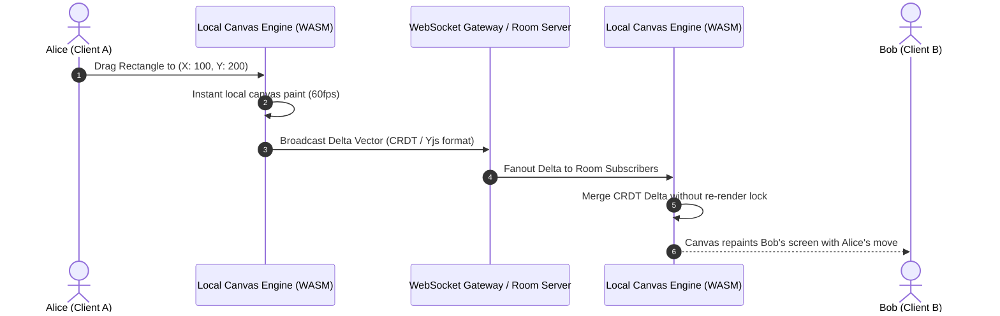

# High-Level Design (HLD) & Frontend System Architecture Laboratory

High-Level Design (HLD) in frontend and distributed web systems is the architectural discipline of structuring web applications at enterprise scale. While Low-Level Design ([LLD.md](LLD.md)) focuses on component composition, state machines, design patterns, and code-level clean interfaces, **HLD focuses on edge delivery, network topologies, micro-frontend federation, real-time protocols, auth security boundaries, and resilience under heavy traffic**.

---

## Table of Contents

1. [The Frontend HLD Paradigm & The RADIO Framework](#1-the-frontend-hld-paradigm--the-radio-framework)
2. [Macro Architecture: Monoliths vs. Micro-Frontends](#2-macro-architecture-monoliths-vs-micro-frontends)
3. [Client-Server Communication & Protocol Decision Matrix](#3-client-server-communication--protocol-decision-matrix)
4. [Rendering Topologies & Global Edge Caching](#4-rendering-topologies--global-edge-caching)
5. [The Backend-for-Frontend (BFF) Pattern & Auth Security](#5-the-backend-for-frontend-bff-pattern--auth-security)
6. [Asset Delivery, Critical Rendering Path & Core Web Vitals](#6-asset-delivery-critical-rendering-path--core-web-vitals)
7. [Resilient Data Synchronization & Local-First Architecture](#7-resilient-data-synchronization--local-first-architecture)
8. [Observability, Telemetry & Real User Monitoring (RUM)](#8-observability-telemetry--real-user-monitoring-rum)
9. [Classic Frontend HLD System Walkthroughs](#9-classic-frontend-hld-system-walkthroughs)
   - [Case 1: Global E-Commerce Checkout & Product Detail Suite](#case-1-global-e-commerce-checkout--product-detail-suite)
   - [Case 2: Real-Time Collaborative Canvas (Figma / Miro)](#case-2-real-time-collaborative-canvas-figma--miro)
   - [Case 3: Infinite Social Media Feed (Twitter / Instagram)](#case-3-infinite-social-media-feed-twitter--instagram)
10. [Staff/Principal Frontend HLD Interview Grill](#10-staffprincipal-frontend-hld-interview-grill)

---

## 1. The Frontend HLD Paradigm & The RADIO Framework

Frontend system design differs fundamentally from backend system design:
* **The Environment is Untrusted & Heterogeneous**: The client runs on low-end Android phones, high-end MacBooks, flaky 3G networks, and varying screen viewports.
* **CPU & Memory are Leased**: You do not own the execution server; you borrow client device battery, memory, and main-thread processing cycles.
* **Latency is Dominated by the Last Mile**: CDN edge points help, but radio cell towers, TCP handshakes, and packet drops dictate real-world perceived performance.

### The RADIO Framework for Frontend System Design

```
┌─────────────────────────────────────────────────────────────────────────────┐
│                            THE RADIO FRAMEWORK                              │
├───┬───────────────────────────────────┬─────────────────────────────────────────┤
│ R │ Requirements Clarification        │ Functional, Non-Functional, Device tiers│
│ A │ Architecture High-Level Design    │ Macro topology, Micro-frontends, BFF   │
│ D │ Data Model & State Entities       │ Client entities, normalized cache       │
│ I │ Interfaces & Network Protocols    │ REST, GraphQL, SSE, WebSockets, gRPC   │
│ O │ Optimization & Deep Dives         │ Caching, CWV, Security, Offline, RUM   │
└───┴───────────────────────────────────┴─────────────────────────────────────────┘
```



---

## 2. Macro Architecture: Monoliths vs. Micro-Frontends

When an organization scales past 50+ frontend developers across multiple product domains (e.g., Search, Checkout, Account, Cart), a single monolithic SPA repository causes deployment lockouts, brittle builds, and organizational bottlenecks.

```
┌──────────────────────────────────────────────────────────────────────────────────────────────────┐
│                                 MICRO-FRONTEND FEDERATION TOPOLOGY                               │
│                                                                                                  │
│                                    ┌───────────────────────┐                                     │
│                                    │  Edge CDN / Gateway   │                                     │
│                                    └───────────┬───────────┘                                     │
│                                                │                                                 │
│                                    ┌───────────▼───────────┐                                     │
│                                    │ Root Container Shell  │ (Host App)                          │
│                                    │ (Router, Auth, Theme) │                                     │
│                                    └─┬─────────┬─────────┬─┘                                     │
│                                      │         │         │                                       │
│                ┌─────────────────────┼─────────┴─────────┼─────────────────────┐                 │
│                ▼                               ▼                               ▼                 │
│    ┌───────────────────────┐       ┌───────────────────────┐       ┌───────────────────────┐     │
│    │  Search Remote App    │       │  Product Remote App   │       │  Checkout Remote App  │     │
│    │  (Team Catalog)       │       │  (Team Discovery)     │       │  (Team Payments)      │     │
│    └───────────────────────┘       └───────────────────────┘       └───────────────────────┘     │
│                                                                                                  │
│ ── Shared Singletons: React Core, Design System Tokens, Event Bus (BroadcastChannel/CustomEvent)──│
└──────────────────────────────────────────────────────────────────────────────────────────────────┘
```

### Micro-Frontend Integration Strategies Comparison

| Integration Mechanism | Loading Phase | Isolation Degree | Shared Dependencies | Performance Overhead | Best For |
| :--- | :--- | :--- | :--- | :--- | :--- |
| **Webpack 5 / Vite Module Federation** | Runtime (Async JS) | Moderate (Shared window) | Excellent (`shared: { react: { singleton: true } }`) | Very Low | Modern SPAs, tightly coupled enterprise suites |
| **Web Components (Custom Elements)** | Runtime | High (Shadow DOM) | Difficult (Bundles bundled per component) | Low-Medium | Framework-agnostic multi-team design systems |
| **Iframe Sandboxing** | Runtime | Absolute (Process-level) | None (100% duplication) | High (Memory, layout shifts) | Third-party payment gateways, untrusted widgets |
| **Server-Side Transclusion (ESI / Edge)** | Edge / Pre-render | Moderate | Edge assembled fragments | Extremely Fast | Content-heavy publishing, e-commerce landing pages |

---

## 3. Client-Server Communication & Protocol Decision Matrix

Frontend architects must select the right transport layer based on latency, multiplexing, bidirectional frequency, and connection overhead.

```
┌─────────────────────────────────────────────────────────────────────────────────────────────┐
│                          COMMUNICATION PROTOCOL DECISION MATRIX                             │
├─────────────────┬──────────────┬─────────────┬──────────────┬───────────────────────────────┤
│ Protocol        │ Direction    │ Multiplexing│ Head-of-Line │ Ideal Use Case                │
├─────────────────┼──────────────┼─────────────┼──────────────┼───────────────────────────────┤
│ **REST / HTTP/2** | Request/Resp | Yes (H2/H3) | Solved in H3 | Standard CRUD operations      │
│ **GraphQL**     | Request/Resp | Yes (H2/H3) | Solved in H3 | Multi-entity relational mobile│
│ **SSE**         | Server ➔ Client| Native (H2) | Minimal      | Live stock ticks, LLM streams │
│ **WebSocket**   | Full-Duplex  | Single Conn | Handled in App| Gaming, chat, collaborative doc│
│ **WebRTC Data** | Peer-to-Peer | Multi-channel| UDP zero-HoL | P2P video, multiplayer canvas │
└─────────────────┴──────────────┴─────────────┴──────────────┴───────────────────────────────┘
```

### Protocol Deep Dive: SSE vs. WebSockets

#### When to Choose Server-Sent Events (SSE)
- **Architecture**: Runs over standard HTTP/2. Native browser auto-reconnect (`EventSource`), firewall-friendly, supports HTTP header authentication natively.
- **Ideal Fit**: One-way server push such as **AI/LLM streaming responses**, notifications, real-time sports scores, and order status updates.

#### When to Choose WebSockets
- **Architecture**: Upgrades TCP connection from HTTP. Full-duplex bidirectional pipe with ultra-low per-frame overhead (2-10 bytes header vs 500+ bytes HTTP).
- **Ideal Fit**: Collaborative editing (Figma), bidirectional low-latency multiplayer gaming, live financial trading desks.
- **Production Hazards**: Requires sticky sessions or a distributed Redis Pub/Sub gateway backplane; does not multiplex over standard HTTP/2 proxies.

---

## 4. Rendering Topologies & Global Edge Caching

Modern web architecture evaluates rendering along two axes: **Where does execution happen?** and **When does compilation occur?**

```
            BUILD TIME                     ON REQUEST
      ┌──────────────────────────┐   ┌──────────────────────────┐
      │   SSG (Static Site)      │   │   SSR (Server Render)    │
SERVER│   HTML compiled at build │   │   HTML dynamic on request│
      ├──────────────────────────┤   ├──────────────────────────┤
      │   ISR (Incremental)      │   │   Streaming SSR + RSC    │
      │   Background re-compile  │   │   Chunked HTML + React   │
      └──────────────────────────┘   └──────────────────────────┘
      ┌─────────────────────────────────────────────────────────┐
EDGE  │   Edge SSR (Cloudflare Workers / Vercel Edge)           │
      │   Compute executes within 5ms of user's cell tower      │
      └─────────────────────────────────────────────────────────┘
      ┌─────────────────────────────────────────────────────────┐
CLIENT│   CSR (Client-Side Rendering)                           │
      │   Raw JS bundle sent; client executes DOM render        │
      └─────────────────────────────────────────────────────────┘
```

### The Cache-Control Blueprint for Production

1. **Immutable Static Chunks (`/assets/chunk-[hash].js`)**:
   ```http
   Cache-Control: public, max-age=31536000, immutable
   ```
   *Never refetched during the lifespan of that specific build.*

2. **Root Entry Document (`/index.html` or SSR route)**:
   ```http
   Cache-Control: no-cache, no-store, must-revalidate
   ```
   *Guarantees the user immediately gets fresh script tags pointing to new hashes upon deployment.*

3. **Dynamic API Edge Caching (Stale-While-Revalidate)**:
   ```http
   Cache-Control: public, s-maxage=60, stale-while-revalidate=86400
   ```
   *Edge CDN serves cached data instantly (0ms latency), while asynchronously pinging the origin database in the background if the asset is older than 60 seconds.*

---

## 5. The Backend-for-Frontend (BFF) Pattern & Auth Security

### 5.1. Why Direct Client-to-Microservice Communication Fails at Scale

In a microservices organization, an e-commerce page needs data from: User Service, Inventory Service, Pricing Service, Review Service, and Recommendation Service.

```
ANTI-PATTERN: Client-to-Microservices                BEST PRACTICE: Backend-for-Frontend (BFF)
┌─────────────────────────┐                         ┌─────────────────────────┐
│ Browser / Mobile App    │                         │ Browser / Mobile App    │
└─┬───────┬───────┬─────┬─┘                         └────────────┬────────────┘
  │       │       │     │ (5 TLS handshakes)                     │ (1 Fast HTTP/3 Conn)
  ▼       ▼       ▼     ▼                                        ▼
[User] [Pricing][Cart] [Reviews]                    ┌─────────────────────────┐
(Exposes internal APIs, cross-domain               │   BFF Gateway (Node.js) │
 CORS, massive mobile battery drain)                │   Aggregates & Shapes   │
                                                    └─┬───────┬───────┬─────┬─┘
                                                      │       │       │     │ (Internal LAN / gRPC)
                                                      ▼       ▼       ▼     ▼
                                                    [User] [Pricing][Cart] [Reviews]
```

### 5.2. Enterprise Frontend Security Matrix

| Threat Vector | Mechanism | Architectural Defense |
| :--- | :--- | :--- |
| **XSS (Cross-Site Scripting)** | Attacker injects malicious JS into DOM to read auth tokens | 1. Never store JWTs in `localStorage`/`sessionStorage`<br/>2. Strict **Content Security Policy (CSP)**<br/>3. Trusted Types & `DOMPurify` |
| **CSRF (Cross-Site Request Forgery)** | Malicious third-party site tricks user's browser into firing authenticated requests | 1. `SameSite=Strict` or `Lax` on all cookies<br/>2. Double-Submit CSRF cookie header verification<br/>3. Custom request headers (`X-Requested-With`) |
| **Token Theft via Man-In-The-Middle** | Network sniffing over public Wi-Fi | 1. HSTS (`Strict-Transport-Security`) enforced<br/>2. Cookies marked `Secure`, `HttpOnly`<br/>3. OAuth2 Authorization Code + PKCE |
| **Subresource Tampering** | Third-party CDN hosting scripts gets compromised | **Subresource Integrity (SRI)**: `<script src="..." integrity="sha384-..." crossorigin="anonymous">` |

---

## 6. Asset Delivery, Critical Rendering Path & Core Web Vitals

### 6.1. The 3 Core Web Vitals (CWV) Architectural Budgets

1. **Largest Contentful Paint (LCP) $\le 2.5\text{s}$**: Measures perceptual loading speed.
   - *Fixes*: Preload hero images (`<link rel="preload" as="image">`), inline critical CSS, prioritize edge caching.
2. **Interaction to Next Paint (INP) $\le 200\text{ms}$**: Measures main-thread responsiveness across entire session.
   - *Fixes*: Break long tasks using `scheduler.yield()` or Web Workers; avoid huge synchronous DOM mutations.
3. **Cumulative Layout Shift (CLS) $\le 0.1$**: Measures visual stability.
   - *Fixes*: Set explicit `aspect-ratio` on all images/videos; reserve slot heights for dynamic ads; use `font-display: optional` or size-adjust font fallbacks.

### 6.2. Resource Hints Pipeline

```html
<!-- 1. Resolve DNS early for remote domains (e.g. analytics, CDN) -->
<link rel="dns-prefetch" href="https://api.mycdn.com" />

<!-- 2. Establish DNS + TCP + TLS handshake during idle cycles -->
<link rel="preconnect" href="https://fonts.gstatic.com" crossorigin />

<!-- 3. Preload high-priority hero asset needed for LCP in the first viewport -->
<link rel="preload" href="/images/hero.webp" as="image" type="image/webp" />

<!-- 4. Speculatively prefetch route chunks the user is likely to visit next -->
<link rel="prefetch" href="/assets/checkout-page.js" />
```

---

## 7. Resilient Data Synchronization & Local-First Architecture

High-reliability frontend systems operate under the assumption that the network **will disconnect intermittently**.

```
LOCAL-FIRST COLLABORATIVE STATE TOPOLOGY
┌────────────────────────────────────────────────────────┐
│ Client Browser Node                                    │
│  [ UI Components ]                                     │
│         │                                              │
│         ▼                                              │
│  [ Local State Engine / CRDT Document ] (Automerge/Yjs)│
│         │                                              │
│         ▼                                              │
│  [ IndexedDB Local Storage ] (Instantly reads/writes)  │
└─────────┬──────────────────────────────────────────────┘
          │ (Background WebSocket Sync Engine)
          ▼
┌────────────────────────────────────────────────────────┐
│ Central Sync Server / WebSocket Gateway                │
│ (Relays delta vectors, persists snapshots to Postgres) │
└────────────────────────────────────────────────────────┘
```

### Conflict Resolution Paradigms

* **Last-Write-Wins (LWW)**: Timestamp-based conflict resolution. Simple, but prone to clock drift and accidental data loss.
* **Operational Transformation (OT)**: Centralized coordination (Google Docs). Requires an authoritative central server to transform operations sequentially.
* **Conflict-Free Replicated Data Types (CRDTs)**: Mathematically proven data structures (Yjs, Automerge) that can be merged concurrently across distributed peers in any order without conflicts. Enables true offline peer-to-peer collaboration.

---

## 8. Observability, Telemetry & Real User Monitoring (RUM)

You cannot improve what you do not measure in the wild.

```
THE CLIENT OBSERVABILITY TRIAD
┌─────────────────────────────────────────────────────────────────────────────┐
│ 1. Performance Telemetry (PerformanceObserver, LoAF, Long Tasks, Web Vitals)│
├─────────────────────────────────────────────────────────────────────────────┤
│ 2. Error Telemetry (Global unhandledrejection, window.onerror, Boundaries)  │
├─────────────────────────────────────────────────────────────────────────────┤
│ 3. User Session Replay (DOM MutationObserver recording: rrweb / Datadog)    │
└──────────────────────────────────────┬──────────────────────────────────────┘
                                       │ (Batched & Gzipped Beacon)
                                       ▼
                       `navigator.sendBeacon('/telemetry')`
```

### The Non-Blocking Telemetry Invariant: `navigator.sendBeacon`
Standard `fetch()` or `XHR` calls during page unload (`beforeunload` / `pagehide`) are canceled by the browser when the page tears down. **`navigator.sendBeacon()`** guarantees that queued telemetry packets are transmitted asynchronously by the browser runtime in the background without delaying page navigation.

---

## 9. Classic Frontend HLD System Walkthroughs

---

### Case 1: Global E-Commerce Checkout & Product Detail Suite

#### System Requirements
- **Scale**: 50 Million Daily Active Users (DAU), global traffic spikes (Black Friday).
- **SLOs**: LCP $< 1.8\text{s}$, zero stock oversell, payment PCI-DSS compliance.

#### Architectural Blueprint
```
[ Anycast GeoDNS / Cloudflare Edge CDN ]
          │
          ├─► Static HTML/CSS/Images ➔ S3 / Cloudflare Edge (0ms cache)
          │
          └─► Dynamic APIs ➔ BFF Gateway (Edge Worker / Node.js)
                                  │
                   ┌──────────────┼──────────────┐
                   ▼              ▼              ▼
             [Catalog Svc]   [Pricing Svc]  [Inventory Svc]
             (Redis cached)  (User tier)    (Strict DB write)
```

#### Key Architectural Decisions
1. **Catalog Rendering**: **Incremental Static Regeneration (ISR)**. Product pages are pre-compiled as static HTML. When price/inventory updates, webhook invalidates edge tag (`Surrogate-Key`).
2. **PCI-DSS Compliance for Payments**: Card numbers NEVER touch the application DOM. The checkout screen embeds an **Iframe Hosted Field** provided directly by Stripe/Adyen.
3. **Cart Synchronization**: Cart mutations run through optimistic UI updates with an IndexedDB fallback outbox queue so mobile users browsing underground tunnels don't lose items.

---

### Case 2: Real-Time Collaborative Canvas (Figma / Miro)

#### System Requirements
- **Scale**: 100 concurrent collaborators modifying thousands of vector shapes simultaneously.
- **SLOs**: 60fps local rendering, $< 50\text{ms}$ multi-cursor peer latency.

#### Architectural Blueprint


#### Key Architectural Decisions
1. **Rendering Engine**: Bypasses the DOM entirely. The canvas is rendered using **WebGL / WebGPU compiled via Rust WebAssembly (WASM)**.
2. **State Synchronization**: Uses **Yjs (CRDT)** over WebSockets. Local changes render with zero network wait; peers merge concurrent vector operations deterministically.
3. **Cursor Throttling**: Ephemeral cursor positions are throttled to 30fps and broadcast over an unbacked transient channel, segregated from persistent vector document changes.

---

### Case 3: Infinite Social Media Feed (Twitter / Instagram)

#### System Requirements
- **Scale**: 200 Million DAU, endless scroll feeds with media autoplay.
- **SLOs**: Zero memory leak over 2 hours of continuous scrolling; stable 60fps scrolling.

#### Architectural Blueprint
```
[ Virtual Window Viewport (DOM: only 15 active nodes) ]
           │
           ├─ Above Viewport: Unmounted, height cached in SizeMap
           ├─ Visible Viewport: Rendered DOM nodes + active video
           └─ Below Viewport: Skeleton placeholders + Sentinel (IntersectionObserver)
```

#### Key Architectural Decisions
1. **DOM Virtualization**: Only items in the active visible viewport (plus a 3-item buffer) exist in the browser DOM. Unseen items are unmounted to keep DOM nodes $< 1000$, preventing browser garbage collection spikes.
2. **Cursor-Based Pagination**: Uses opaque base64 encoded cursor tokens (`next_cursor=eyJpZCI6NDJ9`) instead of SQL `OFFSET` pagination to eliminate duplicate or skipped tweets when new items are posted dynamically.
3. **Predictive Prefetching**: When the user scrolls within 3 screens of the loaded feed edge, the client pre-fetches the next 20 posts and prefetches media assets via `<link rel="prefetch">`.

---

## 10. Staff/Principal Frontend HLD Interview Grill

### Q1: "How do you prevent a slow third-party script (e.g. tracking tag or chat widget) from destroying your Core Web Vitals?"
> **Staff Answer**:
> 1. **Never load synchronously**: Load via `<script async defer>` or dynamically inject inside a non-critical `requestIdleCallback()` block.
> 2. **Run off-main-thread via Partytown**: Use Web Workers to execute third-party marketing and analytics scripts entirely off the main thread, proxying DOM mutations via `postMessage`.
> 3. **Strict Resource Budgets & CSP**: Enforce a Content Security Policy that white-lists allowed third-party origins, and configure synthetic CI/CD budgets that fail PRs if third-party bundle size or execution time exceeds 50ms.

---

### Q2: "A user is on a slow 3G network and submits a \$500 payment, but the network hangs. How do you prevent double-charging while keeping the UI responsive?"
> **Staff Answer**:
> 1. **Client-Generated Idempotency Key**: The client generates a unique UUID (`idempotency_key = uuidv4()`) the millisecond the user clicks "Pay".
> 2. **Local Button Disabling**: Disable the button and display an optimistic progress state to prevent double-taps.
> 3. **Server Contract**: The BFF passes the `Idempotency-Key` header downstream to the payment gateway (Stripe). If network drops and the client retries, the server recognizes the key, suppresses duplicate charges, and returns the previous transaction status.

---

### Q3: "How would you design a global configuration system where product managers can toggle features or redesign layouts without deploying code?"
> **Staff Answer**:
> Use a **Config-Driven UI (CDUI) / Server-Driven UI (SDUI)** architecture backed by an edge feature flag engine (LaunchDarkly or an internal Edge KV store):
> 1. The client maintains a static **Component Registry** (`Map<ComponentType, ReactComponent>`).
> 2. The client requests a layout schema from the Edge BFF on navigation.
> 3. The edge serves a validated JSON schema specifying component names, props, validation rules, and layout order.
> 4. The client's dynamic rendering engine iterates through the schema, resolving components against the local registry with fallbacks for unknown versions.

---

## 🔗 Related Architecture Guides

* 📐 **[Low-Level Design (LLD) & Object-Oriented Architecture](LLD.md)**: Classes, interfaces, component composition, and design patterns.
* 💾 **[State Management Master Cheat Sheet](../cheatsheets/state-management.md)**: 5 Buckets, execution lifecycles, RTK, Zustand, MobX, and XState.
* ⚡ **[Advanced State Patterns & Offline Sync](../cheatsheets/state-management-advanced.md)**: Atomic signals, 60fps form state, optimistic UI rollbacks, and cross-tab sync.
