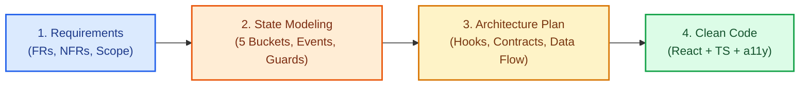

# Frontend Design Problems & Low-Level Design (LLD) Studio

A production-grade laboratory for designing, planning, and implementing **Frontend Machine Coding & Low-Level Design (LLD)** problems in React and TypeScript.

This repository merges theoretical design patterns (from [LLD.md](LLD.md)) with interactive, runnable UI problem implementations.

---

## 🎯 The 4-Step Problem-Solving Framework

Every design problem in this studio follows a strict, repeatable engineering framework:

```
┌─────────────────────────────────────────────────────────────────────────────┐
│                   THE 4-STEP FRONTEND DESIGN BLUEPRINT                      │
├─────────────────────────┬───────────────────────────────────────────────────┤
│ 1. Requirements         │ Functional requirements, edge cases, a11y & NFRs   │
│ 2. State Modeling       │ Run through 5 Buckets, define events & transitions │
│ 3. Engineering Plan     │ Component hierarchy, custom hooks, data flow      │
│ 4. Clean Implementation │ TypeScript types, race-safe hooks, optimized view │
└─────────────────────────┴───────────────────────────────────────────────────┘
```



---

## 📚 Problem Catalog

| Problem                                              | Category       | Difficulty | Key Concepts / Primitives                                                                         |      Status       |
| :--------------------------------------------------- | :------------- | :--------: | :------------------------------------------------------------------------------------------------ | :---------------: |
| **[Infinite Scroll](src/problems/infinite-scroll/)** | Data Feeds     |  `Medium`  | `IntersectionObserver`, Sentinel element, Window scroll listener, overfetch guards, deduplication |  ✅ Implemented   |
| **Autocomplete / Typeahead**                         | Input & Search |  `Medium`  | Debounce, AbortController, Keyboard navigation, Trie / LRU cache                                  | 🔜 Scaffold Ready |
| **Virtualized List**                                 | Performance    |   `Hard`   | Dynamic item height, windowing math, scroll synchronization                                       | 🔜 Scaffold Ready |
| **Nested Comments Tree**                             | Structural     |  `Medium`  | Recursive components, normalized state, immutable tree updates                                    | 🔜 Scaffold Ready |
| **Config-Driven UI (CDUI)**                          | Architecture   |   `Hard`   | Schema validator, dynamic registry, backend layout rendering                                      | 🔜 Scaffold Ready |

---

## ⚡ How to Add a New Problem in 3 Steps

The codebase is built so you can create a new folder and start implementing immediately:

### Step 1: Copy the Problem Template

```bash
cp -r src/problems/_template src/problems/autocomplete
```

### Step 2: Define and Implement

Inside `src/problems/autocomplete/`:

1. **`README.md`**: Fill out the Problem Requirements, State Modeling, and Implementation Plan.
2. **`types.ts`**: Declare data models and state unions.
3. **`index.tsx`**: Build your React component.

### Step 3: Register in the Problem Hub

Open `src/problems/index.ts` and add your problem:

```ts
import { AutocompleteProblem } from './autocomplete';

export const PROBLEMS_REGISTRY: ProblemDefinition[] = [
  // ... existing problems
  {
    id: 'autocomplete',
    title: 'Autocomplete / Typeahead',
    category: 'Input & Search',
    difficulty: 'Medium',
    description: 'Debounced search with keyboard navigation and LRU caching.',
    tags: ['Debounce', 'AbortController', 'Keyboard a11y'],
    component: AutocompleteProblem,
  },
];
```

The new problem **instantly appears in the studio's navigation bar**!

---

## 🛠️ Quick Start (Powered by `pnpm` for 3x Faster Installs)

```bash
# 1. Fast dependency installation via pnpm
pnpm install

# 2. Run local development server
pnpm dev

# 3. Code Quality & Verification Suite
pnpm typecheck       # Strict TypeScript check (tsc --noEmit)
pnpm lint            # ESLint check with React Hooks rules
pnpm lint:fix        # Auto-fix linting issues
pnpm format:check    # Check code style with Prettier
pnpm format          # Format entire project with Prettier
pnpm test            # Run problem logic constraint tests

# 4. Comprehensive All-In-One Gate Check
pnpm check:all       # Runs typecheck + lint + format:check + test

# 5. Production build
pnpm build
```

_(Alternatively, standard `npm install` and `npm run dev` are also supported)._

---

## 📦 Package Management & Maintenance Guide (`pnpm`)

This studio uses **`pnpm`** for lightning-fast, disk-efficient package management via hard links. Here is how to manage dependencies, clean caches, and perform resets:

### 1. Adding Dependencies

```bash
# Add a production package (e.g. state management, icons, utilities)
pnpm add zustand
pnpm add lucide-react

# Add multiple packages at once
pnpm add zod clsx tailwind-merge

# Add a development dependency (types, linters, tooling)
pnpm add -D @types/lodash
pnpm add -D vitest
```

### 2. Removing Dependencies

```bash
# Uninstall a package
pnpm remove lodash

# Remove multiple packages
pnpm remove package-a package-b
```

### 3. Updating Dependencies

```bash
# Update all packages according to package.json version ranges
pnpm update

# Interactively choose packages to update to their latest versions
pnpm update --interactive --latest

# Update a specific single package
pnpm update react
```

### 4. Cache Cleaning & Store Maintenance

Unlike `npm` which stores duplicate copies of packages in every `node_modules` on disk, `pnpm` uses a single **global content-addressable store**.

```bash
# Check the status of your global pnpm store
pnpm store status

# Clean / prune unreferenced packages from the global store to free up disk space
pnpm store prune
```

### 5. Clean Reinstall (Nuclear Reset)

If you ever encounter corrupted dependencies or want a 100% clean reinstall from scratch:

```bash
# Quick reinstall (remove local node_modules and re-link from pnpm store in seconds)
rm -rf node_modules
pnpm install

# Full clean reset (regenerate lockfile fresh)
rm -rf node_modules pnpm-lock.yaml
pnpm install
```

### 6. Package Manager Command Equivalents (`npm` vs `yarn` vs `pnpm`)

| Action / Operation             | `npm`                     | `yarn`                  | `pnpm` (This Studio)                         |
| :----------------------------- | :------------------------ | :---------------------- | :------------------------------------------- |
| **Install all dependencies**   | `npm install`             | `yarn` / `yarn install` | `pnpm install`                               |
| **Add dependency**             | `npm install <pkg>`       | `yarn add <pkg>`        | `pnpm add <pkg>`                             |
| **Add dev dependency**         | `npm install -D <pkg>`    | `yarn add -D <pkg>`     | `pnpm add -D <pkg>`                          |
| **Remove / Uninstall package** | `npm uninstall <pkg>`     | `yarn remove <pkg>`     | `pnpm remove <pkg>`                          |
| **Update packages**            | `npm update`              | `yarn upgrade`          | `pnpm update`                                |
| **Run scripts**                | `npm run <cmd>`           | `yarn <cmd>`            | `pnpm <cmd>` (e.g. `pnpm dev`, `pnpm build`) |
| **Clean cache / prune store**  | `npm cache clean --force` | `yarn cache clean`      | `pnpm store prune`                           |
| **Lockfile format**            | `package-lock.json`       | `yarn.lock`             | `pnpm-lock.yaml`                             |

### 7. Configuration & Metadata Files Decoded

#### A. Why `update-notifier=false`?

- **What happens by default**: Every single time you run any CLI command (`pnpm dev`, `pnpm build`, `pnpm test`), `pnpm` fires an asynchronous background network request to `https://registry.npmjs.org/pnpm` to check if a newer CLI version is available.
- **Why it breaks**:
  - **Network Overhead**: Adds 200ms–500ms of latency to every command.
  - **Corporate Proxies / Air-Gapped / Sandbox Failures**: In offline environments, corporate networks, or secure agent sandboxes without public internet access, this unsolicited network call fails with `HTTP 403 Forbidden` or `ETIMEDOUT`, printing warnings into terminal logs.
- **The Fix**: `update-notifier=false` mutes the background network check, ensuring instant, silent, and resilient execution.

#### B. Why `prefer-offline=true`?

- **What happens by default**: When you run `pnpm install`, `pnpm` queries the remote npm registry to verify whether newer metadata or patch releases exist for your dependencies.
- **The Fix**: `prefer-offline=true` tells `pnpm` to prioritize packages already stored in your local Content-Addressable Store (`~/.pnpm-store`). It only reaches out to the remote network if a required package version does NOT exist on your disk.
- **Benefits**:
  - **Installs run up to 5x faster** (1–2 seconds).
  - **Saves local and corporate network bandwidth**.
  - **Enables 100% offline development** (e.g., coding on an airplane or spotty Wi-Fi).

#### C. Other Common Enterprise `.npmrc` Uses

- **Scoped Registries**: `@myorg:registry=https://npm.pkg.github.com` routes proprietary packages to internal registries.
- **Token Authentication**: `//npm.pkg.github.com/:_authToken=${GITHUB_TOKEN}` secures deployment pipelines.
- **Peer Dependencies**: `auto-install-peers=true` auto-resolves transitive peer dependencies.
- **Engine Strictness**: `engine-strict=true` hard-fails builds if local Node/pnpm versions mismatch team requirements.

#### D. Why Two YAML Files? (`pnpm-lock.yaml` vs. `pnpm-workspace.yaml`)

| File                      | Purpose                                                                   | Author             | When It Changes                               |     Commit to Git?     |
| :------------------------ | :------------------------------------------------------------------------ | :----------------- | :-------------------------------------------- | :--------------------: |
| **`pnpm-lock.yaml`**      | Exact cryptographic lock of all direct & transitive package hashes        | Machine (pnpm CLI) | When packages are added, updated, or removed  |    **YES (Always)**    |
| **`pnpm-workspace.yaml`** | Topology descriptor defining monorepo boundaries (`apps/*`, `packages/*`) | Human (Engineer)   | Only when project workspace structure changes | **YES (In Monorepos)** |

---

## 📖 Deep Dives & Theoretical Foundations

- 🏛️ **[Architecture Decision Records (ADRs)](adr/README.md)**: Formal system design decisions following the `{00x}-{date}-{slug}.md` standard, including [ADR-001: Hotstar Clickstream Aggregator](adr/001-2026-11-22-clickstream-aggregator.md).
- 🌐 **[High-Level Design (HLD) & Frontend System Architecture](HLD.md)**: Master guide on the RADIO framework, Micro-Frontends (Module Federation), Edge CDN caching, BFF architecture, WebSocket/SSE protocols, CWV budgets, and local-first CRDT sync.
- 📐 **[Low-Level Design (LLD) & Design Patterns](LLD.md)**: Master guide on Component Composition, Config-Driven UI (CDUI/SDUI), Observer, Factory, and Strategy patterns.
- 👁️ **[IntersectionObserver & Scroll Architecture](../cheatsheets/IntersectionObserver_and_Scroll.md)**: Production guide on `IntersectionObserver` vs `window.scrollY`, `threshold`, `rootMargin`, Sentinel Pattern, and Layout Thrashing.
- 📄 **[API Pagination Architecture (Offset vs. Keyset vs. Cursor)](../cheatsheets/pagination.md)**: Master guide on Offset vs Keyset vs Cursor, SQL deep paging traps, compound Base64 tokens, and GraphQL Relay specs.
- 💾 **[State Management Master Cheat Sheet](../cheatsheets/state-management.md)**: The 5-question interrogation framework, RTK, Zustand, MobX, and XState.
- ⚡ **[Advanced State Patterns](../cheatsheets/state-management-advanced.md)**: Atomic signals, 60fps form state, optimistic UI updates, and cross-tab sync.
- 📦 **[Package Managers & Monorepos Master Cheat Sheet](../cheatsheets/package-managers.md)**: `pnpm` vs `yarn` vs `npm` hierarchy, Content-Addressable Storage (CAS), Phantom Dependencies, Corepack, pnpm workspaces, and Turborepo vs Nx.
