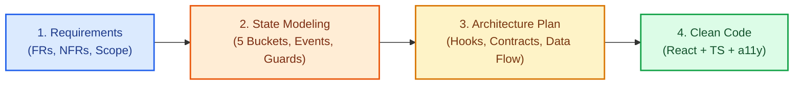

# Frontend Design Problems & Low-Level Design (LLD) Studio

A production-grade laboratory for designing, planning, and implementing **Frontend Machine Coding & Low-Level Design (LLD)** problems in React and TypeScript.

This repository merges theoretical design patterns (from [LLD.md](LLD.md)) with interactive, runnable UI problem implementations.

---

## 🎯 The 4-Step Problem-Solving Framework

Every design problem in this studio follows a strict, repeatable engineering framework:

```
┌─────────────────────────────────────────────────────────────────────────────┐
│                   THE 4-STEP FRONTEND DESIGN BLUEPRINT                      │
├─────────────────────────┬───────────────────────────────────────────────────┤
│ 1. Requirements         │ Functional requirements, edge cases, a11y & NFRs   │
│ 2. State Modeling       │ Run through 5 Buckets, define events & transitions │
│ 3. Engineering Plan     │ Component hierarchy, custom hooks, data flow      │
│ 4. Clean Implementation │ TypeScript types, race-safe hooks, optimized view │
└─────────────────────────┴───────────────────────────────────────────────────┘
```



---

## 📚 Problem Catalog

| Problem | Category | Difficulty | Key Concepts / Primitives | Status |
| :--- | :--- | :---: | :--- | :---: |
| **[Infinite Scroll](src/problems/infinite-scroll/)** | Data Feeds | `Medium` | `IntersectionObserver`, Sentinel element, Window scroll listener, overfetch guards, deduplication | ✅ Implemented |
| **Autocomplete / Typeahead** | Input & Search | `Medium` | Debounce, AbortController, Keyboard navigation, Trie / LRU cache | 🔜 Scaffold Ready |
| **Virtualized List** | Performance | `Hard` | Dynamic item height, windowing math, scroll synchronization | 🔜 Scaffold Ready |
| **Nested Comments Tree** | Structural | `Medium` | Recursive components, normalized state, immutable tree updates | 🔜 Scaffold Ready |
| **Config-Driven UI (CDUI)** | Architecture | `Hard` | Schema validator, dynamic registry, backend layout rendering | 🔜 Scaffold Ready |

---

## ⚡ How to Add a New Problem in 3 Steps

The codebase is built so you can create a new folder and start implementing immediately:

### Step 1: Copy the Problem Template
```bash
cp -r src/problems/_template src/problems/autocomplete
```

### Step 2: Define and Implement
Inside `src/problems/autocomplete/`:
1. **`README.md`**: Fill out the Problem Requirements, State Modeling, and Implementation Plan.
2. **`types.ts`**: Declare data models and state unions.
3. **`index.tsx`**: Build your React component.

### Step 3: Register in the Problem Hub
Open `src/problems/index.ts` and add your problem:
```ts
import { AutocompleteProblem } from './autocomplete';

export const PROBLEMS_REGISTRY: ProblemDefinition[] = [
  // ... existing problems
  {
    id: 'autocomplete',
    title: 'Autocomplete / Typeahead',
    category: 'Input & Search',
    difficulty: 'Medium',
    description: 'Debounced search with keyboard navigation and LRU caching.',
    tags: ['Debounce', 'AbortController', 'Keyboard a11y'],
    component: AutocompleteProblem,
  },
];
```

The new problem **instantly appears in the studio's navigation bar**!

---

## 🛠️ Quick Start

```bash
# 1. Install dependencies
npm install

# 2. Run local development server
npm run dev

# 3. Run test runner
npm test

# 4. Type check and build
npm run build
```

---

## 📖 Deep Dives & Theoretical Foundations

* 🌐 **[High-Level Design (HLD) & Frontend System Architecture](HLD.md)**: Master guide on the RADIO framework, Micro-Frontends (Module Federation), Edge CDN caching, BFF architecture, WebSocket/SSE protocols, CWV budgets, and local-first CRDT sync.
* 📐 **[Low-Level Design (LLD) & Design Patterns](LLD.md)**: Master guide on Component Composition, Config-Driven UI (CDUI/SDUI), Observer, Factory, and Strategy patterns.
* 💾 **[State Management Master Cheat Sheet](../cheatsheets/state-management.md)**: The 5-question interrogation framework, RTK, Zustand, MobX, and XState.
* ⚡ **[Advanced State Patterns](../cheatsheets/state-management-advanced.md)**: Atomic signals, 60fps form state, optimistic UI updates, and cross-tab sync.
