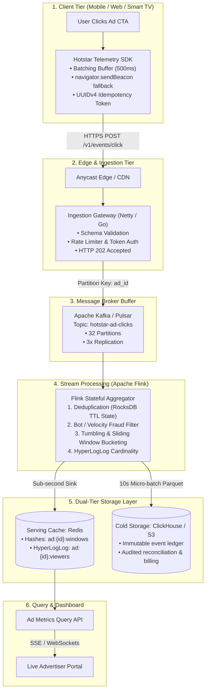

# ADR-001: Hotstar Ad Clickstream Aggregator Architecture

| Attribute        | Details                                                                                    |
| :--------------- | :----------------------------------------------------------------------------------------- |
| **Status**       | **PROPOSED** (Awaiting Engineering Review)                                                 |
| **Date**         | 2026-11-22                                                                                 |
| **Domain**       | High-Throughput Stream Ingestion & Real-Time Aggregation                                   |
| **Target Scale** | Hotstar Live Sports (50M Concurrent Viewers, 25,000 Clicks/sec Burst)                      |
| **Scope**        | Client Telemetry SDK, Edge Ingestion, Stream Processing, Dual-tier Storage, Live Analytics |

---

## 1. Problem Statement

### 1.1. Context

During high-concurrency live streaming events on **Disney+ Hotstar** (e.g., ICC Cricket World Cup or IPL Finals), concurrent viewership regularly exceeds **50 million active users**. Advertisers bid premium rates for interactive 30-second video and banner ad slots. When an ad triggers, millions of viewers simultaneously see interactive call-to-action (CTA) banners.

### 1.2. The Business & Technical Problem

We must accurately record, deduplicate, aggregate, and report ad clicks under extreme burst conditions without:

1. Dropping valid clicks during sudden traffic surges ($99.999\%$ ingestion availability).
2. Double-counting clicks caused by mobile network retries or fast double-tapping.
3. Overbilling advertisers due to automated bot attacks or fraud.
4. Exceeding a 3-second latency budget for live campaign dashboards and real-time budget pacing engines.

---

## 2. Scale & Back-of-the-Envelope Estimations

```
┌────────────────────────────────────────────────────────────────────────┐
│                      HOTSTAR IPL BURST CAPACITY                        │
├───────────────────────────────────┬────────────────────────────────────┤
│ Peak Live Viewership              │ 50,000,000 (50M concurrent)        │
├───────────────────────────────────┼────────────────────────────────────┤
│ Targeted Audience for Ad Slot     │ 20,000,000 (20M targeted segment)  │
├───────────────────────────────────┼────────────────────────────────────┤
│ Click-Through Rate (CTR)          │ 1.5% average                       │
├───────────────────────────────────┼────────────────────────────────────┤
│ Total Clicks in 30s Ad Window     │ 300,000 clicks                     │
├───────────────────────────────────┼────────────────────────────────────┤
│ Peak Ingestion Velocity           │ 15,000 – 25,000 clicks/sec         │
├───────────────────────────────────┼────────────────────────────────────┤
│ Click Event Payload               │ ~500 bytes (Protobuf / JSON)       │
├───────────────────────────────────┼────────────────────────────────────┤
│ Peak Ingestion Bandwidth          │ 25,000 × 500 B ≈ 12.5 MB/sec       │
├───────────────────────────────────┼────────────────────────────────────┤
│ Max End-to-End Analytics Latency  │ < 3 seconds (Dashboard Freshness)  │
├───────────────────────────────────┼────────────────────────────────────┤
│ Financial Billing SLA             │ Exactly-Once (Zero Drift)          │
└───────────────────────────────────┴────────────────────────────────────┘
```

---

## 3. Decision Drivers & System Requirements

### 3.1. Functional Requirements

- **Click Ingestion**: Ingest high-volume click telemetry from Web, Android, iOS, and Connected Smart TV clients.
- **Real-time Window Aggregation**:
  - **Tumbling Windows** (1-minute, 5-minute) for continuous time-series analytics.
  - **Sliding Windows** (30-second window, 5-second slide) for live velocity and budget pacing.
- **Cardinality & Metrics**: Track total raw clicks, deduplicated valid clicks, and unique viewers per ad.
- **Click Fraud Detection**: Automatically detect and quarantine clicks exceeding velocity thresholds (>5 clicks/second from a single device/IP).
- **Serving API**: Low-latency query endpoint (`GET /v1/ads/{adId}/metrics`) serving live dashboard feeds.

### 3.2. Non-Functional Requirements

- **Availability**: Ingestion endpoint SLA $\ge 99.999\%$. Ingestion path must be completely decoupled from aggregation computation.
- **Sub-Second P99 Query Latency**: Real-time advertiser dashboards refresh via WebSockets/SSE with zero UI lag.
- **Idempotency & Exactly-Once Semantics**: Network retries from clients must produce identical state.
- **Bounded Memory Usage**: Cardinality tracking for millions of unique viewers must fit in fixed memory using probabilistic data structures (HyperLogLog).

---

## 4. Evaluated Architectural Options

```
┌──────────────────────────────────────────────────────────────────────────────────────────────────────────┐
│                                   ARCHITECTURAL OPTIONS COMPARISON                                       │
├───────────────────┬───────────────────────────────────┬──────────────────────────────────────────────────┤
│ Option            │ Architecture Description          │ Verdict & Rationale                              │
├───────────────────┼───────────────────────────────────┼──────────────────────────────────────────────────┤
│ **Option 1**      │ Ingest Gateway direct-write to    │ ❌ **REJECTED**: Direct DB write creates a        │
│ *Direct Database* │ Relational DB (PostgreSQL / MySQL)│ bottleneck. Connection pool exhaustion and row   │
│                   │ with `UPDATE ad SET clicks=c+1`   │ lock contention crash at >1,000 clicks/sec.      │
├───────────────────┼───────────────────────────────────┼──────────────────────────────────────────────────┤
│ **Option 2**      │ Ingest Gateway direct to Redis    │ ⚠️ **REJECTED**: Fails financial audit. While     │
│ *Direct In-Memory*│ using `INCRBY` counters           │ Redis handles 50k ops/sec, memory loss or node   │
│                   │                                   │ restart loses billing events. No replayability.  │
├───────────────────┼───────────────────────────────────┼──────────────────────────────────────────────────┤
│ **Option 3**      │ **Edge Gateway ➔ Kafka Buffer ➔** │ ✅ **ACCEPTED**: Ingestion is decoupled from      │
│ *Stream Pipeline* │ **Flink Window Aggregator ➔**     │ processing. Kafka absorbs bursts. Flink provides │
│ *(Chosen)*        │ **Dual Storage (Redis + Cold)**   │ exactly-once windows. Redis serves fast reads.   │
└───────────────────┴───────────────────────────────────┴──────────────────────────────────────────────────┘
```

---

## 5. Proposed Architecture (The Decision)

### 5.1. End-to-End Pipeline



---

## 6. Technical Specifications

### 6.1. Event Schema

```typescript
interface AdClickEvent {
  eventId: string; // UUIDv4 client-generated idempotency key
  adId: string; // Target advertisement ID (e.g., "ad_tata_safari_ipl_01")
  campaignId: string; // Advertiser campaign ID
  viewerId: string; // Anonymized Hotstar subscriber ID
  impressionId: string; // Unique ID linking click to the specific ad impression
  timestamp: number; // Epoch timestamp (ms) from client device clock
  serverReceivedTime: number; // Server ingestion timestamp (prevents device clock drift)
  platform: 'web' | 'android' | 'ios' | 'smart_tv';
  deviceFingerprint: string; // Hash of Canvas/User-Agent/Device ID
  ipHash: string; // Anonymized IP hash for regional aggregation & fraud
  signature: string; // HMAC SHA-256 preventing payload tampering
}
```

### 6.2. Deduplication & Idempotency Engine

- **Idempotency Key**:
  $$\text{DeduplicationKey} = \text{SHA256}(\text{eventId} + \text{viewerId} + \text{adId})$$
- **Mechanism**:
  - Maintained in Flink's managed RocksDB state with a **10-minute sliding TTL**.
  - If key is found in cache $\rightarrow$ event is flagged as a duplicate, logged for metrics, and excluded from billing counters.
  - Ensures zero overcounting during mobile network reconnection retries.

### 6.3. Windowing Mechanics

1. **1-Minute Tumbling Windows**:
   - Boundary: $[T, T + 60\text{s})$. Fixed, non-overlapping.
   - Purpose: Historical time-series charts, reporting, and hourly rollups.
2. **30-Second Sliding Windows (5s slide)**:
   - Window: $[T - 30\text{s}, T]$, evaluated every 5 seconds.
   - Purpose: Real-time velocity gauge, pacing throttle, and sudden drop-off alerts.
3. **Watermarking & Late Arrivals**:
   - Watermark defined as: $\text{Watermark}(t) = \max(\text{eventTime}) - 15\text{ seconds}$.
   - Events arriving $> 15\text{ seconds}$ late are routed to a **Dead-Letter Queue (DLQ)** and processed in cold storage reconciliation.

### 6.4. Memory-Bounded Unique Viewer Counting (HyperLogLog)

- Counting 10M raw `viewerId` strings in Redis requires $\approx 360\text{ MB}$ per ad.
- **HyperLogLog Decision**:
  - Command: `PFADD ad:{adId}:unique_viewers {viewerId}`
  - Memory: Exactly **12 KB** per ad regardless of whether there are 1,000 or 10,000,000 unique viewers!
  - Accuracy: Standard error of $\pm 0.81\%$, perfectly suited for real-time dashboards.

### 6.5. Click Fraud & Bot Filtering Rules

| Rule                   | Condition                                                               | Action Taken                                       |
| :--------------------- | :---------------------------------------------------------------------- | :------------------------------------------------- |
| **Rapid Double-Tap**   | $\Delta t < 200\text{ ms}$ between clicks on same `(viewerId, adId)`    | Second click dropped as accidental double-tap.     |
| **Velocity Flooding**  | $> 5\text{ clicks/second}$ from same `deviceFingerprint` or `ipHash`    | Quarantined as bot traffic; excluded from billing. |
| **Missing Impression** | Click received without corresponding `impressionId` in impression store | Quarantined as spoofed event.                      |

---

## 7. Implementation Blueprint in `DesignProblems/`

### 7.1. Directory Structure

```
DesignProblems/src/problems/clickstream-aggregator/
├── ADR.md                       # This architectural decision record
├── README.md                    # Problem guide & interview playbook
├── types.ts                     # TypeScript interfaces & domain models
├── engine/
│   ├── ClientCollectorSDK.ts    # Client telemetry: batching, sendBeacon, retry with jitter
│   ├── FlinkAggregatorEngine.ts # Windowing, RocksDB deduplication, HyperLogLog, fraud filter
│   └── ServingCache.ts          # In-memory Redis simulation for sub-millisecond reads
├── components/
│   ├── HotstarPlayerView.tsx    # Live cricket video mockup with interactive ad banner
│   ├── TrafficControls.tsx      # Burst sliders, "IPL Final Spike" & "Bot Flood" buttons
│   ├── PipelineTelemetry.tsx    # Live visualizer of Ingestion -> Broker -> Windows -> Cache
│   └── AdvertiserDashboard.tsx   # Live real-time chart of Raw vs Valid vs Fraud clicks
├── index.tsx                    # Top-level problem orchestrator
└── styles.css                   # Hotstar dark-mode responsive styling
```

### 7.2. Test Suite & Verification (`test-clickstream.mjs`)

1. **Idempotency Test**: Fire 5,000 identical `eventId`s; verify aggregate counter increments by exactly 1.
2. **Window Rolling Test**: Verify 30s sliding window decays correctly as older clicks slide past the horizon.
3. **Bot Quarantine Test**: Simulate 50 clicks in 2 seconds from 1 IP; verify 45 clicks are tagged as fraud.
4. **Build & Typecheck**: Zero TypeScript compile errors (`pnpm build` in <300ms).

---

## 8. Consequences & Trade-offs

### Positive

- **Decoupled Resiliency**: Even if the stream aggregator or Redis experiences a momentary failover, the Ingestion Gateway and Kafka continue accepting clicks without dropping a single event.
- **Deterministic Billing**: Zero double-counting guarantee prevents financial dispute with advertisers.
- **Cost Efficiency**: HyperLogLog keeps in-memory state constant ($12\text{ KB}$ per ad) during 50M concurrent traffic surges.

### Negative & Mitigations

- **Eventual Consistency (<3s)**: Dashboard lags wall-clock time by up to 3 seconds due to Kafka batching and Flink window intervals. _(Mitigation: Completely acceptable for analytics; advertiser contracts specify 3-second freshness)._
- **Late-Arriving Events**: Mobile devices regaining cellular connectivity after 20 seconds miss the real-time sliding window. _(Mitigation: Late events are ingested into ClickHouse cold storage for end-of-day billing reconciliation)._
