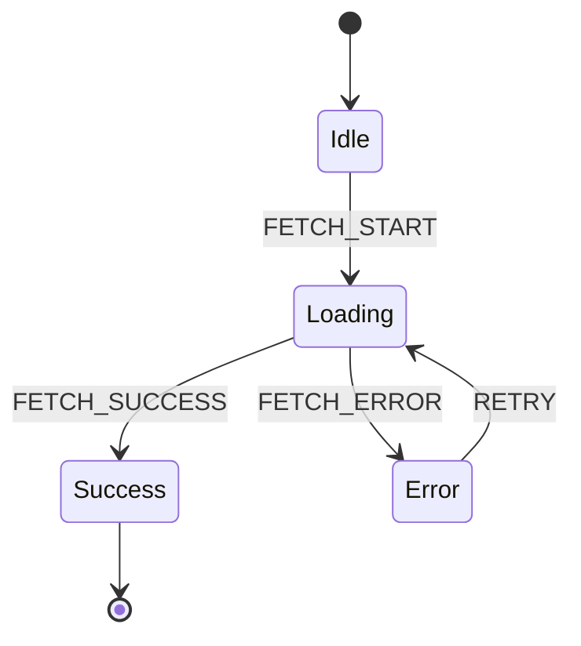

# [Problem Name] - Frontend System Design & LLD

> **Category**: [e.g. Data Display / Form / Navigation / Real-Time]  
> **Difficulty**: [Medium / Hard]  
> **Target Concepts**: [e.g. Virtualization, Debouncing, Pub-Sub, State Machine]

---

## 1. Problem Statement & Requirements

### Functional Requirements
- **FR 1**: [Core user interaction or data presentation requirement]
- **FR 2**: [Pagination / filtering / sorting / selection requirement]
- **FR 3**: [Error handling, retry, and loading states]

### Non-Functional Requirements
- **NFR 1 (Performance)**: 60fps interaction; no unnecessary re-renders during high-frequency events.
- **NFR 2 (Accessibility)**: Keyboard navigability (WCAG 2.1 AA), correct ARIA roles and labels.
- **NFR 3 (Resilience)**: Network failure tolerance, race-condition prevention, and request cancellation.

---

## 2. State Architecture & Design

### The 5 Buckets Analysis
| Bucket | State Variable | Reason & Lifecycle |
| :--- | :--- | :--- |
| **Local State** | `isOpen`, `activeIdx` | Single widget lifecycle, dies with component unmount |
| **Server State** | `items`, `status` | Remote database entity, cached & invalidated |
| **URL State** | `query`, `page` | Shareable via link, survives page refresh |
| **Global State** | `theme`, `auth` | App-wide cross-cutting concerns |
| **Workflow State** | `step`, `machine` | Finite multi-step process with strict legal transitions |

### State Transitions & Events

---

## 3. Step-by-Step Implementation Plan

1. **Step 1 - Data Contracts & Types**: Define input props, response models, and status unions in `types.ts`.
2. **Step 2 - Custom Hook / State Engine**: Build the state transition and API integration logic.
3. **Step 3 - View Presentation**: Render accessible UI with loading skeletons and error banners.
4. **Step 4 - Concurrency & Race-Safety**: Add `AbortController` cancellation for rapid changes.
5. **Step 5 - Keyboard & a11y Optimization**: Ensure focus management and ARIA states.

---

## 4. Key Trade-offs & Interview Discussion Points
- **Trade-off A vs. B**: [e.g., Controlled vs. Uncontrolled inputs]
- **Memory vs. CPU**: [e.g., Pre-indexing items in a Map vs. array linear searches]
