# 🧱 Backend & System Design Fundamentals

> A master reference guide to the core building blocks of backend engineering and distributed system design.
> **Target:** Understand **what each concept solves**, **why it is needed**, and **when to use it**, backed by production examples, OS primitives, and database consistency guarantees.

---

## Master Architecture Map

```mermaid
flowchart TD
    subgraph ComputeOS ["1. Compute & OS Primitives"]
        P1["<b>Process vs. Thread</b><br/>Isolated memory vs. Shared memory"]
        P2["<b>Thread Pool</b><br/>Task queues & bounded concurrency"]
        P3["<b>Duplex Modes</b><br/>Simplex, Half-Duplex, Full-Duplex"]
    end

    subgraph DataStorage ["2. Database & Consistency"]
        D1["<b>Indexing</b><br/>B-Trees, Hash, LSM seeks"]
        D2["<b>ACID & Isolation Levels</b><br/>Dirty reads, Non-repeatable, Phantoms"]
        D3["<b>Concurrency Control</b><br/>Optimistic vs. Pessimistic Locking"]
        D4["<b>Race Conditions</b><br/>Lost updates & check-then-act"]
    end

    subgraph ScaleTraffic ["3. Scalability & Traffic Management"]
        S1["<b>Load Balancing</b><br/>L4 vs. L7, Consistent Hashing"]
        S2["<b>Rate Limiting</b><br/>Token Bucket, Sliding Window"]
        S3["<b>Caching Strategy</b><br/>Cache-Aside, Eviction (LRU/LFU)"]
        S4["<b>Scaling Paths</b><br/>Horizontal (Out) vs. Vertical (Up)"]
    end

    subgraph AsyncResilience ["4. Async Processing & Reliability"]
        R1["<b>Message Queues</b><br/>Kafka, RabbitMQ, Backpressure"]
        R2["<b>Idempotency</b><br/>Idempotency-Key, Deduplication"]
        R3["<b>Resilience Patterns</b><br/>Exponential Backoff, Circuit Breakers"]
        R4["<b>Observability</b><br/>Metrics, Structured Logs, Distributed Traces"]
    end

    subgraph TransportAPI ["5. API & Communication"]
        A1["<b>Protocols</b><br/>REST vs. WebSockets vs. SSE"]
        A2["<b>Pagination</b><br/>Offset vs. Keyset / Cursor"]
        A3["<b>Edge Delivery</b><br/>CDNs, Anycast routing"]
    end

    ComputeOS --> DataStorage
    DataStorage --> ScaleTraffic
    ScaleTraffic --> AsyncResilience
    AsyncResilience --> TransportAPI

    classDef c fill:#1e293b,stroke:#0284c7,color:#fff;
    classDef d fill:#065f46,stroke:#10b981,color:#fff;
    classDef s fill:#7c2d12,stroke:#f97316,color:#fff;
    classDef r fill:#4c1d95,stroke:#8b5cf6,color:#fff;
    classDef a fill:#1f2937,stroke:#64748b,color:#fff;
    class P1,P2,P3 c; class D1,D2,D3,D4 d; class S1,S2,S3,S4 s; class R1,R2,R3,R4 r; class A1,A2,A3 a;
```

---

## Table of Contents

- [🧱 Backend \& System Design Fundamentals](#-backend--system-design-fundamentals)
  - [Master Architecture Map](#master-architecture-map)
  - [Table of Contents](#table-of-contents)
  - [1. Foundational OS \& Compute Primitives](#1-foundational-os--compute-primitives)
    - [Process vs. Thread](#process-vs-thread)
    - [Thread Pool Architecture](#thread-pool-architecture)
      - [Thread Pool Sizing Formula (Goetz Equation)](#thread-pool-sizing-formula-goetz-equation)
      - [Queue Rejection Policies (When Queue is Full)](#queue-rejection-policies-when-queue-is-full)
    - [Communication Channels: Simplex vs. Half-Duplex vs. Full-Duplex](#communication-channels-simplex-vs-half-duplex-vs-full-duplex)
  - [2. Database and Consistency](#2-database-and-consistency)
    - [Database Indexing](#database-indexing)
    - [ACID Transactions in Depth](#acid-transactions-in-depth)
    - [Transaction Isolation Levels \& Concurrency Anomalies](#transaction-isolation-levels--concurrency-anomalies)
      - [Concurrency Anomalies Defined](#concurrency-anomalies-defined)
    - [Optimistic vs. Pessimistic Locking](#optimistic-vs-pessimistic-locking)
    - [Race Conditions](#race-conditions)
  - [3. Scalability and Traffic Management](#3-scalability-and-traffic-management)
    - [Load Balancing](#load-balancing)
    - [Rate Limiting](#rate-limiting)
      - [Algorithms Comparison](#algorithms-comparison)
    - [Caching](#caching)
      - [Caching Strategies](#caching-strategies)
    - [Horizontal vs. Vertical Scaling](#horizontal-vs-vertical-scaling)
  - [4. Asynchronous Processing and Reliability](#4-asynchronous-processing-and-reliability)
    - [Message Queues](#message-queues)
    - [Idempotency](#idempotency)
    - [Fault Tolerance](#fault-tolerance)
    - [Retry with Exponential Backoff \& Jitter](#retry-with-exponential-backoff--jitter)
    - [Circuit Breaker](#circuit-breaker)
    - [Observability (The Three Pillars)](#observability-the-three-pillars)
  - [5. API and Communication](#5-api-and-communication)
    - [API Pagination](#api-pagination)
    - [REST APIs](#rest-apis)
    - [WebSockets](#websockets)
    - [Server-Sent Events (SSE)](#server-sent-events-sse)
    - [Content Delivery Networks (CDN)](#content-delivery-networks-cdn)
  - [6. Architect's Decision Matrix](#6-architects-decision-matrix)

---

## 1. Foundational OS & Compute Primitives

Before scaling distributed systems across multiple machines, you must understand how a single machine schedules and runs work.

### Process vs. Thread

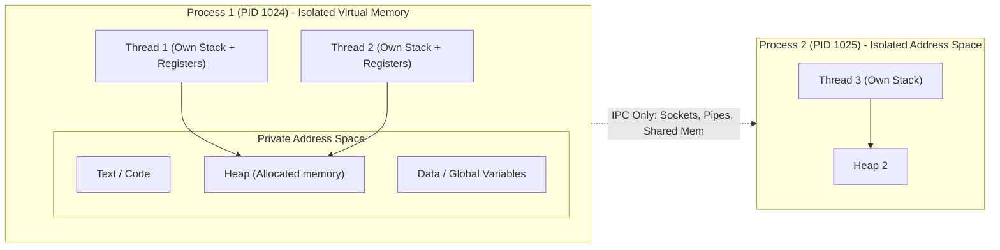

| Dimension             | Process                                                                        | Thread                                                                                       |
| :-------------------- | :----------------------------------------------------------------------------- | :------------------------------------------------------------------------------------------- |
| **Definition**        | An executing instance of a program with private memory.                        | The smallest unit of execution inside a process ("lightweight process").                     |
| **Memory Isolation**  | **Total isolation.** Crashing one process does not kill another.               | **Shared heap & data segment.** If one thread corrupts memory, the entire process can crash. |
| **Creation Overhead** | **High** (allocates new address space, page tables, file descriptors).         | **Low** (shares address space; only allocates a stack ~1MB to 8MB and registers).            |
| **Context Switching** | **Expensive** (CPU flushes TLB / page table translation cache).                | **Cheap** (switches stack pointer and registers; preserves cache locality).                  |
| **Communication**     | Inter-Process Communication (**IPC**): Sockets, Pipes, Signals, Shared Memory. | Direct read/write to shared heap variables (requires mutexes/locks).                         |
| **Real-World Model**  | Node.js cluster workers, Nginx worker processes, Chrome tabs.                  | Java worker threads, Go goroutines (user-space green threads), C++ `std::thread`.            |

---

### Thread Pool Architecture

- **What it solves:** Creating a new OS thread for every incoming request causes thread explosion, exhausting server RAM and spending 80% of CPU time on context switching instead of real work.
- **Why it's needed:** A Thread Pool limits concurrent execution to a manageable number while queuing surplus tasks.
- **How it works:**

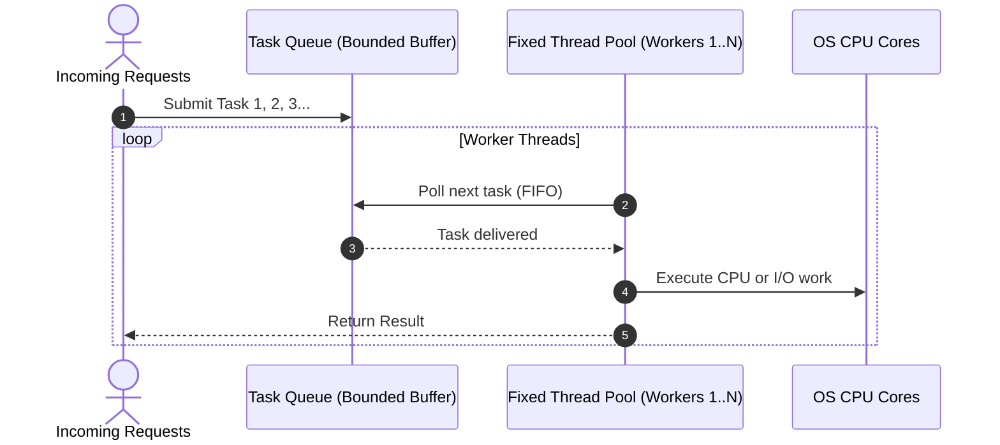

#### Thread Pool Sizing Formula (Goetz Equation)

For optimal throughput without CPU starvation:
$$N_{\text{threads}} = N_{\text{CPU}} \times U_{\text{CPU}} \times \left(1 + \frac{W}{C}\right)$$

- $N_{\text{CPU}}$: Number of available CPU cores.
- $U_{\text{CPU}}$: Target CPU utilization ($0 \le U \le 1$, typically $0.8$ or $1.0$).
- $\frac{W}{C}$: Ratio of **Wait time** (waiting on DB, network, disk) to **Compute time** (CPU execution).
  - _CPU-bound tasks (image resizing, hashing):_ $\frac{W}{C} \approx 0 \implies N_{\text{threads}} \approx N_{\text{CPU}} + 1$.
  - _I/O-bound tasks (database queries, external APIs):_ $\frac{W}{C} \approx 10 \implies N_{\text{threads}} \approx N_{\text{CPU}} \times 10$.

#### Queue Rejection Policies (When Queue is Full)

1. **AbortPolicy:** Throws `RejectedExecutionException` (returns `503 Service Unavailable`).
2. **CallerRunsPolicy:** The thread submitting the task executes it itself. This naturally **applies backpressure** by slowing down request ingestion.
3. **DiscardOldestPolicy:** Drops the oldest unprocessed task to make room for newer requests.

---

### Communication Channels: Simplex vs. Half-Duplex vs. Full-Duplex

Understanding duplex modes prevents protocol mismatches when designing real-time systems.

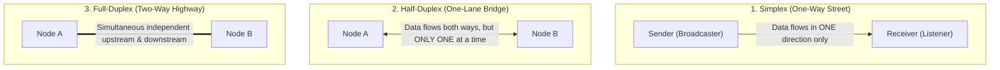

| Mode            | Directionality                     | Analogy                                    | Real-World Network Protocols                                                             | System Design Use Case                                                       |
| :-------------- | :--------------------------------- | :----------------------------------------- | :--------------------------------------------------------------------------------------- | :--------------------------------------------------------------------------- |
| **Simplex**     | Unidirectional ($A \to B$ only)    | FM Radio, Keyboard to PC                   | TV broadcast, Sensor telemetry, Syslog UDP unidirection                                  | IoT temperature sensor pumping metrics to gateway.                           |
| **Half-Duplex** | Bidirectional, but **alternating** | Walkie-Talkie (_"Over"_), Single-lane road | **HTTP/1.1** (Request must finish before response can be sent), Standard Wi-Fi (CSMA/CA) | Classic REST request-response API interactions.                              |
| **Full-Duplex** | Bidirectional, **simultaneous**    | Phone Call, Dual-track railway             | **WebSockets**, **HTTP/2 & HTTP/3** (multiplexed streams over single connection), TCP    | Collaborative document editing (Google Docs), multiplayer gaming, live chat. |

---

## 2. Database and Consistency

> ⚠️ **Golden Rule:** **Frontend validation cannot guarantee data consistency.** Critical business rules and data integrity must be strictly enforced at the backend and database layer.

### Database Indexing

- **What it solves:** Without an index, the database must execute a Full Table Scan ($O(N)$), reading every single disk block to find matching rows.
- **Why it's needed:** Reduces query lookup time from minutes to milliseconds ($O(\log N)$ or $O(1)$) by maintaining an ordered auxiliary data structure.
- **Under the Hood:**
  - **B+ Tree (PostgreSQL, MySQL InnoDB):** Keeps data sorted in balanced tree pages. Extremely fast for both point queries (`id = 123`) and **range scans** (`created_at BETWEEN a AND b`).
  - **Hash Index:** $O(1)$ point lookups, but does **not** support range scans or sorting.
  - **LSM Tree (Log-Structured Merge-Tree in Cassandra, RocksDB):** Optimized for high-throughput append writes; merges SSTables in background.

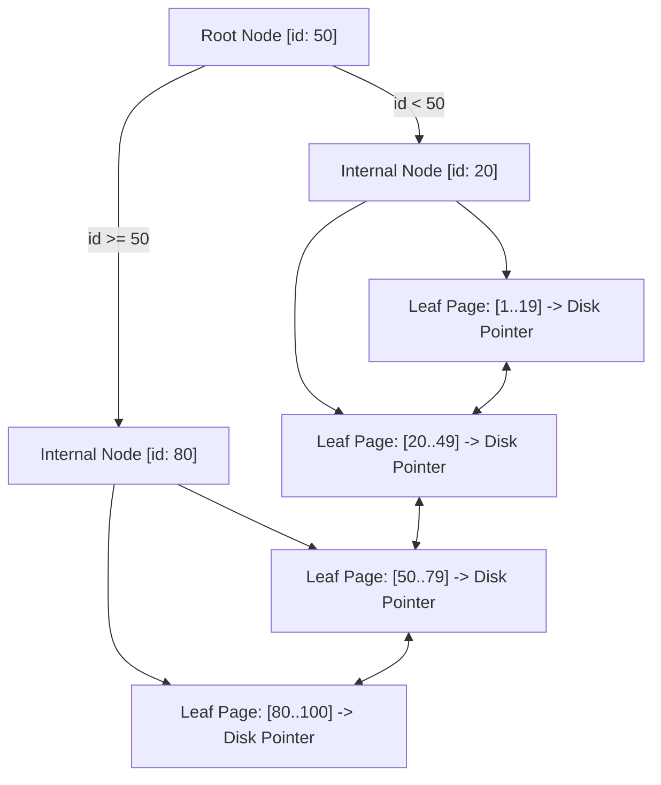

- **When to use:** On high-cardinality columns used in `WHERE`, `JOIN`, and `ORDER BY` clauses (e.g., `conversation_id`, `email`, `user_id`).
- **Trade-off:** Indexes speed up `SELECT` queries but **slow down `INSERT`, `UPDATE`, and `DELETE`** because the DB must rebalance the index tree on disk for every write.

---

### ACID Transactions in Depth

A transaction is a logical unit of work encompassing one or more SQL operations that must be executed reliably.

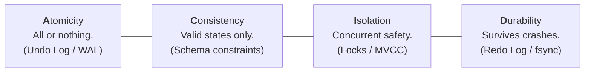

1. **Atomicity (All-or-Nothing):**
   - If an error occurs halfway through (e.g., power failure or constraint violation), the database uses the **Write-Ahead Log (WAL)** or Undo Logs to roll back every mutation to its initial state.
   - _Example:_ Deducting \$100 from Account A and crediting \$100 to Account B. If step 2 fails, step 1 is rolled back.
2. **Consistency (Preserving Invariants):**
   - The database moves from one valid state to another, enforcing all foreign keys, check constraints, and unique indexes (e.g., account balance cannot drop below \$0).
3. **Isolation (Concurrent Execution):**
   - Determines how changes made by one transaction are visible to other concurrent transactions (preventing dirty reads or lost updates).
4. **Durability (Survivability):**
   - Once a transaction commits, its mutations are permanently recorded to non-volatile storage (via `fsync` to disk and Redo Logs) and will survive server crashes or power cuts.

---

### Transaction Isolation Levels & Concurrency Anomalies

Increasing isolation increases consistency but decreases concurrency and throughput.

| Isolation Level                       |    Dirty Read    | Non-Repeatable Read |              Phantom Read               | Mechanism Used                                                    |
| :------------------------------------ | :--------------: | :-----------------: | :-------------------------------------: | :---------------------------------------------------------------- |
| **Read Uncommitted**                  |    ❌ Allowed    |     ❌ Allowed      |               ❌ Allowed                | No read locks; reads raw uncommitted memory.                      |
| **Read Committed** (Postgres default) | ✅ **Prevented** |     ❌ Allowed      |               ❌ Allowed                | Reads snapshot at the start of each query; MVCC.                  |
| **Repeatable Read** (MySQL default)   | ✅ **Prevented** |  ✅ **Prevented**   | ❌ Allowed _(Prevented in InnoDB MVCC)_ | Reads snapshot at the start of the transaction.                   |
| **Serializable**                      | ✅ **Prevented** |  ✅ **Prevented**   |            ✅ **Prevented**             | Two-Phase Locking (2PL) or Serializable Snapshot Isolation (SSI). |

#### Concurrency Anomalies Defined

- **Dirty Read:** Transaction A reads data written by Transaction B before Transaction B commits. If B rolls back, A holds garbage data.
- **Non-Repeatable Read:** Transaction A reads a row. Transaction B updates that same row and commits. Transaction A re-reads the row and sees different values.
- **Phantom Read:** Transaction A reads all orders where `status = 'pending'` (finds 5 rows). Transaction B inserts a new pending order and commits. Transaction A re-queries and finds 6 rows.

---

### Optimistic vs. Pessimistic Locking

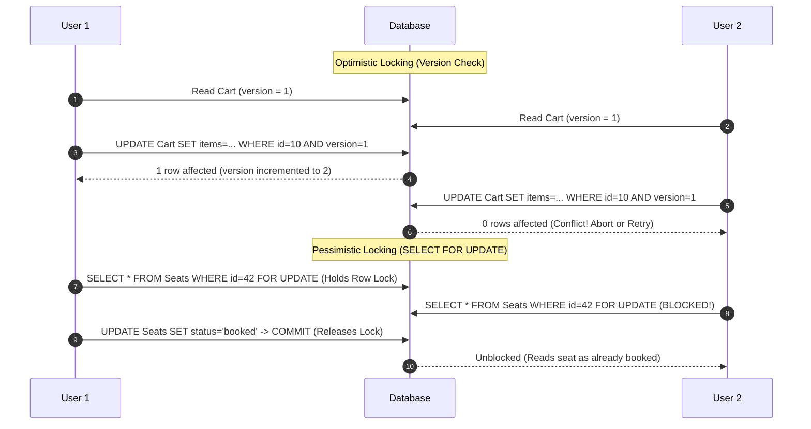

| Dimension           | Optimistic Locking                                                                              | Pessimistic Locking                                                                                              |
| :------------------ | :---------------------------------------------------------------------------------------------- | :--------------------------------------------------------------------------------------------------------------- |
| **Core Philosophy** | _"Conflicts are rare. Proceed without locks, but verify before committing."_                    | _"Conflicts are frequent. Lock the record immediately; make others wait."_                                       |
| **Mechanism**       | Add a `version` column or `updated_at` timestamp. `UPDATE ... WHERE version = current_version`. | Database row/table level exclusive locks (`SELECT ... FOR UPDATE`).                                              |
| **Performance**     | High throughput; zero lock contention overhead.                                                 | Slower; holds DB connection open and blocks competing threads.                                                   |
| **Failure Mode**    | Transaction aborts/retries if collision occurs.                                                 | Deadlock risk if transactions acquire multiple locks in different orders.                                        |
| **When to Use**     | Low-to-moderate contention: Editing user profile, updating shopping cart.                       | High contention on scarce resources: Booking concert/movie seats, bank balance transfers, inventory flash sales. |

---

### Race Conditions

- **What it solves:** Prevents concurrent threads/processes from corrupting shared state due to interleaving operations.
- **The "Check-Then-Act" Trap:**
  ```python
  # BUG: Race condition!
  seat = db.query("SELECT booked FROM seats WHERE id = 42")
  if not seat.booked:
      # If two requests reach here at the same millisecond,
      # BOTH will execute the booking and book the same seat twice!
      db.execute("UPDATE seats SET booked = TRUE, user_id = ? WHERE id = 42", user_id)
  ```
- **Solution:**
  1. **Atomic SQL Updates:** `UPDATE seats SET booked = TRUE, user_id = ? WHERE id = 42 AND booked = FALSE;` (Check rows affected).
  2. **Pessimistic Row Lock:** `SELECT * FROM seats WHERE id = 42 FOR UPDATE;`
  3. **Distributed Locks (Redis Redlock):** When synchronizing state across multiple external microservices.

---

## 3. Scalability and Traffic Management

### Load Balancing

- **What it solves:** Prevents a single server from being overwhelmed by distributing incoming traffic across a pool of application servers.
- **Why it's needed:** Enables high availability (HA). If Server 2 crashes, the Load Balancer detects health check failure and routes 100% of traffic to healthy nodes without user disruption.

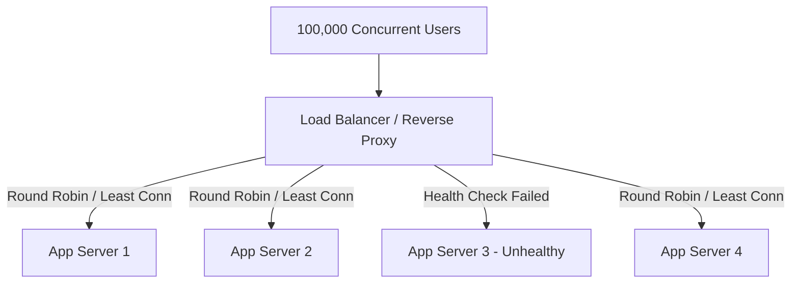

- **L4 vs. L7 Load Balancing:**
  - **L4 (Transport Layer - TCP/UDP):** Routes traffic based on IP address and port without inspecting the HTTP payload. Extremely fast, lower CPU overhead (e.g., AWS NLB, HAProxy TCP mode).
  - **L7 (Application Layer - HTTP/HTTPS):** Inspects HTTP headers, cookies, URL paths, and query parameters. Supports SSL termination, intelligent routing (`/api` vs `/static`), and sticky sessions (e.g., AWS ALB, Nginx).
- **Algorithms:**
  - _Round Robin:_ Cycles through servers sequentially.
  - _Least Connections:_ Routes to the server currently handling the fewest active connections.
  - _Consistent Hashing:_ Maps client IP or session ID to a hash ring to minimize cache thrashing.

---

### Rate Limiting

- **What it solves:** Protects backend services from accidental denial of service (DDOS), scraper bots, brute-force credential stuffing, and noisy neighbors.
- **Why it's needed:** Enforces fair usage and protects downstream database capacity.
- **When to use:** On public API endpoints (e.g., login, search, checkout) and webhook receivers.

#### Algorithms Comparison

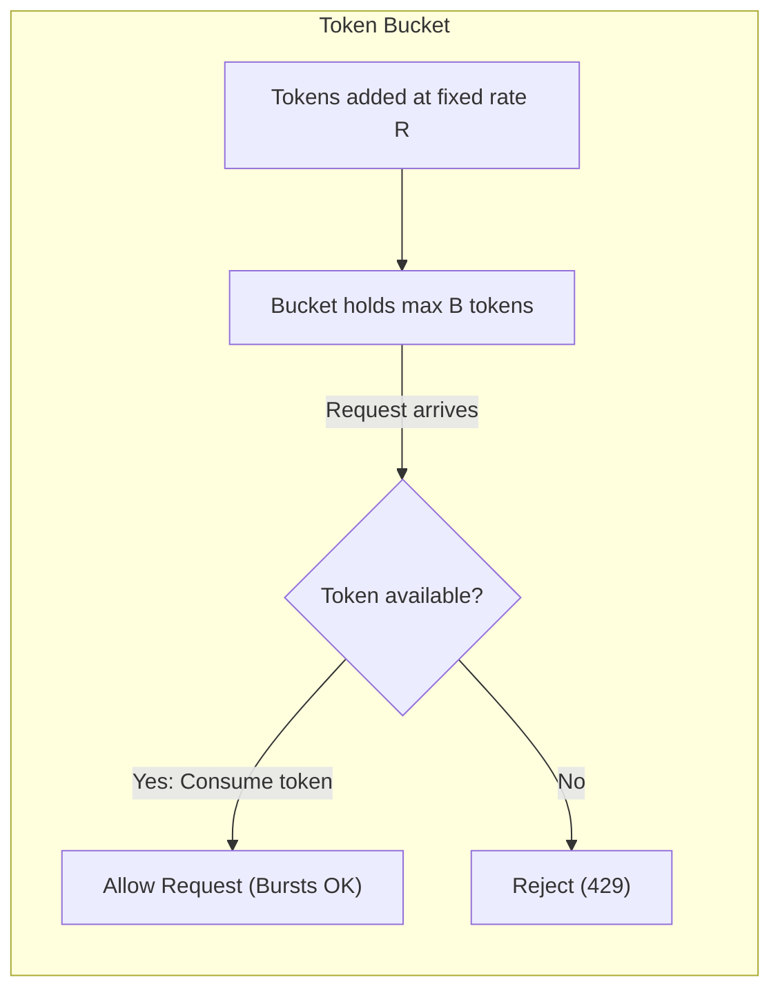

| Algorithm              | How it Works                                                                     | Pros                                                            | Cons                                                                                     |
| :--------------------- | :------------------------------------------------------------------------------- | :-------------------------------------------------------------- | :--------------------------------------------------------------------------------------- |
| **Token Bucket**       | Tokens refill at constant rate $R$ up to capacity $C$. Request consumes 1 token. | Allows controlled **bursts** of traffic; memory efficient.      | Tuning token refill parameters.                                                          |
| **Leaky Bucket**       | Requests enter FIFO buffer and leak out at a strictly constant rate.             | **Smooths out spikes**; guarantees predictable downstream load. | Can drop valid requests if the queue fills up during bursts.                             |
| **Fixed Window**       | Counter resets every time window (e.g., 100 req/min).                            | Trivial to implement in Redis (`INCR` + `EXPIRE`).              | **Boundary spike:** User can send 100 req at 00:59 and 100 req at 01:00 (200 req in 2s). |
| **Sliding Window Log** | Stores timestamp of each request in a Redis Sorted Set (`ZADD`).                 | Completely accurate; zero boundary spikes.                      | **High memory consumption** for high-volume endpoints.                                   |

_Response standard:_ Always return `429 Too Many Requests` along with the `Retry-After: <seconds>` header.

---

### Caching

- **What it solves:** Eliminates repeated expensive computations and disk I/O for frequently accessed data.
- **Why it's needed:** RAM access (Redis: ~1ms) is $100\times$ to $1000\times$ faster than querying disk-backed relational databases (Postgres/MySQL: ~10-100ms).
- **Cache Eviction Policies:**
  - **LRU (Least Recently Used):** Discards the item not accessed for the longest time (ideal for general workloads).
  - **LFU (Least Frequently Used):** Discards the item with the lowest hit counter (ideal for identifying stable popular items).
  - **TTL (Time to Live):** Explicit expiration timestamp.

#### Caching Strategies

1. **Cache-Aside (Lazy Loading):** Application queries cache first. On miss, queries DB, populates cache, and returns data.
2. **Write-Through:** Application writes to cache; cache immediately writes to DB before returning success.
3. **Write-Behind (Write-Back):** Application writes to cache; cache batches writes and asynchronously writes to DB later (risk of data loss on crash).

---

### Horizontal vs. Vertical Scaling

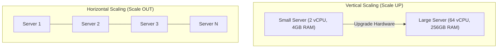

| Dimension                    | Vertical Scaling (Scale Up)                                                     | Horizontal Scaling (Scale Out)                                                     |
| :--------------------------- | :------------------------------------------------------------------------------ | :--------------------------------------------------------------------------------- |
| **Mechanism**                | Add more CPU cores, RAM, and NVMe SSDs to existing machine.                     | Provision additional server instances behind a load balancer.                      |
| **Hard Limit**               | **Physical hardware ceiling**; diminishing returns; exponential hardware costs. | **Virtually limitless** (linear scaling across hundreds of nodes).                 |
| **Downtime**                 | Often requires machine reboot or maintenance window.                            | **Zero downtime** via rolling deployments and autoscaling groups.                  |
| **Application Architecture** | Works with legacy monolithic code without changes.                              | Requires **Stateless Architecture** (session state in Redis, not in local memory). |
| **Best Used For**            | Relational databases in early-to-mid stages (RDS PostgreSQL).                   | Stateless web/API tiers, microservices, containerized workloads.                   |

---

## 4. Asynchronous Processing and Reliability

### Message Queues

- **What it solves:** Decouples the slow, long-running parts of a request from the fast, interactive user response.
- **Why it's needed:** Prevents HTTP connection timeouts and enforces **Backpressure** so spikes in requests don't crash backend worker services.
- **Example:** In a video streaming app, when a creator uploads an MP4 video, the API immediately responds with `202 Accepted`. A background message queue orchestrates video transcoding across worker nodes.

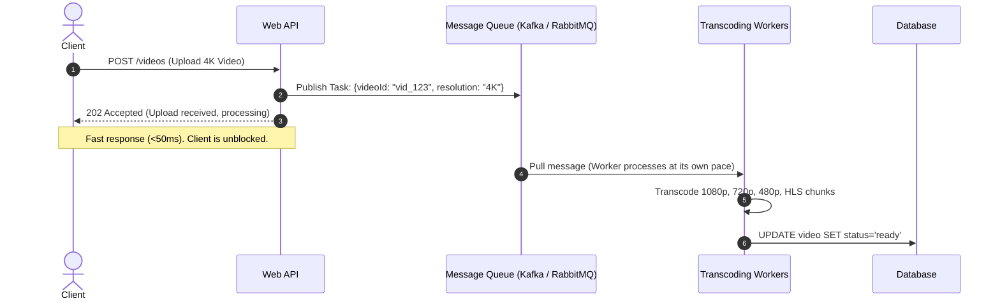

---

### Idempotency

- **What it solves:** Prevents duplicate side effects (e.g., charging a customer twice, ordering two items) when network failures cause clients to retry requests.
- **Why it's needed:** In distributed systems, network errors are ambiguous. A timeout could mean the request failed to reach the server, OR the server processed the request but the response dropped on the return path.
- **Implementation:** Client generates a unique UUID `Idempotency-Key`. The server saves the key in Redis with the resulting response. If the client retries with the same key, the server returns the cached response without re-executing the payment.

---

### Fault Tolerance

- **What it solves:** Ensures the system as a whole continues to function even when individual sub-services, disks, or network switches fail.
- **Techniques:**
  - **Graceful Degradation:** If the personalization/recommendation engine crashes, show generic trending movies instead of throwing a `500 Server Error`.
  - **Redundancy (N+1):** Run multiple instances of each service across independent availability zones (AZs).
  - **Health Probes:** Kubernetes `livenessProbe` and `readinessProbe` to automatically kill and replace zombie pods.

---

### Retry with Exponential Backoff & Jitter

- **What it solves:** Prevents retrying clients from launching a **thundering herd** attack against a struggling downstream dependency.
- **The Math:**
  $$T_{\text{wait}} = \min(T_{\text{max}}, T_{\text{base}} \times 2^{\text{attempt}}) + \text{random\_jitter}$$
- **Why Jitter is Mandatory:** Without random jitter, if 10,000 clients fail at time $T$, all 10,000 will retry together at $T+1\text{s}$, then all retry together at $T+3\text{s}$, repeatedly slamming the server in synchronized waves.

---

### Circuit Breaker

- **What it solves:** Cascading failures. When Service C slows down, Service B runs out of threads waiting on C, which causes Service A to run out of threads waiting on B, collapsing the entire system.
- **The 3 States:**

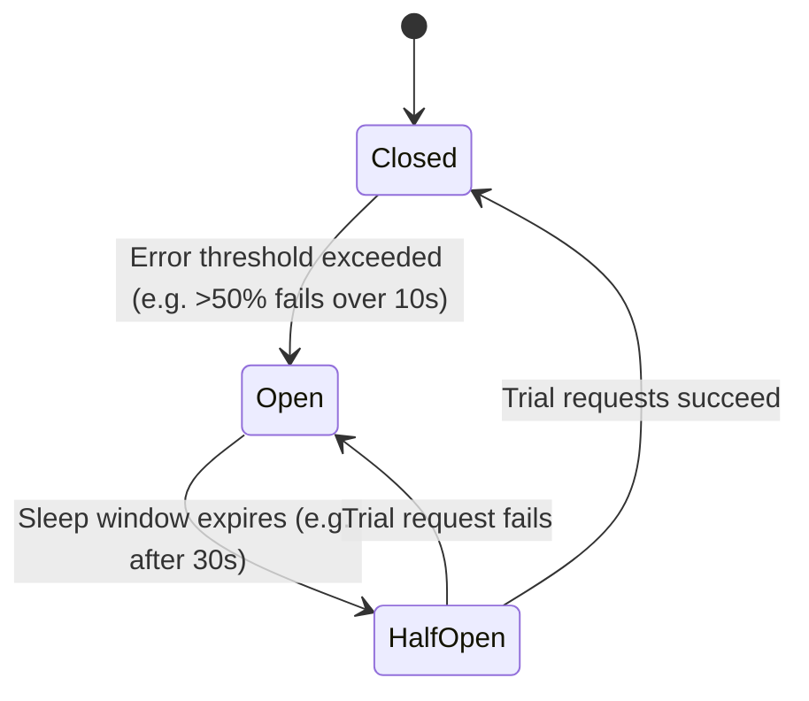

1. **Closed (Normal):** Requests pass through. Failures are counted.
2. **Open (Tripped):** Service is failing. Requests immediately fail fast or return fallback data without touching the failing dependency.
3. **Half-Open (Testing Recovery):** After a timeout, allows a small canary percentage of traffic through. If successful, resets to Closed. If fails, trips back to Open.

---

### Observability (The Three Pillars)

You cannot fix what you cannot measure.

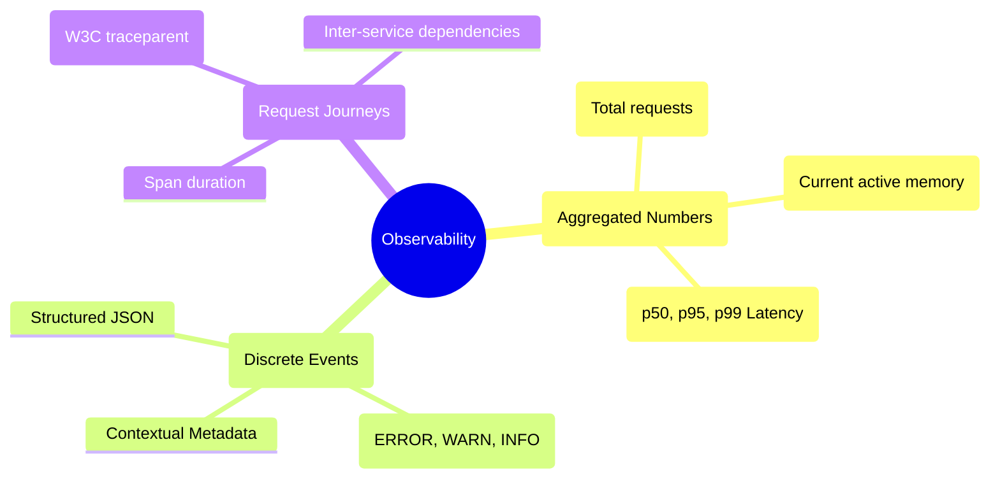

- **Metrics:** Tell you **that** a problem exists (e.g., p99 latency spiked to 4.2 seconds).
- **Traces:** Tell you **where** the problem is located (e.g., trace reveals 3.9 seconds was spent inside PostgreSQL query on Service B).
- **Logs:** Tell you **why** the problem occurred (e.g., `Deadlock found when trying to get lock`).

---

## 5. API and Communication

### API Pagination

- **What it solves:** Prevents out-of-memory errors on both server and client when querying tables with millions of rows.
- **Offset vs. Keyset / Cursor Pagination:**

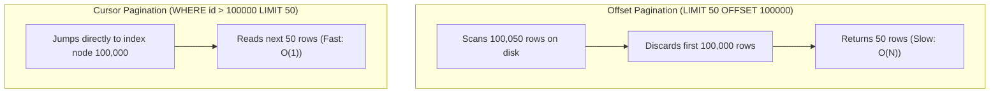

_(For exhaustive deep dive, see the [API Pagination Master Cheatsheet](pagination.md))._

---

### REST APIs

- **What it solves:** Provides a standard, predictable, stateless interface using existing HTTP semantics.
- **Core Conventions:**
  - `GET /movies`: Retrieve list.
  - `POST /movies`: Create new movie.
  - `PUT /movies/123`: Replace movie entirely.
  - `PATCH /movies/123`: Partial update.
  - `DELETE /movies/123`: Remove resource.
- **When to use:** Public APIs, CRUD applications, web hooks.

---

### WebSockets

- **What it solves:** Eliminates the latency and HTTP header overhead of repeated polling when real-time, two-way communication is needed.
- **Protocol:** Starts with an HTTP handshake (`Upgrade: websocket`), then transitions to a raw, persistent full-duplex TCP socket.
- **When to use:** Real-time chat, multiplayer gaming, financial trading tickers, collaborative canvas tools.

---

### Server-Sent Events (SSE)

- **What it solves:** Provides lightweight, browser-native real-time updates when data only flows **one-way** (Server → Client).
- **Why it's better than WebSockets for unilateral updates:**
  - Runs over standard HTTP/1.1 or HTTP/2 (`Content-Type: text/event-stream`).
  - Automatic reconnection out of the box (`Last-Event-ID`).
  - Works through standard corporate proxies and firewalls without custom protocol handling.
- **When to use:** LLM streaming responses (ChatGPT tokens), live sports score tickers, notification bells.

---

### Content Delivery Networks (CDN)

- **What it solves:** Eliminates the speed-of-light physical distance latency between users and the origin server.
- **Mechanism:** Uses BGP Anycast routing to direct user requests to the nearest edge PoP (Point of Presence). Static assets (JS, CSS, images, video segments) are cached at the edge.
- **When to use:** All publicly accessible web assets, media files, and cacheable API responses.

---

## 6. Architect's Decision Matrix

| Requirement                                                        | Preferred Pattern                                              | Alternative      | Why the Preferred Wins                                                                      |
| :----------------------------------------------------------------- | :------------------------------------------------------------- | :--------------- | :------------------------------------------------------------------------------------------ |
| **High write contention on scarce inventory (Flash sale)**         | **Pessimistic Lock (`SELECT FOR UPDATE`)** or Redis Lua script | Optimistic Lock  | Optimistic locking causes massive abort storms and wasted CPU cycles under heavy collision. |
| **User profile edits / shopping cart updates**                     | **Optimistic Locking (`version` column)**                      | Pessimistic Lock | Collisions are rare; avoids holding database connection locks.                              |
| **Real-time bidirectional chat**                                   | **WebSockets**                                                 | Long Polling     | True full-duplex communication with negligible frame overhead after handshake.              |
| **LLM streaming token output**                                     | **Server-Sent Events (SSE)**                                   | WebSockets       | Unidirectional; native browser reconnects; operates over standard HTTP/2 streams.           |
| **Slow, resource-heavy background work (Transcoding, PDF export)** | **Message Queue (Kafka / RabbitMQ)**                           | Synchronous HTTP | Frees up API web threads immediately; prevents client HTTP timeouts; applies backpressure.  |
| **Deep pagination on 10M rows**                                    | **Keyset / Cursor Pagination**                                 | Offset / Limit   | $O(1)$ index seek vs. $O(N)$ full table scan + discard penalty.                             |
| **Payment charge retry**                                           | **`Idempotency-Key` + Redis TTL lock**                         | Blind retry      | Guarantees exactly-once execution semantics across network drops.                           |
