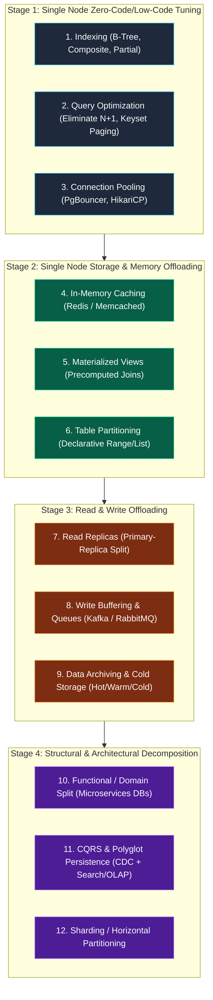
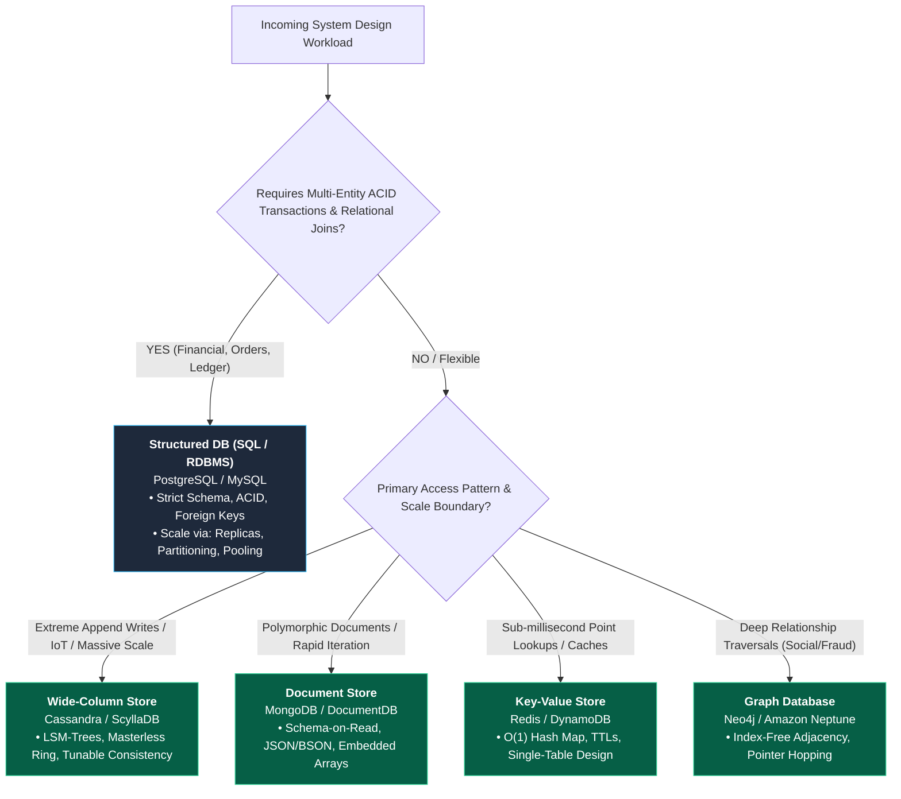

# 🗄️ Database Scaling Architecture & Techniques Master Cheatsheet

> A comprehensive, production-grade guide to scaling databases from 1,000 to 100,000,000+ queries per second.
> Covers the original 8 core scaling patterns, essential missing enterprise techniques, **Structured (SQL) vs. Non-Structured (NoSQL) trade-off deep dive**, ASCII/Mermaid visual mechanics, killer use-cases, trade-offs, pros & cons, code examples, and the **Database Scaling Order of Operations**.

---

## 📚 Table of Contents

- [🗄️ Database Scaling Architecture \& Techniques Master Cheatsheet](#️-database-scaling-architecture--techniques-master-cheatsheet)
  - [📚 Table of Contents](#-table-of-contents)
  - [🧭 The Database Scaling Ladder (Order of Operations)](#-the-database-scaling-ladder-order-of-operations)
  - [1. Indexing (B-Trees, Composite, Partial \& Covering)](#1-indexing-b-trees-composite-partial--covering)
    - [🎬 Mental Animation \& Mechanics](#-mental-animation--mechanics)
    - [🎯 Why This is Best](#-why-this-is-best)
    - [⚖️ Trade-offs \& The Catch](#️-trade-offs--the-catch)
    - [📊 Pros \& Cons in Short](#-pros--cons-in-short)
    - [💻 Production Example \& SQL](#-production-example--sql)
  - [2. Query Optimization (Eliminating N+1 \& SARGable Predicates)](#2-query-optimization-eliminating-n1--sargable-predicates)
    - [🎬 Mental Animation \& Mechanics](#-mental-animation--mechanics-1)
    - [🎯 Why This is Best](#-why-this-is-best-1)
    - [⚖️ Trade-offs \& The Catch](#️-trade-offs--the-catch-1)
    - [📊 Pros \& Cons in Short](#-pros--cons-in-short-1)
    - [💻 Production Example](#-production-example)
  - [3. Connection Pooling (PgBouncer, HikariCP)](#3-connection-pooling-pgbouncer-hikaricp)
    - [🎬 Mental Animation \& Mechanics](#-mental-animation--mechanics-2)
    - [🎯 Why This is Best](#-why-this-is-best-2)
    - [⚖️ Trade-offs \& The Catch](#️-trade-offs--the-catch-2)
    - [📊 Pros \& Cons in Short](#-pros--cons-in-short-2)
    - [💻 Production Example (PgBouncer Configuration)](#-production-example-pgbouncer-configuration)
  - [4. Sharding (Horizontal Partitioning Across Nodes)](#4-sharding-horizontal-partitioning-across-nodes)
    - [🎬 Mental Animation \& Mechanics](#-mental-animation--mechanics-3)
    - [🎯 Why This is Best](#-why-this-is-best-3)
    - [⚖️ Trade-offs \& The Catch](#️-trade-offs--the-catch-3)
    - [📊 Pros \& Cons in Short](#-pros--cons-in-short-3)
    - [💻 Production Example (Consistent Hashing / Routing Rule)](#-production-example-consistent-hashing--routing-rule)
  - [5. Read Replicas \& Read-Write Splitting](#5-read-replicas--read-write-splitting)
    - [🎬 Mental Animation \& Mechanics](#-mental-animation--mechanics-4)
    - [🎯 Why This is Best](#-why-this-is-best-4)
    - [⚖️ Trade-offs \& The Catch](#️-trade-offs--the-catch-4)
    - [📊 Pros \& Cons in Short](#-pros--cons-in-short-4)
    - [💻 Production Mitigation: Read-Your-Own-Writes Pattern](#-production-mitigation-read-your-own-writes-pattern)
  - [6. Materialized Views (Precomputed Caching)](#6-materialized-views-precomputed-caching)
    - [🎬 Mental Animation \& Mechanics](#-mental-animation--mechanics-5)
    - [🎯 Why This is Best](#-why-this-is-best-5)
    - [⚖️ Trade-offs \& The Catch](#️-trade-offs--the-catch-5)
    - [📊 Pros \& Cons in Short](#-pros--cons-in-short-5)
    - [💻 Production Example \& SQL](#-production-example--sql-1)
  - [7. CQRS (Command Query Responsibility Segregation)](#7-cqrs-command-query-responsibility-segregation)
    - [🎬 Mental Animation \& Mechanics](#-mental-animation--mechanics-6)
    - [🎯 Why This is Best](#-why-this-is-best-6)
    - [⚖️ Trade-offs \& The Catch](#️-trade-offs--the-catch-6)
    - [📊 Pros \& Cons in Short](#-pros--cons-in-short-6)
    - [💻 Production Example: CQRS Command \& Async Projection](#-production-example-cqrs-command--async-projection)
  - [8. Functional Split (Domain Database Decomposition)](#8-functional-split-domain-database-decomposition)
    - [🎬 Mental Animation \& Mechanics](#-mental-animation--mechanics-7)
    - [🎯 Why This is Best](#-why-this-is-best-7)
    - [⚖️ Trade-offs \& The Catch](#️-trade-offs--the-catch-7)
    - [📊 Pros \& Cons in Short](#-pros--cons-in-short-7)
    - [💻 Production Mitigation: Transactional Outbox Pattern (Cross-Domain Sync)](#-production-mitigation-transactional-outbox-pattern-cross-domain-sync)
  - [🚀 The Essential Missing Techniques (Enterprise Scaling)](#-the-essential-missing-techniques-enterprise-scaling)
    - [9. In-Memory Caching (Redis / Memcached \& Cache-Aside)](#9-in-memory-caching-redis--memcached--cache-aside)
    - [💻 Production Example: Cache-Aside with Stampede Protection](#-production-example-cache-aside-with-stampede-protection)
    - [10. Declarative Table Partitioning (Range, List \& Hash on Single Node)](#10-declarative-table-partitioning-range-list--hash-on-single-node)
    - [11. Hot-Warm-Cold Storage Tiering \& Archiving](#11-hot-warm-cold-storage-tiering--archiving)
    - [12. Write Buffering \& Asynchronous Ingestion (Queue Load Leveling)](#12-write-buffering--asynchronous-ingestion-queue-load-leveling)
    - [13. Change Data Capture (CDC) \& Polyglot Persistence](#13-change-data-capture-cdc--polyglot-persistence)
    - [14. Distributed SQL / NewSQL (CockroachDB, YugabyteDB, Google Spanner)](#14-distributed-sql--newsql-cockroachdb-yugabytedb-google-spanner)
  - [🏛️ Structured (SQL) vs. Non-Structured (NoSQL) Database Architecture](#️-structured-sql-vs-non-structured-nosql-database-architecture)
    - [1. Architectural Philosophy: Structured vs. Non-Structured](#1-architectural-philosophy-structured-vs-non-structured)
    - [2. Deep Dive: Structured Databases (RDBMS / SQL)](#2-deep-dive-structured-databases-rdbms--sql)
      - [🎯 Why Choose Structured Over Non-Structured?](#-why-choose-structured-over-non-structured)
      - [⚖️ The Catch / Trade-offs](#️-the-catch--trade-offs)
      - [📊 Pros \& Cons in Short](#-pros--cons-in-short-8)
      - [💻 Production Example (PostgreSQL Transactional Safety)](#-production-example-postgresql-transactional-safety)
    - [3. Deep Dive: Non-Structured Databases (NoSQL Archetypes)](#3-deep-dive-non-structured-databases-nosql-archetypes)
      - [A. Document Stores (MongoDB, Amazon DocumentDB, Couchbase)](#a-document-stores-mongodb-amazon-documentdb-couchbase)
      - [B. Key-Value Stores (Redis, AWS DynamoDB, Memcached)](#b-key-value-stores-redis-aws-dynamodb-memcached)
      - [C. Wide-Column / Columnar Stores (Apache Cassandra, ScyllaDB, ClickHouse)](#c-wide-column--columnar-stores-apache-cassandra-scylladb-clickhouse)
      - [D. Graph Databases (Neo4j, Amazon Neptune)](#d-graph-databases-neo4j-amazon-neptune)
    - [4. Direct Showdown: When to Choose One Over the Other](#4-direct-showdown-when-to-choose-one-over-the-other)
    - [5. The Modern Hybrid: Polyglot Persistence \& PostgreSQL JSONB](#5-the-modern-hybrid-polyglot-persistence--postgresql-jsonb)
      - [The PostgreSQL `JSONB` Compromise](#the-postgresql-jsonb-compromise)
  - [📊 Complete Architectural Comparison Matrix](#-complete-architectural-comparison-matrix)
  - [💡 Quick Rules of Thumb for Interviews \& Production](#-quick-rules-of-thumb-for-interviews--production)

---

## 🧭 The Database Scaling Ladder (Order of Operations)

Before implementing complex distributed patterns like Sharding or CQRS, always follow the scaling hierarchy. **Premature distributed complexity causes more outages than raw load.**



---

## 1. Indexing (B-Trees, Composite, Partial & Covering)

### 🎬 Mental Animation & Mechanics

Without an index, the database engine executes a **Sequential Scan** ($O(N)$), reading every single disk page and row into memory. With an index (commonly a balanced B-Tree), the engine traverses sorted pointer nodes from the Root to Leaf in $\mathcal{O}(\log N)$ disk I/O operations (typically 3 to 4 block reads for millions of rows), jumping straight to the row pointer (`ctid` / tuple ID).

```text
Without Index (Full Table Scan):
Query: WHERE user_id = 42
[Row 1] ──► [Row 2] ──► [Row 3] ──► ... ──► [Row 10,000,000] (Scans every page from disk!)

With B-Tree Index:
                  [Root Node: 50]
                 /               \
         [Internal: 25]      [Internal: 75]
           /        \
       [Leaf: 1..25] [Leaf: 26..50] ──► Found '42'! Points directly to Tuple on Disk Page #812
```

### 🎯 Why This is Best

- **Instant Latency Drop:** Reduces query execution time from 5,000ms to 2ms on large tables without altering infrastructure or application architecture.
- **Hardware Efficiency:** Drastically reduces disk I/O and RAM buffer churn.

### ⚖️ Trade-offs & The Catch

- **Write Penalty:** Every `INSERT`, `UPDATE`, and `DELETE` must update both the base table and every single index on that table.
- **Storage Overhead:** Indexes consume significant disk and RAM (Buffer Pool). Excessive indexes cause write-amplification and table bloat.

### 📊 Pros & Cons in Short

- **Pros:** $\mathcal{O}(\log N)$ lookup speed; enables fast sorting (`ORDER BY`) and range filters; zero architectural complexity.
- **Cons:** Slows down bulk writes; consumes memory buffer space; index fragmentation requires periodic vacuuming/reindexing.

### 💻 Production Example & SQL

```sql
-- 1. Anti-Pattern: Scans 50M rows
SELECT id, email, status FROM users WHERE status = 'ACTIVE' AND email = 'alex@example.com';

-- 2. Best Practice: Composite Index matching left-to-right query predicates
CREATE INDEX idx_users_email_status ON users(email, status);

-- 3. Advanced Covering Index (Index-Only Scan: never visits heap table)
CREATE INDEX idx_users_covering ON users(email) INCLUDE (id, status);

-- 4. Partial Index (Index ONLY the hot subset to save 90% space)
CREATE INDEX idx_orders_unfulfilled ON orders(created_at) WHERE status = 'PENDING';
```

---

## 2. Query Optimization (Eliminating N+1 & SARGable Predicates)

### 🎬 Mental Animation & Mechanics

**The N+1 Trap:** Fetching 100 users, then in a loop issuing 100 separate database queries to fetch each user's orders. This introduces 101 round-trips over the network stack, connection handshakes, and query planning overhead.
**Optimized Approach:** Single `JOIN` or batched keyset query (`WHERE user_id IN (...)`), transferring all needed tuples in a single network round-trip.

```text
The N+1 Network Cascade:
Client ────── GET /users ──────► DB (1 Query)
Client ◄───── 100 Users ──────── DB
Client ────── GET Orders(User 1) ─► DB (Query 2)
Client ────── GET Orders(User 2) ─► DB (Query 3)
... (100 sequential round-trips across TCP socket!)

Optimized (Single Trip via JOIN or Keyset IN):
Client ────── SELECT ... JOIN ... ─► DB (1 Query, 1 Round-Trip)
Client ◄───── All Users + Orders ── DB
```

### 🎯 Why This is Best

- Eliminates application latency dominated by network round-trip time (RTT).
- Frees database CPU from redundant parsing, authorization, query planning, and lock acquisition.

### ⚖️ Trade-offs & The Catch

- **Cartesian Product Risk:** Giant multi-table joins can send massive duplicate data over the wire (e.g., repeating user profile fields on every order line item).
- **ORM Opacity:** Modern ORMs (Hibernate, Prisma, Django ORM, ActiveRecord) generate N+1 queries invisibly unless eager loading (`includes`, `select_related`) is strictly enforced.

### 📊 Pros & Cons in Short

- **Pros:** 10x–100x latency reduction without adding hardware; lowers active DB connection utilization.
- **Cons:** Complex raw SQL can be harder to maintain than simple ORM calls; requires developer discipline and query linting.

### 💻 Production Example

```javascript
// ❌ Anti-Pattern: N+1 queries in Node.js
const users = await db.query('SELECT id, name FROM users LIMIT 100');
for (const user of users) {
  // Triggers 100 network round trips
  user.orders = await db.query('SELECT * FROM orders WHERE user_id = $1', [user.id]);
}

// 🟢 Optimized: Single Batched Query via IN or JOIN
const users = await db.query('SELECT id, name FROM users LIMIT 100');
const userIds = users.map((u) => u.id);
const orders = await db.query('SELECT * FROM orders WHERE user_id = ANY($1)', [userIds]);
// Map orders back in application memory in O(N) time!
```

---

## 3. Connection Pooling (PgBouncer, HikariCP)

### 🎬 Mental Animation & Mechanics

In systems like PostgreSQL, every client connection spawns a **heavy dedicated OS process** allocating 2MB–10MB of RAM, causing OS context switching and internal lock contention. When 5,000 serverless Lambdas or microservices connect simultaneously, the DB crashes from thread exhaustion. A connection pool holds a small, fixed set of warm connections (e.g., 50–100) and multiplexes thousands of incoming queries across them.

```text
Without Connection Pool (5,000 App Threads vs Postgres):
[App Srv 1] ──┐
[App Srv 2] ──┼──► 5,000 Concurrent TCP Connections ──► Postgres [Crash: Out of Memory / OS PIDs]
[App Srv N] ──┘

With Connection Pool (PgBouncer / HikariCP):
[5,000 App Clients]
         │ (Fast lightweight virtual client connections)
         ▼
┌─────────────────────────┐
│ Connection Pooler       │ Multiplexes 5,000 client queries
│ (Transaction-Level Mode)│ onto 50 persistent, warm backend processes
└─────────────────────────┘
         │
         ▼ (50 Stable TCP Connections)
┌─────────────────────────┐
│ PostgreSQL Engine       │ Runs at peak CPU efficiency without context-switch thrash!
└─────────────────────────┘
```

### 🎯 Why This is Best

- Prevents database connection exhaustion during traffic spikes and serverless scaling.
- Protects database memory and limits OS thread context switching.

### ⚖️ Trade-offs & The Catch

- **Stateful Features Disabled:** In "Transaction Pooling" mode, features tied to session state (prepared statements, temporary tables, `LISTEN/NOTIFY`, session-level locks) may break or require special pooler flags.

### 📊 Pros & Cons in Short

- **Pros:** Handles tens of thousands of client connections effortlessly; caps backend DB resource usage; smooths spikes.
- **Cons:** Added architectural hop; requires tuning pool sizes (e.g., using the _HikariCP formula_: `connections = ((core_count * 2) + effective_spindle_count)`).

### 💻 Production Example (PgBouncer Configuration)

```ini
[databases]
production_db = host=127.0.0.1 port=5432 dbname=prod_db

[pgbouncer]
listen_port = 6432
listen_addr = 0.0.0.0
auth_type = md5
auth_file = /etc/pgbouncer/userlist.txt
# Transaction pooling: connection is returned to pool immediately after transaction finishes
pool_mode = transaction
max_client_conn = 10000
default_pool_size = 50
min_pool_size = 10
reserve_pool_size = 5
```

---

## 4. Sharding (Horizontal Partitioning Across Nodes)

### 🎬 Mental Animation & Mechanics

When a single database server cannot handle the dataset size (e.g., 50TB) or write throughput (e.g., 100k writes/sec), the dataset is split horizontally across multiple independent database servers (shards) by a **Shard Key**. A routing layer evaluates `hash(shard_key) % num_shards` to direct requests to the correct machine.

```text
Incoming Write: Order #9812 (user_id = 42)
Hash(42) = 0x2A ... 0x2A % 3 = Shard 1

                     ┌─────────────┐
                     │ Routing/    │
  Write Request ────►│ Proxy Layer │
  (user_id = 42)     └──────┬──────┘
                            │
        ┌───────────────────┼───────────────────┐
        ▼                   ▼                   ▼
┌───────────────┐   ┌───────────────┐   ┌───────────────┐
│    Shard 0    │   │    Shard 1    │   │    Shard 2    │
│ (users 0-33)  │   │ (users 34-66) │   │ (users 67-99) │
└───────────────┘   └───────────────┘   └───────────────┘
```

### 🎯 Why This is Best

- **Unlimited Horizontal Scale:** Solves hard limits on disk size, CPU throughput, and memory capacity for write-heavy massive scale.

### ⚖️ Trade-offs & The Catch

- **Hotspots:** An uneven shard key (e.g., sharding by celebrity `tenant_id` or date) causes one node to overload while others sit idle.
- **No Global Joins / 2PC:** Joins across shards require scatter-gather queries, which are brutally slow. Distributed transactions require Two-Phase Commit (2PC), slashing throughput.
- **Re-sharding Nightmare:** Changing shard counts requires moving terabytes of live data across networks.

### 📊 Pros & Cons in Short

- **Pros:** Linear write and storage scaling; isolates blast radius of single-node hardware failure.
- **Cons:** High operational complexity; no foreign keys or cross-shard ACID guarantees; schema migrations are painful.

### 💻 Production Example (Consistent Hashing / Routing Rule)

```python
import mmh3

SHARDS = ["db-node-0.internal", "db-node-1.internal", "db-node-2.internal", "db-node-3.internal"]

def get_shard_host(user_id: str) -> str:
    # MurmurHash3 ensures uniform distribution across shards
    shard_index = mmh3.hash(user_id) % len(SHARDS)
    return SHARDS[shard_index]

# Writes and reads for user_id="usr_9481" always hit the exact same shard
db_target = get_shard_host("usr_9481")
```

---

## 5. Read Replicas & Read-Write Splitting

### 🎬 Mental Animation & Mechanics

Most applications have an **80/20 or 95/5 read-to-write ratio**. A single primary server handles all writes (`INSERT`, `UPDATE`, `DELETE`) and streams its Write-Ahead Log (WAL) or binlog to multiple read-only replica servers. Read traffic is load-balanced across replicas, multiplying read throughput.

```text
                  Write Requests (1,000 req/s)
                             │
                             ▼
                    ┌─────────────────┐
                    │ Primary DB (W)  │
                    └────────┬────────┘
                             │ WAL Streaming / Async Replication
                 ┌───────────┴───────────┐
                 ▼                       ▼
        ┌─────────────────┐     ┌─────────────────┐
        │ Read Replica 1  │     │ Read Replica 2  │
        └────────┬────────┘     └────────┬────────┘
                 ▲                       ▲
                 └───────────┬───────────┘
                             │
                 Read Requests (20,000 req/s)
```

### 🎯 Why This is Best

- Simple, battle-tested horizontal scaling for read-dominated workloads (social media, content catalogs, e-commerce browsing).
- High Availability: Replicas act as standby failover targets if the primary crashes.

### ⚖️ Trade-offs & The Catch

- **Replication Lag & Read-Your-Own-Writes Anomaly:** Asynchronous replication introduces a delay (from milliseconds to seconds). If a user posts a comment and refreshes immediately, reading from a lagging replica makes their comment appear to have vanished!

### 📊 Pros & Cons in Short

- **Pros:** 5x–10x read throughput boost; zero change to data model; provides live failover targets.
- **Cons:** Does not scale write throughput; eventual consistency challenges; connection routing complexity in application code.

### 💻 Production Mitigation: Read-Your-Own-Writes Pattern

```typescript
// Route reads to Primary for 5 seconds after a write to avoid replication lag
async function getUserProfile(userId: string, req: Request) {
  const lastWriteTimestamp = await redis.get(`last_write:${userId}`);
  const isRecentWrite = lastWriteTimestamp && Date.now() - Number(lastWriteTimestamp) < 5000;

  if (isRecentWrite) {
    // Read from PRIMARY to guarantee strong consistency
    return primaryDb.query('SELECT * FROM profiles WHERE user_id = $1', [userId]);
  } else {
    // Read from LOAD-BALANCED REPLICA POOL
    return replicaPool.query('SELECT * FROM profiles WHERE user_id = $1', [userId]);
  }
}
```

---

## 6. Materialized Views (Precomputed Caching)

### 🎬 Mental Animation & Mechanics

Instead of running a 5-way table `JOIN` with aggregations (`SUM`, `COUNT`, `GROUP BY`) across 20 million rows on every client dashboard load, the database executes the query once and saves the physical result table to disk as a **Materialized View**. Read queries read directly from this flat precomputed table in $O(1)$ time.

```text
On-Demand Complex Query (Slow: 4,500ms):
Client ──► SELECT SUM(o.amount), u.country FROM users u JOIN orders o ... GROUP BY u.country ──► DB computes 10M rows!

With Materialized View:
[Cron / Trigger / Background Worker] ──► REFRESH MATERIALIZED VIEW monthly_sales_by_country;
Client ─────────────────────────────────► SELECT * FROM monthly_sales_by_country WHERE country = 'IN'; (Fast: 3ms!)
```

### 🎯 Why This is Best

- Eliminates CPU spikes for heavy analytics, reporting dashboards, and complex aggregations.
- Enables standard SQL indexing on the precalculated result columns.

### ⚖️ Trade-offs & The Catch

- **Data Freshness:** Data is stale between refresh intervals.
- **Refresh Overhead:** Full view refreshes lock resources and consume heavy disk I/O (mitigated by `CONCURRENTLY` in PostgreSQL with unique indexes).

### 📊 Pros & Cons in Short

- **Pros:** Transforms multi-second analytic queries into single-millisecond reads; supports indexes on view output.
- **Cons:** Stale data; complete refreshes consume high CPU/disk I/O; incremental refreshes require specialized extensions.

### 💻 Production Example & SQL

```sql
-- 1. Create the materialized view
CREATE MATERIALIZED VIEW mv_user_order_stats AS
SELECT
    u.id AS user_id,
    u.email,
    COUNT(o.id) AS total_orders,
    COALESCE(SUM(o.amount), 0) AS total_spent
FROM users u
LEFT JOIN orders o ON u.id = o.user_id
GROUP BY u.id, u.email;

-- 2. Build a unique index to allow non-blocking concurrent refreshes
CREATE UNIQUE INDEX idx_mv_user_order_stats_uid ON mv_user_order_stats(user_id);

-- 3. Refresh concurrently in background cron (Zero read downtime!)
REFRESH MATERIALIZED VIEW CONCURRENTLY mv_user_order_stats;
```

---

## 7. CQRS (Command Query Responsibility Segregation)

### 🎬 Mental Animation & Mechanics

Standard architectures use the same relational tables for writes and reads. **CQRS decouples the Write Model (Command) from the Read Model (Query).**

- **Command Side (Write):** Highly normalized, optimized for fast validation, append-only transactions, or Event Sourcing.
- **Query Side (Read):** Denormalized, flat read projections stored in high-speed engines (e.g., Redis, Elasticsearch, DynamoDB).
- Changes sync asynchronously via Event Bus (Kafka) or Change Data Capture (CDC).

```text
                       ┌────────────────────────┐
                       │  Client Application    │
                       └────┬───────────────▲───┘
               Commands     │               │  Queries
            (Write / Mutate)│               │  (Fast Read Projections)
                            ▼               │
                  ┌────────────────┐        │
                  │ Command Svc    │        │
                  │ (Postgres/ACID)│        │
                  └────────┬───────┘        │
                           │ Domain Events  │
                           ▼                │
                  ┌────────────────┐        │
                  │ Message Bus    │        │
                  │ (Kafka / SQS)  │        │
                  └────────┬───────┘        │
                           │ Consume & Project
                           ▼                │
                  ┌────────────────┐        │
                  │ Read Model     ├────────┘
                  │ (Elastic/Redis)│
                  └────────────────┘
```

### 🎯 Why This is Best

- Lets you independently scale the write and read engines based on completely different usage profiles.
- Read models are pre-flattened: zero runtime joins required.

### ⚖️ Trade-offs & The Catch

- **Eventual Consistency:** Write confirmation happens before the read projection updates.
- **Code & Operational Duplication:** You must maintain separate data schemas, synchronization pipelines, and failure recovery workers.

### 📊 Pros & Cons in Short

- **Pros:** Maximum read/write scalability; allows picking the best engine for each task (Postgres for ACID writes, Elasticsearch for search).
- **Cons:** High architectural complexity; eventual consistency delay; risk of read-model sync bugs.

### 💻 Production Example: CQRS Command & Async Projection

```typescript
// 1. COMMAND HANDLER (Writes normalized ACID entity & publishes domain event)
async function handleCreateOrder(command: CreateOrderCommand): Promise<string> {
  const orderId = await postgresDb.transaction(async (trx) => {
    const [row] = await trx
      .insertInto('orders')
      .values({
        customer_id: command.customerId,
        status: 'CREATED',
        total_amount: command.total,
      })
      .returning('id');
    return row.id;
  });

  // Publish event to event bus (or via transactional outbox pattern)
  await kafkaProducer.send('order-events', {
    type: 'OrderCreated',
    orderId,
    customerId: command.customerId,
    total: command.total,
    timestamp: Date.now(),
  });

  return orderId;
}

// 2. QUERY PROJECTION WORKER (Asynchronously builds flat read model in Elasticsearch/Redis)
async function onOrderCreatedEvent(event: OrderCreatedEvent) {
  const customer = await cache.get(`customer:${event.customerId}`);

  // Flatten everything into a single denormalized document for O(1) query
  await elasticsearch.index({
    index: 'orders_read_model',
    id: event.orderId,
    body: {
      orderId: event.orderId,
      customerName: customer.name,
      customerEmail: customer.email,
      totalAmount: event.total,
      status: 'CREATED',
      searchableText: `${customer.name} ${customer.email} ${event.orderId}`,
    },
  });
}
```

---

## 8. Functional Split (Domain Database Decomposition)

### 🎬 Mental Animation & Mechanics

Instead of running a monolithic database where `Users`, `Orders`, `Products`, and `Billing` share one schema and CPU, you split the database vertically along business domain boundaries into dedicated databases (**Database-per-Service**).

```text
Monolithic Database (Single Point of Failure & Contention):
┌────────────────────────────────────────────────────────┐
│               PostgreSQL Monolith                      │
│   [Users Table]   [Orders Table]   [Billing Table]     │
└────────────────────────────────────────────────────────┘

Functional Split (Independent Domain Stores):
┌─────────────────┐     ┌─────────────────┐     ┌─────────────────┐
│    Users DB     │     │    Orders DB    │     │   Payments DB   │
│  (Postgres SQL) │     │  (DynamoDB / NoSQL)│     │  (Postgres ACID)│
└─────────────────┘     └─────────────────┘     └─────────────────┘
```

### 🎯 Why This is Best

- Team autonomy: Teams can deploy schemas, scale, and optimize their domain database without coordinating across the enterprise.
- Fault isolation: A traffic spike on the product catalog cannot crash order processing or payments.

### ⚖️ Trade-offs & The Catch

- **No Cross-Domain Foreign Keys or Joins:** Joining `Orders` with `Users` requires application-level stitching or asynchronous data streaming.
- **Distributed Transactions:** Multi-domain mutations require Saga orchestrators or two-phase commits instead of simple `BEGIN ... COMMIT` blocks.

### 📊 Pros & Cons in Short

- **Pros:** Perfect fault isolation; granular infrastructure scaling; independent CI/CD release cycles.
- **Cons:** Loss of ACID foreign keys across domains; data stitching latency; requires Saga patterns for distributed consistency.

### 💻 Production Mitigation: Transactional Outbox Pattern (Cross-Domain Sync)

```sql
-- In Orders DB: Write Order + Outbox event in the same atomic local SQL transaction
BEGIN;
  INSERT INTO orders (id, customer_id, total, status)
  VALUES ('ord_102', 'cust_501', 120.00, 'PENDING');

  -- Outbox table eliminates distributed 2PC between Orders DB and Payments Service
  INSERT INTO outbox_events (aggregate_type, aggregate_id, event_type, payload)
  VALUES ('ORDER', 'ord_102', 'ORDER_SUBMITTED', '{"customerId": "cust_501", "total": 120.00}');
COMMIT;
-- A background CDC connector (e.g. Debezium) streams outbox_events to Payment Service!
```

---

## 🚀 The Essential Missing Techniques (Enterprise Scaling)

### 9. In-Memory Caching (Redis / Memcached & Cache-Aside)

- **Mechanics:** 90%+ of queries are served directly from RAM (sub-millisecond latency) using Redis. The primary database is only visited on a cache miss.
- **Trade-off:** Cache invalidation complexity ("The hardest problem in CS") and stampede risks.
- **When to Use:** Read-heavy workloads, session storage, rate limiting, and frequent identical queries.

### 💻 Production Example: Cache-Aside with Stampede Protection

```typescript
async function getProductWithCache(productId: string): Promise<Product> {
  const cacheKey = `product:${productId}`;

  // 1. Try Cache First (sub-millisecond RAM seek)
  const cached = await redis.get(cacheKey);
  if (cached) return JSON.parse(cached);

  // 2. Cache Miss: Query Primary DB
  const product = await db.query('SELECT * FROM products WHERE id = $1', [productId]);

  // 3. Write back with jittered TTL to avoid thundering herd expirations
  const ttlWithJitter = 3600 + Math.floor(Math.random() * 300); // 1 hour + jitter
  await redis.set(cacheKey, JSON.stringify(product), 'EX', ttlWithJitter);

  return product;
}
```

### 10. Declarative Table Partitioning (Range, List & Hash on Single Node)

- **Mechanics:** A single giant table (e.g., 500 million audit logs) is broken into smaller physical sub-tables on disk (e.g., `orders_2026_q1`, `orders_2026_q2`). Queries targeting a specific date range use **Partition Pruning** to skip 90%+ of disk files.
- **Trade-off:** Queries omitting the partition key must scan every partition.
- **When to Use:** Time-series tables, multi-tenant tables, and fast drop-off archiving (`DROP TABLE orders_2024` in 1ms instead of `DELETE WHERE` which bloats WAL).

```sql
-- Single-node declarative range partitioning
CREATE TABLE telemetry_events (
    id BIGINT,
    recorded_at TIMESTAMPTZ NOT NULL,
    payload JSONB
) PARTITION BY RANGE (recorded_at);

CREATE TABLE telemetry_2026_01 PARTITION OF telemetry_events
    FOR VALUES FROM ('2026-01-01') TO ('2026-02-01');
```

### 11. Hot-Warm-Cold Storage Tiering & Archiving

- **Mechanics:** Keep only active, recent data (last 30–90 days) in hot, fast NVMe SSD relational databases. Periodically migrate older settled records to low-cost columnar formats (Apache Parquet on S3 or Snowflake/BigQuery).
- **Trade-off:** Historical queries require a different API/query engine.
- **When to Use:** High-volume financial transactions, audit logs, and compliance records.

### 12. Write Buffering & Asynchronous Ingestion (Queue Load Leveling)

- **Mechanics:** Instead of firing `INSERT` directly to the DB during flash sales, write events to an append-only distributed log (Kafka / AWS SQS). Background consumers batch-insert 5,000 records at a time into the database.
- **Trade-off:** Writes are acknowledged before they appear in the database table (asynchronous pipeline).
- **When to Use:** IoT telemetry, analytics clickstream, and sudden viral flash-sale traffic spikes.

### 13. Change Data Capture (CDC) & Polyglot Persistence

- **Mechanics:** Use tools like **Debezium** to read the database Write-Ahead Log (WAL) directly and stream change deltas into specialized search or analytics engines (e.g., Elasticsearch for full-text search, ClickHouse for analytical aggregations).
- **Trade-off:** Downstream indices lag primary writes by milliseconds to seconds.
- **When to Use:** When relational SQL is forced to do full-text searches (`LIKE '%keyword%'`) or heavy OLAP aggregations.

### 14. Distributed SQL / NewSQL (CockroachDB, YugabyteDB, Google Spanner)

- **Mechanics:** Next-generation databases that provide the ACID guarantees, SQL interfaces, and foreign keys of Postgres, but with native horizontal auto-sharding and multi-master consensus (Raft/Paxos) built into the storage engine.
- **Trade-off:** Higher write latency due to network consensus round trips between consensus nodes; higher compute costs.
- **When to Use:** Global scale with strict ACID requirements (e.g., multi-region banking, global inventory).

---

## 🏛️ Structured (SQL) vs. Non-Structured (NoSQL) Database Architecture

A foundational architectural decision in database scaling is choosing between **Structured (Relational / SQL)** and **Non-Structured / Semi-Structured (NoSQL)** storage engines.



---

### 1. Architectural Philosophy: Structured vs. Non-Structured

| Architectural Dimension    | Structured DB (SQL / Relational)                                       | Non-Structured / Semi-Structured (NoSQL)                                            |
| :------------------------- | :--------------------------------------------------------------------- | :---------------------------------------------------------------------------------- |
| **Data Representation**    | Rigid tabular schemas (`Rows` & `Columns`).                            | Flexible objects (`JSON Documents`, `Key-Value`, `Wide-Columns`, `Graph Nodes`).    |
| **Schema Paradigm**        | **Schema-on-Write**: Data validated before disk write.                 | **Schema-on-Read**: Application interprets shape upon retrieval.                    |
| **Consistency Model**      | **ACID** (Atomicity, Consistency, Isolation, Durability).              | **BASE** (Basically Available, Soft state, Eventual consistency).                   |
| **Scaling Default**        | **Vertical (Scale-Up)** first; horizontal via replicas and sharding.   | **Horizontal (Scale-Out)** by default via automatic sharding & hashing.             |
| **Query Engine**           | Declarative SQL with multi-table `JOIN`, subqueries, window functions. | Key-based lookups, partition queries, or specialized query languages (MQL, Cypher). |
| **Primary Storage Engine** | **B-Tree / B+Tree** (Optimized for random reads & range scans).        | **LSM-Tree** (Append-heavy writes) or In-Memory Hash Tables.                        |

---

### 2. Deep Dive: Structured Databases (RDBMS / SQL)

**Examples:** PostgreSQL, MySQL, MariaDB, Oracle, SQLite.

#### 🎯 Why Choose Structured Over Non-Structured?

1. **Multi-Row ACID Transactions:** When mutating multiple tables simultaneously (e.g., deducting $100 from Account A and crediting Account B), SQL engines provide strict rollback guarantees via Two-Phase Locking (2PL) and Write-Ahead Logging (WAL).
2. **Referential Integrity & Constraints:** Foreign keys (`ON DELETE CASCADE`), `UNIQUE`, and `CHECK` constraints prevent corrupt or orphaned data at the storage layer rather than relying on buggy application code.
3. **Ad-Hoc Complex Queries & Analytics:** Business analysts and backend services can query data using arbitrary joins and aggregations without needing to know access patterns ahead of time.

#### ⚖️ The Catch / Trade-offs

- **Horizontal Scaling Wall:** Relational joins across physically sharded machines are notoriously slow and complex.
- **Schema Migrations at Scale:** Adding a column to a 500-million row SQL table can cause table locks, replication lag, and connection saturation unless using zero-downtime tooling (e.g., `gh-ost`, `pt-online-schema-change`).
- **Object-Relational Impedance Mismatch:** Translating nested object graphs (e.g., Order with Line Items, Shipping Address, Discounts) into normalized 2D tables requires complex ORM mappings and multiple joins.

#### 📊 Pros & Cons in Short

- **Pros:** Unmatched data integrity; flexible ad-hoc querying; standardized SQL; mature tooling and backup ecosystems.
- **Cons:** Difficult write scaling; rigid schema evolution; high compute/memory footprint under heavy concurrency.

#### 💻 Production Example (PostgreSQL Transactional Safety)

```sql
-- Atomicity & Consistency Guarantee: If credit fails, debit automatically rolls back
BEGIN;
    UPDATE accounts
    SET balance = balance - 250.00
    WHERE id = 'acc_user_1' AND balance >= 250.00;

    -- If no row updated (insufficient balance), transaction aborts
    UPDATE accounts
    SET balance = balance + 250.00
    WHERE id = 'acc_merchant_9';

    INSERT INTO audit_log (from_acc, to_acc, amount, created_at)
    VALUES ('acc_user_1', 'acc_merchant_9', 250.00, NOW());
COMMIT;
```

---

### 3. Deep Dive: Non-Structured Databases (NoSQL Archetypes)

Non-structured databases abandon relational constraints and multi-table joins to achieve **linear horizontal scalability, high write throughput, and schema flexibility**.

#### A. Document Stores (MongoDB, Amazon DocumentDB, Couchbase)

- **Under the Hood:** Stores hierarchical documents (JSON/BSON). Related entities are embedded as nested arrays/objects directly inside the parent root entity.
- **Why Choose This:** Matches modern application JSON objects 1:1; ideal for polymorphic data (products with differing attributes like clothing sizes vs. laptop RAM specs).
- **Trade-off:** Data duplication. If an author's name is duplicated across 10,000 embedded blog comments, updating that author's name requires 10,000 writes instead of 1 SQL update.
- **Pros:** Fast $O(1)$ reads for entire aggregated entities; zero schema migrations; rapid prototyping.
- **Cons:** No native cross-document joins; high risk of data inconsistency; memory bloat from repetitive JSON field keys.

#### B. Key-Value Stores (Redis, AWS DynamoDB, Memcached)

- **Under the Hood:** An indexed associative array (Hash Table) mapping a unique key string to an arbitrary opaque value (string, hash, list, JSON).
- **Why Choose This:** Lowest possible latency ($<1\text{ms}$) and massive throughput (millions of ops/sec); single-table access patterns.
- **Trade-off:** No ability to query by value contents without scanning the entire dataset (or maintaining secondary Global Indexes in DynamoDB).
- **Pros:** Unbeatable speed; horizontal auto-partitioning; simple operational model.
- **Cons:** Restricted query model (`GET` / `SET` by primary key only); impossible to perform complex aggregations.

#### C. Wide-Column / Columnar Stores (Apache Cassandra, ScyllaDB, ClickHouse)

- **Under the Hood:** Uses **Log-Structured Merge-Trees (LSM-Trees)**. Writes append instantly to an in-memory `MemTable` and append-only commit log on disk, bypassing random disk I/O. Background threads compact data into sorted `SSTables`.
- **Why Choose This:** Massive write ingestion (100,000+ writes/sec per node) and petabyte-scale time-series or analytics.
- **Trade-off:** Every query pattern must be planned ahead of time during table creation. You cannot query a column that is not part of the partition or clustering key.
- **Pros:** Masterless active-active replication; zero single point of failure; blazing append writes.
- **Cons:** Eventual consistency anomalies (tombstones, read repair latency); no joins or subqueries.

#### D. Graph Databases (Neo4j, Amazon Neptune)

- **Under the Hood:** Uses **Index-Free Adjacency**. Every node directly stores physical memory pointers to its neighboring nodes and edges.
- **Why Choose This:** Traversing deep, complex relationships (e.g., 6 degrees of separation, social friend-of-friend, fraud rings, identity graphs). In SQL, an 8-level self-join crashes the database; in a Graph DB, it traverses pointers in milliseconds.
- **Trade-off:** Extremely difficult to shard across multiple machines; expensive RAM requirements.
- **Pros:** $O(1)$ pointer-hop relationship traversal regardless of total graph size.
- **Cons:** Hard to partition horizontally; slow for bulk tabular scans.

---

### 4. Direct Showdown: When to Choose One Over the Other

| Use Case & Scenario                                 | Choose Structured (SQL) |  Choose Non-Structured (NoSQL)  | Architectural Reason                                                                                         |
| :-------------------------------------------------- | :---------------------: | :-----------------------------: | :----------------------------------------------------------------------------------------------------------- |
| **Banking Ledger & Double-Entry Accounting**        |      ✅ **RDBMS**       |               ❌                | Requires strict ACID transactions, isolation levels, and zero phantom reads.                                 |
| **IoT Sensor Telemetry (1M writes/sec)**            |           ❌            | ✅ **Wide-Column / TimeSeries** | LSM-tree architecture absorbs sequential write bursts without random I/O thrashing.                          |
| **E-Commerce Product Catalog (Varying specs)**      |           ❌            |      ✅ **Document Store**      | T-shirts have `size/color`, laptops have `cpu/ram/storage`. JSON schema flexibility avoids sparse SQL nulls. |
| **User Authentication & Session Tokens**            |           ❌            |    ✅ **Key-Value (Redis)**     | $O(1)$ sub-millisecond retrieval with automatic TTL expirations.                                             |
| **Order Management System (OMS)**                   |      ✅ **RDBMS**       |               ❌                | Strict relations between Users, Orders, Line Items, Inventory, and Tax tables.                               |
| **Social Network Follower Recommendations**         |           ❌            |         ✅ **Graph DB**         | Pointer-hopping index-free adjacency beats recursive multi-table SQL self-joins.                             |
| **SaaS Multi-Tenant Analytics (Trillions of rows)** |           ❌            |  ✅ **Columnar (ClickHouse)**   | Columnar compression and vectorized execution calculate aggregations 100x faster than row-based SQL.         |

---

### 5. The Modern Hybrid: Polyglot Persistence & PostgreSQL JSONB

Modern enterprise architectures rarely choose only one. Instead, they leverage **Polyglot Persistence** or **hybrid relational capabilities**:

```text
                                  ┌───────────────────────────────┐
                                  │      Client Applications      │
                                  └───────────────┬───────────────┘
                                                  │
                 ┌────────────────────────────────┼────────────────────────────────┐
                 ▼                                ▼                                ▼
      ┌──────────────────────┐        ┌──────────────────────┐        ┌──────────────────────┐
      │ PostgreSQL (SQL)     │        │ Redis (Key-Value)    │        │ Elasticsearch (NoSQL)│
      │ • Users, Orders      │        │ • Active Sessions    │        │ • Full-Text Search   │
      │ • Payments, ACID     │        │ • Rate Limiting      │        │ • Filter Catalog     │
      └──────────────────────┘        └──────────────────────┘        └──────────────────────┘
```

#### The PostgreSQL `JSONB` Compromise

You do not always need MongoDB for flexible schemas. PostgreSQL supports native `JSONB` columns with GIN (Generalized Inverted) indexing, offering NoSQL document flexibility while retaining SQL ACID guarantees on the same row!

```sql
-- Hybrid SQL + Document in PostgreSQL
CREATE TABLE customer_orders (
    id UUID PRIMARY KEY DEFAULT gen_random_uuid(),
    customer_id BIGINT NOT NULL REFERENCES customers(id), -- Strict Relational FK
    total_amount NUMERIC(10, 2) NOT NULL,
    metadata JSONB -- Flexible NoSQL Document Storage
);

-- Index internal JSON fields using GIN for fast lookups
CREATE INDEX idx_orders_device ON customer_orders USING GIN ((metadata -> 'device_info'));

-- Fast query inside the JSON document
SELECT * FROM customer_orders
WHERE metadata -> 'device_info' ->> 'os' = 'iOS';
```

---

## 📊 Complete Architectural Comparison Matrix

| Scaling Technique               | Primary Target             | Scaling Dimension                   | Complexity | Consistency Guarantee        | Best For                                   |
| :------------------------------ | :------------------------- | :---------------------------------- | :--------- | :--------------------------- | :----------------------------------------- |
| **1. Indexing**                 | Read Latency               | Single Node ($\mathcal{O}(\log N)$) | Very Low   | Immediate (ACID)             | Missing query predicates, range queries    |
| **2. Query Optimization**       | Latency & CPU              | Single Node                         | Low        | Immediate (ACID)             | Eliminating N+1 loops, slow joins          |
| **3. Connection Pooling**       | Concurrency / RAM          | Single Node                         | Low        | Immediate (ACID)             | Spiky traffic, serverless architectures    |
| **4. In-Memory Caching**        | Read Latency & Throughput  | Horizontal (RAM)                    | Medium     | Eventual                     | High-frequency repetitive read queries     |
| **5. Read Replicas**            | Read Throughput            | Horizontal (Nodes)                  | Medium     | Eventual (Replication Lag)   | 90%+ read-heavy web apps                   |
| **6. Materialized Views**       | Heavy Aggregations         | Single Node                         | Low        | Eventual / Scheduled         | Analytics dashboards, recurring reports    |
| **7. Table Partitioning**       | Maintenance & Scan Speed   | Single Node (Disk)                  | Medium     | Immediate (ACID)             | Time-series, audit logs, bulk purges       |
| **8. Write Buffering (Queues)** | Write Spikes               | Horizontal (Queue)                  | Medium     | Eventual                     | IoT, clickstream, flash sales              |
| **9. CQRS**                     | Read/Write Independence    | Multi-Engine                        | High       | Eventual                     | Complex domains, search + transactional    |
| **10. Functional Split**        | Fault Isolation & Autonomy | Microservice DBs                    | High       | Eventual (Sagas)             | Decoupling large engineering teams         |
| **11. Sharding**                | Write & Storage Capacity   | Horizontal (Nodes)                  | Very High  | Tunable / Eventual           | 10TB+ tables, 100k+ writes/sec             |
| **12. Distributed SQL**         | Global Write & Read Scale  | Horizontal (Clustered)              | High (Ops) | Immediate (Distributed ACID) | Global banking, multi-region auto-sharding |

---

## 💡 Quick Rules of Thumb for Interviews & Production

1. **Rule of 10x:** Never shard on Day 1. Start with **Indexing & Query Optimization** $\rightarrow$ add a **Connection Pool** $\rightarrow$ add **Redis Caching** $\rightarrow$ add **Read Replicas** $\rightarrow$ consider **Partitioning/Sharding** only when single-node vertical hardware and replicas are exhausted.
2. **Replication is for READS, not Writes:** Adding 10 read replicas does not give you more write throughput; in fact, it slightly degrades primary write throughput because the primary must broadcast WAL logs to 10 targets.
3. **The Shard Key is Forever:** Once you shard by `user_id`, queries by `order_id` or `email` become expensive scatter-gather broadcasts across all shards. Pick your shard key based on your primary write and read access pattern.
4. **Partition before you Shard:** If your table is 500GB because of 5 years of logs, use single-node **Declarative Table Partitioning** and drop old partitions before paying the distributed tax of Sharding.
