# IntersectionObserver, Viewport Geometry & Scroll Architecture Master Cheat Sheet

A comprehensive, production-grade guide covering **`IntersectionObserver` vs. `window.scrollY`**, the **Sentinel Pattern**, **`threshold` and `rootMargin` mechanics**, **Layout Thrashing & Forced Synchronous Layouts**, and **60 FPS Infinite Scroll Architecture**.

---

## Table of Contents

- [IntersectionObserver, Viewport Geometry \& Scroll Architecture Master Cheat Sheet](#intersectionobserver-viewport-geometry--scroll-architecture-master-cheat-sheet)
  - [Table of Contents](#table-of-contents)
  - [1. Architectural Overview: The Paradigm Shift](#1-architectural-overview-the-paradigm-shift)
  - [2. Internal Mechanics: Off-Main-Thread vs. Layout Thrashing](#2-internal-mechanics-off-main-thread-vs-layout-thrashing)
    - [2.1. The Forced Synchronous Reflow Trap (Layout Thrashing)](#21-the-forced-synchronous-reflow-trap-layout-thrashing)
    - [2.2. The IntersectionObserver Solution](#22-the-intersectionobserver-solution)
  - [3. IntersectionObserver Deep Dive: Configuration \& Mechanics](#3-intersectionobserver-deep-dive-configuration--mechanics)
    - [3.1. The `root` Option](#31-the-root-option)
    - [3.2. The `rootMargin` Option (Pre-fetch Zones)](#32-the-rootmargin-option-pre-fetch-zones)
      - [Why `rootMargin: '200px'` is Essential for Infinite Scroll:](#why-rootmargin-200px-is-essential-for-infinite-scroll)
    - [3.3. The `threshold` Option (Floats \& Arrays)](#33-the-threshold-option-floats--arrays)
      - [Reading `entry.intersectionRatio`:](#reading-entryintersectionratio)
  - [4. The Sentinel Element Pattern Decoded](#4-the-sentinel-element-pattern-decoded)
    - [What is a "Sentinel"?](#what-is-a-sentinel)
    - [Sentinel Best Practices:](#sentinel-best-practices)
  - [5. The Traditional Window Scroll Approach (`window.scrollY`)](#5-the-traditional-window-scroll-approach-windowscrolly)
    - [5.1. The Scroll Calculation Formula](#51-the-scroll-calculation-formula)
    - [5.2. Why Scroll Events Cause Layout Thrashing](#52-why-scroll-events-cause-layout-thrashing)
    - [5.3. Mitigation: Passive Listeners \& `requestAnimationFrame`](#53-mitigation-passive-listeners--requestanimationframe)
  - [6. Master Comparison: IntersectionObserver vs. window.scrollY](#6-master-comparison-intersectionobserver-vs-windowscrolly)
  - [7. Production Implementations](#7-production-implementations)
    - [7.1. Vanilla JavaScript: Sentinel Observer](#71-vanilla-javascript-sentinel-observer)
    - [7.2. React TypeScript: Reusable `useInfiniteScroll` Hook](#72-react-typescript-reusable-useinfinitescroll-hook)
      - [Usage in a Component:](#usage-in-a-component)
    - [7.3. React TypeScript: Throttled Window Scroll Fallback](#73-react-typescript-throttled-window-scroll-fallback)
  - [8. Edge Cases, Gotchas \& Production Traps](#8-edge-cases-gotchas--production-traps)
    - [Trap 1: The Initial Viewport Overlap Bug](#trap-1-the-initial-viewport-overlap-bug)
    - [Trap 2: The Fast-Flick Threshold Skip](#trap-2-the-fast-flick-threshold-skip)
    - [Trap 3: Zero Height Sentinel Dropping Out](#trap-3-zero-height-sentinel-dropping-out)
    - [Trap 4: Memory Leak on Component Unmount](#trap-4-memory-leak-on-component-unmount)

---

## 1. Architectural Overview: The Paradigm Shift

Modern web interfaces constantly need to know when elements enter or exit the visible screen (infinite feeds, image lazy-loading, scroll-spy navigation, ad impression tracking).

```mermaid
flowchart TD
    subgraph Traditional["Legacy Approach: window.scrollY"]
        Scroll["User Scrolls Window"] --> Event["Scroll Event Fires (60-120 Hz)"]
        Event --> MainThread["Main Thread Interrupted"]
        MainThread --> Recalc["Forced Reflow / getBoundingClientRect()"]
        Recalc --> DroppedFrames["❌ Dropped Frames & Scroll Jank"]
    end

    subgraph Modern["Modern Approach: IntersectionObserver"]
        UserScroll["User Scrolls Window"] --> Compositor["Browser Compositor Thread"]
        Compositor --> Check["Internal Hardware Check (Off Main Thread)"]
        Check -->|Threshold Crossed| BatchQueue["Async Callback Microtask"]
        BatchQueue --> UI["✅ Zero Frame Drops / 60-120 FPS Fluid"]
    end
```



---

## 2. Internal Mechanics: Off-Main-Thread vs. Layout Thrashing

### 2.1. The Forced Synchronous Reflow Trap (Layout Thrashing)

When you attach a listener to `window.addEventListener('scroll', handler)`:

1. Every wheel flick or swipe fires **60 to 120 scroll events per second**.
2. Inside the handler, querying geometry (`window.scrollY`, `rect.top`, `offsetHeight`) forces the browser engine to **pause JavaScript execution, flush all pending CSS layout calculations, and recompute the entire layout tree immediately**.
3. If styles were altered before or during scroll, this causes **Forced Synchronous Layout** (Layout Thrashing), dropping rendering down to 15–25 FPS.

```
SCROLL EVENT LOOP (Main Thread Blocked):
[JS Task] ──► Query offsetHeight ──► [FORCED REFLOW: Recalculate Tree] ──► 16ms EXCEEDED ──► JANK!
```

### 2.2. The IntersectionObserver Solution

`IntersectionObserver` delegates visibility checks to the **browser's internal render engine and compositor**:

- Observations are evaluated asynchronously during idle rendering phases or after layout/paint cycles.
- **Zero Layout Thrashing**: Does not trigger synchronous reflows on the main JavaScript thread.
- **Battery & CPU Friendly**: Browsers optimize unobserved or hidden tabs automatically.

---

## 3. IntersectionObserver Deep Dive: Configuration & Mechanics

```typescript
const observer = new IntersectionObserver(callback, {
  root: null, // Target ancestor container
  rootMargin: '150px', // Bounding box expansion/shrinkage
  threshold: 0.1, // Visibility ratio trigger
});
```

### 3.1. The `root` Option

Defines the outer bounding container whose viewport is checked against the target element:

| Value                                       | Behavior                                                         | Use Case                                            |
| :------------------------------------------ | :--------------------------------------------------------------- | :-------------------------------------------------- |
| `null` _(Default)_                          | Uses the **top-level browser document viewport**                 | Full page infinite feeds, global ad visibility      |
| `document.querySelector('#feed-container')` | Specific scrollable ancestor element (`overflow: auto / scroll`) | Modal dialog feeds, split-pane panels, chat windows |

> [!WARNING]
> If `root` is explicitly set to an element, the target element **must be a descendant** of that root container in the DOM tree. If it is not, the observer will never trigger.

---

### 3.2. The `rootMargin` Option (Pre-fetch Zones)

`rootMargin` expands or shrinks the effective bounding box of the `root` before computing intersections. It uses CSS margin syntax (e.g., `'100px'`, `'200px 0px'`, `'-50px'`).

```
                ┌───────────────────────────────────┐  ▲
                │      Virtual Pre-Fetch Margin     │  │ +200px rootMargin
    ┌───────────┼───────────────────────────────────┼──┴────────┐
    │           │                                   │           │
    │           │      Visible Screen Viewport      │           │
    │           │          (Screen Bounds)          │           │
    │           │                                   │           │
    └───────────┼───────────────────────────────────┼──┬────────┘
                │   Sentinel triggers fetch HERE!   │  │ +200px rootMargin
                └───────────────────────────────────┘  ▼
```

#### Why `rootMargin: '200px'` is Essential for Infinite Scroll:

- **The Problem with 0px**: If `rootMargin: '0px'`, the fetch only fires the moment the sentinel enters the screen. The user hits an empty spinner and experiences a loading freeze.
- **The Solution**: With `rootMargin: '200px'`, the browser fires the callback when the sentinel is still **200 pixels below the screen**.
- **The Result**: The next chunk loads over the network _while the user is still reading_, achieving a continuous, zero-waiting scroll experience.

---

### 3.3. The `threshold` Option (Floats & Arrays)

`threshold` indicates **what percentage of the target element's area must intersect the root bounding box** before the callback is fired.

- **Range**: `0.0` (0%) to `1.0` (100%).

```
┌─────────────────┬───────────────────────────────────┬─────────────────────────────────┐
│ Threshold Value │ When Callback Fires               │ Typical Production Use Case     │
├─────────────────┼───────────────────────────────────┼─────────────────────────────────┤
│ `0.0`           │ Instant **1 single pixel** enters │ **Infinite Scroll Sentinel**,   │
│                 │ the expanded root margin          │ Lazy loading images/iframes     │
├─────────────────┼───────────────────────────────────┼─────────────────────────────────┤
│ `0.5`           │ When **50%** of element is visible│ Interactive video auto-play     │
├─────────────────┼───────────────────────────────────┼─────────────────────────────────┤
│ `1.0`           │ Only when **100%** of element is  │ Audited Ad Impressions          │
│                 │ completely inside the viewport    │ (IAB Standard: 100% in-view)    │
├─────────────────┼───────────────────────────────────┼─────────────────────────────────┤
│ `[0, 0.25, 0.5, │ Fires at every 25% progression    │ Reading progress bars,          │
│   0.75, 1.0]`   │ milestone                         │ Scroll-linked sticky headers    │
└─────────────────┴───────────────────────────────────┴─────────────────────────────────┘
```

#### Reading `entry.intersectionRatio`:

In the callback, `entry.intersectionRatio` gives the exact floating-point percentage:

```javascript
const observer = new IntersectionObserver(
  (entries) => {
    entries.forEach((entry) => {
      console.log(`Target visibility ratio: ${(entry.intersectionRatio * 100).toFixed(1)}%`);
      if (entry.isIntersecting) {
        // Element is visible
      }
    });
  },
  { threshold: [0, 0.5, 1.0] },
);
```

---

## 4. The Sentinel Element Pattern Decoded

### What is a "Sentinel"?

- **Not the scrollbar thumb**: It is **not** the mouse cursor, scroll handle, or viewport track.
- **Origin**: Derived from the military term for a **guard stationed at an outpost**.
- **Web Architecture Definition**: A lightweight, invisible HTML element placed at the very end of a dynamic list that acts as a trigger marker.

```html
<main class="product-feed">
  <div class="product-card">Product 1</div>
  <div class="product-card">Product 2</div>
  <!-- ... 20 products ... -->
  <div class="product-card">Product 20</div>

  <!-- THE SENTINEL (The invisible guard) -->
  <div id="feed-sentinel" style="height: 1px; width: 100%; pointer-events: none;"></div>
</main>
```

### Sentinel Best Practices:

1. **Dimensions**: Set `height: 1px` (avoid `0px` or `display: none` which may cause some browsers to skip intersection calculations).
2. **Interaction**: Set `pointer-events: none` to prevent blocking user clicks or taps.
3. **Unmount / Detach**: When all items have been fetched (`hasMore === false`), remove the sentinel or invoke `observer.disconnect()` to prevent zombie callbacks.

---

## 5. The Traditional Window Scroll Approach (`window.scrollY`)

### 5.1. The Scroll Calculation Formula

```
┌───────────────────────────────────────────────┐  ▲
│ Page Top                                      │  │
│                                               │  │
│                                               │  │ window.scrollY
│                                               │  │ (Scrolled past top)
│ ┌───────────────────────────────────────────┐ │  ▼
│ │                                           │ │  ▲
│ │            Active Viewport Area           │ │  │ window.innerHeight
│ │                                           │ │  │ (Visible screen)
│ └───────────────────────────────────────────┘ │  ▼
│                 ▲                             │
│                 │ BUFFER_PX (e.g. 200px)      │
│                 ▼                             │
│ ───────────────────────────────────────────── │
│ Document End                                  │  document.documentElement.scrollHeight
└───────────────────────────────────────────────┘
```

$$\mathbf{Trigger\ Condition}: \quad \text{window.scrollY} + \text{window.innerHeight} \ge \text{document.documentElement.scrollHeight} - \text{BUFFER}$$

```javascript
const BUFFER = 200; // Trigger 200px before reaching page bottom

function handleScroll() {
  const scrollY = window.scrollY || window.pageYOffset;
  const viewportHeight = window.innerHeight;
  const totalDocHeight = document.documentElement.scrollHeight;

  if (scrollY + viewportHeight >= totalDocHeight - BUFFER) {
    loadNextPage();
  }
}
```

---

### 5.2. Why Scroll Events Cause Layout Thrashing

When JavaScript reads `document.documentElement.scrollHeight` or `window.scrollY` inside a high-frequency scroll event loop, the browser is forced to re-run the layout algorithm synchronously.

```javascript
// ❌ WRONG: Layout Thrashing anti-pattern
window.addEventListener('scroll', () => {
  // Reading triggers forced reflow!
  const isBottom = window.scrollY + window.innerHeight >= document.documentElement.scrollHeight;
  if (isBottom) {
    fetchMore();
  }
});
```

---

### 5.3. Mitigation: Passive Listeners & `requestAnimationFrame`

If you **must** use scroll listeners (e.g. legacy browsers or custom canvas viewports), apply two critical performance guards:

1. **`{ passive: true }`**: Tells the browser that the event handler will **not call `event.preventDefault()`**, allowing the browser compositor thread to scroll immediately without waiting for JS.
2. **`requestAnimationFrame` Throttling**: Coalesces dozens of scroll events into a single execution per display refresh cycle (16.6ms at 60Hz).

```javascript
let isTicking = false;

window.addEventListener(
  'scroll',
  () => {
    if (!isTicking) {
      window.requestAnimationFrame(() => {
        checkScrollPosition();
        isTicking = false;
      });
      isTicking = true;
    }
  },
  { passive: true },
);
```

---

## 6. Master Comparison: IntersectionObserver vs. window.scrollY

| Dimension             | `IntersectionObserver` (Sentinel)                    | `window.scrollY` (Scroll Listener)                      |
| :-------------------- | :--------------------------------------------------- | :------------------------------------------------------ |
| **Execution Thread**  | **Compositor thread / Off-main-thread**              | **Main JavaScript thread**                              |
| **Frame Rate Impact** | 0% frame drops (steady 60–120 FPS)                   | High risk of layout thrashing and dropped frames        |
| **Event Frequency**   | Fires **only when boundary is crossed**              | Fires **60–120 times every single second** of scrolling |
| **Pre-fetch Control** | Declarative via `rootMargin: '200px'`                | Manual arithmetic (`scrollHeight - BUFFER`)             |
| **Calculations**      | Done internally in native C++ engine                 | Manual JavaScript arithmetic on DOM properties          |
| **Container Nesting** | Supports custom scrollable DOM elements via `root`   | Difficult to measure with nested overflow containers    |
| **Browser Support**   | Modern standard (97%+ global support; IE11 polyfill) | 100% universal legacy compatibility                     |
| **Recommended Use**   | **Default choice for all modern applications**       | Fallback for legacy IE11 or specialized canvas apps     |

---

## 7. Production Implementations

### 7.1. Vanilla JavaScript: Sentinel Observer

```javascript
class InfiniteScroller {
  constructor(sentinelElement, onFetchNext) {
    this.sentinel = sentinelElement;
    this.onFetchNext = onFetchNext;
    this.isFetching = false;
    this.hasMore = true;

    this.observer = new IntersectionObserver(this.handleIntersect.bind(this), {
      root: null,
      rootMargin: '250px', // Fetch 250px before sentinel hits screen
      threshold: 0.0,
    });

    this.observer.observe(this.sentinel);
  }

  async handleIntersect(entries) {
    const entry = entries[0];
    if (entry.isIntersecting && !this.isFetching && this.hasMore) {
      this.isFetching = true;
      try {
        const hasNext = await this.onFetchNext();
        if (!hasNext) {
          this.destroy();
        }
      } finally {
        this.isFetching = false;
      }
    }
  }

  destroy() {
    this.hasMore = false;
    this.observer.disconnect();
    this.sentinel.remove();
  }
}
```

---

### 7.2. React TypeScript: Reusable `useInfiniteScroll` Hook

```typescript
import { useEffect, useRef, useCallback } from 'react';

interface UseInfiniteScrollOptions {
  onLoadMore: () => Promise<boolean>; // Returns false when no more items exist
  hasMore: boolean;
  rootMargin?: string;
  threshold?: number;
}

export function useInfiniteScroll({
  onLoadMore,
  hasMore,
  rootMargin = '200px',
  threshold = 0.0,
}: UseInfiniteScrollOptions) {
  const sentinelRef = useRef<HTMLDivElement | null>(null);
  const isFetchingRef = useRef<boolean>(false);

  const handleIntersect = useCallback(
    async (entries: IntersectionObserverEntry[]) => {
      const [entry] = entries;
      if (entry.isIntersecting && hasMore && !isFetchingRef.current) {
        isFetchingRef.current = true;
        try {
          await onLoadMore();
        } finally {
          isFetchingRef.current = false;
        }
      }
    },
    [onLoadMore, hasMore],
  );

  useEffect(() => {
    const sentinelNode = sentinelRef.current;
    if (!sentinelNode || !hasMore) return;

    const observer = new IntersectionObserver(handleIntersect, {
      root: null,
      rootMargin,
      threshold,
    });

    observer.observe(sentinelNode);

    return () => {
      observer.disconnect();
    };
  }, [handleIntersect, hasMore, rootMargin, threshold]);

  return { sentinelRef };
}
```

#### Usage in a Component:

```tsx
export const ProductFeed: React.FC = () => {
  const [products, setProducts] = useState<Product[]>([]);
  const [hasMore, setHasMore] = useState(true);

  const fetchNextChunk = async (): Promise<boolean> => {
    const response = await fetch(`/api/products?skip=${products.length}&limit=20`);
    const newItems = await response.json();
    if (newItems.length === 0) {
      setHasMore(false);
      return false;
    }
    setProducts((prev) => [...prev, ...newItems]);
    return true;
  };

  const { sentinelRef } = useInfiniteScroll({
    onLoadMore: fetchNextChunk,
    hasMore,
    rootMargin: '250px',
  });

  return (
    <div className="feed-grid">
      {products.map((p) => (
        <ProductCard key={p.id} item={p} />
      ))}

      {/* Sentinel Element */}
      {hasMore && <div ref={sentinelRef} style={{ height: '1px', pointerEvents: 'none' }} />}
    </div>
  );
};
```

---

### 7.3. React TypeScript: Throttled Window Scroll Fallback

```typescript
import { useEffect, useRef } from 'react';

export function useWindowScrollFallback(onLoadMore: () => Promise<void>, hasMore: boolean, bufferPx: number = 200) {
  const isFetchingRef = useRef(false);

  useEffect(() => {
    if (!hasMore) return;

    let isTicking = false;

    const onScroll = () => {
      if (isTicking) return;

      isTicking = true;
      window.requestAnimationFrame(async () => {
        const scrollY = window.scrollY || window.pageYOffset;
        const viewportHeight = window.innerHeight;
        const fullHeight = document.documentElement.scrollHeight;

        if (scrollY + viewportHeight >= fullHeight - bufferPx && !isFetchingRef.current) {
          isFetchingRef.current = true;
          try {
            await onLoadMore();
          } finally {
            isFetchingRef.current = false;
          }
        }
        isTicking = false;
      });
    };

    window.addEventListener('scroll', onScroll, { passive: true });
    return () => window.removeEventListener('scroll', onScroll);
  }, [onLoadMore, hasMore, bufferPx]);
}
```

---

## 8. Edge Cases, Gotchas & Production Traps

### Trap 1: The Initial Viewport Overlap Bug

- **The Bug**: On high-resolution displays (4K screens), an initial load of only 5 items does not fill the screen. The sentinel remains visible in the initial viewport, but the user hasn't scrolled!
- **The Fix**: `IntersectionObserver` triggers immediately upon initial observation if the element is already inside the viewport. Ensure your `isFetchingRef` guard is active so items continue loading until the page overflows the viewport height.

### Trap 2: The Fast-Flick Threshold Skip

- **The Bug**: Using `threshold: 1.0` (100% visible) with an element that has large height. A fast swipe scrolls past the element so quickly that the browser compositor skips rendering the exact frame where 100% was in-view!
- **The Fix**: For triggers and sentinels, **always use `threshold: 0.0` or `threshold: 0.1`** with a positive `rootMargin`. Never require 100% visibility for pagination markers.

### Trap 3: Zero Height Sentinel Dropping Out

- **The Bug**: Setting `height: 0px` or `display: none` on the sentinel.
- **The Fix**: Some browser engines skip intersection tests for zero-box elements. Always specify at least `height: 1px; width: 100%;`.

### Trap 4: Memory Leak on Component Unmount

- **The Bug**: Not calling `observer.disconnect()` in the cleanup function when React unmounts a component, leaving an active observation handler attached to detached DOM nodes.
- **The Fix**: Always return `() => observer.disconnect()` from your `useEffect`.
