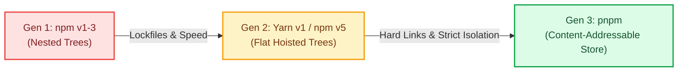

# Package Managers, Monorepos & Workspace Architecture Master Cheat Sheet

A comprehensive, production-grade guide covering **`npm` vs. `yarn` vs. `pnpm` vs. `bun`**, the **internal mechanics of Content-Addressable Storage (CAS)**, **Phantom Dependencies**, **Zero-Installs & Remote Caching**, **Docker Monorepo Pruning (`pnpm deploy` / `turbo prune`)**, **Hot-Patching (`pnpm patch`)**, and **Enterprise Supply Chain Security**.

---

## Table of Contents

- [Package Managers, Monorepos \& Workspace Architecture Master Cheat Sheet](#package-managers-monorepos--workspace-architecture-master-cheat-sheet)
  - [Table of Contents](#table-of-contents)
  - [1. The Evolution \& Hierarchy (`pnpm > Yarn > npm`)](#1-the-evolution--hierarchy-pnpm--yarn--npm)
    - [The Production Hierarchy Rule](#the-production-hierarchy-rule)
  - [2. Internal Mechanics: Why pnpm Crushes npm \& Yarn at Scale](#2-internal-mechanics-why-pnpm-crushes-npm--yarn-at-scale)
    - [The Phantom Dependency Trap (Hoisting Bug)](#the-phantom-dependency-trap-hoisting-bug)
      - [The Production Hazard](#the-production-hazard)
    - [Content-Addressable Storage \& Hard Links](#content-addressable-storage--hard-links)
      - [What is a Hard Link?](#what-is-a-hard-link)
  - [3. Configuration \& Metadata Files Decoded (.npmrc, pnpm-lock.yaml vs. pnpm-workspace.yaml)](#3-configuration--metadata-files-decoded-npmrc-pnpm-lockyaml-vs-pnpm-workspaceyaml)
    - [3.1. The Purpose of `.npmrc`](#31-the-purpose-of-npmrc)
      - [A. Why `update-notifier=false`?](#a-why-update-notifierfalse)
      - [B. Why `prefer-offline=true`?](#b-why-prefer-offlinetrue)
      - [C. Other Common Enterprise `.npmrc` Uses](#c-other-common-enterprise-npmrc-uses)
    - [3.2. Why Two YAML Files? (`pnpm-lock.yaml` vs. `pnpm-workspace.yaml`)](#32-why-two-yaml-files-pnpm-lockyaml-vs-pnpm-workspaceyaml)
      - [1. `pnpm-lock.yaml` (The Cryptographic Lockfile)](#1-pnpm-lockyaml-the-cryptographic-lockfile)
      - [2. `pnpm-workspace.yaml` (The Monorepo Topology)](#2-pnpm-workspaceyaml-the-monorepo-topology)
  - [4. Corepack: Zero-Install Deterministic Toolchains](#4-corepack-zero-install-deterministic-toolchains)
    - [3.1. Enable Corepack Once on Your Machine](#31-enable-corepack-once-on-your-machine)
    - [3.2. Declare in `package.json`](#32-declare-in-packagejson)
  - [5. Zero-Installs, Cold Builds, Warm Builds \& Remote Caching](#5-zero-installs-cold-builds-warm-builds--remote-caching)
    - [4.1. What is "Zero-Install"? (Yarn PnP vs. pnpm Store)](#41-what-is-zero-install-yarn-pnp-vs-pnpm-store)
      - [The Trade-offs of Zero-Install](#the-trade-offs-of-zero-install)
      - [How `pnpm` Achieves "Near-Zero Install" Without Git Bloat](#how-pnpm-achieves-near-zero-install-without-git-bloat)
    - [4.2. Cold Install vs. Warm Install Breakdown](#42-cold-install-vs-warm-install-breakdown)
    - [4.3. Cold Build vs. Warm Build vs. Remote Computation Cache](#43-cold-build-vs-warm-build-vs-remote-computation-cache)
      - [The Power of Remote Caching (Turborepo + Vercel / S3)](#the-power-of-remote-caching-turborepo--vercel--s3)
    - [4.4. CI/CD GitHub Actions Optimization Recipe](#44-cicd-github-actions-optimization-recipe)
  - [6. Peer Dependencies, Overrides \& Resolving Lockfile Conflicts](#6-peer-dependencies-overrides--resolving-lockfile-conflicts)
    - [6.1. The React 18 vs. 19 Peer Dependency Trap](#61-the-react-18-vs-19-peer-dependency-trap)
      - [The Anti-Pattern: `--legacy-peer-deps`](#the-anti-pattern---legacy-peer-deps)
      - [The pnpm Deterministic Solution: Virtual Store Grouping](#the-pnpm-deterministic-solution-virtual-store-grouping)
    - [6.2. Deep Dependency Overrides (`pnpm.overrides`)](#62-deep-dependency-overrides-pnpmoverrides)
    - [6.3. Resolving Lockfile Git Merge Conflicts](#63-resolving-lockfile-git-merge-conflicts)
  - [7. Docker \& Containerization: Isolated Monorepo Deployments](#7-docker--containerization-isolated-monorepo-deployments)
    - [7.1. The Docker Monorepo Bloat Problem](#71-the-docker-monorepo-bloat-problem)
    - [7.2. Isolated Production Deployments via `pnpm deploy`](#72-isolated-production-deployments-via-pnpm-deploy)
    - [7.3. Multi-Stage Docker Layer Caching via `turbo prune`](#73-multi-stage-docker-layer-caching-via-turbo-prune)
  - [8. Hot-Patching Dependencies (`pnpm patch`)](#8-hot-patching-dependencies-pnpm-patch)
  - [9. Enterprise Supply Chain Security \& Scoped Registries](#9-enterprise-supply-chain-security--scoped-registries)
    - [9.1. Dependency Confusion Attacks](#91-dependency-confusion-attacks)
      - [The `.npmrc` Defense](#the-npmrc-defense)
    - [9.2. Sandboxed Native Build Scripts (`pnpm approve-builds`)](#92-sandboxed-native-build-scripts-pnpm-approve-builds)
  - [10. Master Comparison Matrix (Including Bun)](#10-master-comparison-matrix-including-bun)
  - [11. Monorepos: Workspaces, Turborepo \& Nx](#11-monorepos-workspaces-turborepo--nx)
    - [pnpm Workspaces (`pnpm-workspace.yaml`)](#pnpm-workspaces-pnpm-workspaceyaml)
      - [The `workspace:*` Protocol](#the-workspace-protocol)
    - [Build Orchestration: Turborepo vs. Nx](#build-orchestration-turborepo-vs-nx)
      - [Turborepo (`turbo.json`)](#turborepo-turbojson)
      - [Turborepo vs. Nx Comparison](#turborepo-vs-nx-comparison)
  - [12. Architecture Guide: Micro-Frontends \& Microservices](#12-architecture-guide-micro-frontends--microservices)
    - [Scenario A: Monorepo with Multiple Micro-Frontends](#scenario-a-monorepo-with-multiple-micro-frontends)
    - [Scenario B: High-Volume CI/CD Deployment Pipelines](#scenario-b-high-volume-cicd-deployment-pipelines)
    - [Scenario C: Microservices with Independent Deployments](#scenario-c-microservices-with-independent-deployments)
  - [13. Complete CLI Command Reference](#13-complete-cli-command-reference)
    - [13.1. Everyday Essentials](#131-everyday-essentials)
    - [13.2. Monorepo Multi-Package Filtering (`--filter` / `-F`)](#132-monorepo-multi-package-filtering---filter---f)
    - [13.3. Maintenance, Cleaning \& Store Management](#133-maintenance-cleaning--store-management)
    - [13.4. Hot-Patching \& Lockfile Repair](#134-hot-patching--lockfile-repair)

---

## 1. The Evolution & Hierarchy (`pnpm > Yarn > npm`)

Over the last decade, JavaScript package management evolved across three distinct generations to solve **dependency hell, hoisting bugs, disk duplication, and monorepo scaling**:

```
┌──────────────────────────────────────────────────────────────────────────────────────────────────┐
│                                   PACKAGE MANAGER GENERATIONS                                    │
├───────────────┬───────────────────────────────────┬──────────────────────────────────────────────┤
│ Generation 1  │ npm v1 - v3 (Nested Trees)        │ Giant deeply nested node_modules, duplicated │
│               │ (2010 - 2015)                     │ packages, path length limit errors on Windows │
├───────────────┼───────────────────────────────────┼──────────────────────────────────────────────┤
│ Generation 2  │ Yarn v1 & npm v5 (Flat Hoisting)  │ Deterministic lockfiles, flat node_modules,  │
│               │ (2016 - 2020)                     │ but introduced PHANTOM DEPENDENCIES bug      │
├───────────────┼───────────────────────────────────┼──────────────────────────────────────────────┤
│ Generation 3  │ pnpm (Content-Addressable Store)  │ Non-flat isolated symlinks, hard links,      │
│               │ & Yarn Berry PnP (2020 - Present) │ O(1) disk space, 3x faster, 100% strictness  │
└───────────────┴───────────────────────────────────┴──────────────────────────────────────────────┘
```



### The Production Hierarchy Rule

$$\mathbf{pnpm} \succ \mathbf{Yarn\ (Modern)} \succ \mathbf{npm}$$

- **pnpm (Recommended Standard)**: Default choice for standalone apps, design systems, and enterprise monorepos. Fast cold installs, instantaneous warm installs, zero disk duplication across projects, and strict isolation.
- **Yarn Modern (v3/v4 Berry)**: Excellent for teams using Plug'n'Play (PnP) or Zero-Installs (committing zip caches to Git), but has steeper configuration overhead.
- **npm (Baseline Fallback)**: Ships with Node.js. Useful for minimal quick scripts, but scales poorly in large projects and monorepos due to duplicate disk consumption and hoisting bugs.

---

## 2. Internal Mechanics: Why pnpm Crushes npm & Yarn at Scale

### The Phantom Dependency Trap (Hoisting Bug)

In `npm` and `Yarn Classic`, dependencies are **hoisted** to the root of `node_modules` to avoid deep nesting:

```
YOUR APP (package.json):
  └── dependencies: { "foo": "1.0.0" }   <-- You ONLY declared 'foo'

FOO'S DEPENDENCIES:
  └── dependencies: { "bar": "2.0.0" }

NPM / YARN FLAT HOISTING:
node_modules/
├── foo/
└── bar/   <-- HOISTED TO TOP LEVEL!
```

#### The Production Hazard

Because `bar` is hoisted to the root of `node_modules`, developer code can write:

```ts
import bar from 'bar'; // Works locally without compile error!
```

Even though `bar` is **NOT declared in your `package.json`**!

- **The Crash**: Weeks later, `foo` updates and drops `bar`. Your local build or production CI/CD suddenly fails with `Cannot find module 'bar'`.
- **pnpm Solution**: `pnpm` creates a **non-flat, symlinked directory structure**. Your project root `node_modules` _only_ contains symlinks to packages explicitly declared in your `package.json`. Phantom imports throw an immediate, deterministic error during development!

---

### Content-Addressable Storage & Hard Links

```
NPM / YARN DISK CONSUMPTION (10 Projects = 5.0 GB):
Project 1 ➔ node_modules/react (500MB)
Project 2 ➔ node_modules/react (500MB)  <-- Duplicate copy on disk!
Project 10 ➔ node_modules/react (500MB) <-- Duplicate copy on disk!

PNPM GLOBAL STORE DEDUPLICATION (10 Projects = 500 MB Total!):
┌────────────────────────────────────────────────────────┐
│ Global Content-Addressable Store (~/.pnpm-store)       │
│ Stores react@18.3.1 ONCE by content hash               │
└───────────┬────────────────┬────────────────┬──────────┘
            │ (Hard Link)    │ (Hard Link)    │ (Hard Link)
            ▼                ▼                ▼
       Project 1        Project 2        Project 10
       (0 extra MB)     (0 extra MB)     (0 extra MB)
```

#### What is a Hard Link?

A **hard link** points directly to the file's raw inode on your disk storage. It is not an alias; it is an identical pointer to the same physical disk sectors.

- Modifying nothing consumes **zero additional disk bytes**.
- When you run `pnpm install` across 15 projects on your laptop, **packages are linked in milliseconds** without copying files or re-downloading bytes over the network!

---

## 3. Configuration & Metadata Files Decoded (.npmrc, pnpm-lock.yaml vs. pnpm-workspace.yaml)

### 3.1. The Purpose of `.npmrc`

The `.npmrc` (Node Package Manager Run Commands) file is the **runtime configuration contract** for `npm` and `pnpm`. It sets environment rules, registry endpoints, network behaviors, and dependency resolution policies for your project.

---

#### A. Why `update-notifier=false`?

- **What happens by default**: Every single time you run any CLI command (`pnpm dev`, `pnpm build`, `pnpm test`), `pnpm` fires an asynchronous background network request to `https://registry.npmjs.org/pnpm` to check if a newer CLI version is available.
- **Why it breaks**:
  - **Network Overhead**: Adds 200ms–500ms of latency to every command.
  - **Corporate Proxies / Air-Gapped / Sandbox Failures**: In offline environments, corporate networks, or secure agent sandboxes without public internet access, this unsolicited network call fails with `HTTP 403 Forbidden` or `ETIMEDOUT`, printing warnings into terminal logs.
- **The Fix**: `update-notifier=false` mutes the background network check, ensuring instant, silent, and resilient execution.

---

#### B. Why `prefer-offline=true`?

- **What happens by default**: When you run `pnpm install`, `pnpm` queries the remote npm registry to verify whether newer metadata or patch releases exist for your dependencies.
- **The Fix**: `prefer-offline=true` tells `pnpm` to prioritize packages already stored in your local Content-Addressable Store (`~/.pnpm-store`). It only reaches out to the remote network if a required package version does NOT exist on your disk.
- **Benefits**:
  - **Installs run up to 5x faster** (1–2 seconds).
  - **Saves local and corporate network bandwidth**.
  - **Enables 100% offline development** (e.g., coding on an airplane or spotty Wi-Fi).

---

#### C. Other Common Enterprise `.npmrc` Uses

In large-scale production repositories and enterprise teams, `.npmrc` governs security, peer dependencies, and compatibility:

| Directive                                       | Enterprise Purpose                               | Impact                                                                                                                                |
| :---------------------------------------------- | :----------------------------------------------- | :------------------------------------------------------------------------------------------------------------------------------------ |
| `@mycompany:registry=https://...`               | **Scoped Private Registries**                    | Directs internal packages to private feeds (GitHub Packages, Artifactory, AWS CodeArtifact). Prevents Dependency Confusion attacks.   |
| `//registry.npmjs.org/:_authToken=${NPM_TOKEN}` | **CI/CD Authentication**                         | Injects deployment/publishing credentials securely via environment variables without hardcoding secrets.                              |
| `auto-install-peers=true`                       | **Automatic Peer Dependencies**                  | Automatically installs required peer dependencies instead of throwing fatal install errors.                                           |
| `strict-peer-dependencies=false`                | **Flexible Peer Resolution**                     | Prevents builds from halting if peer dependency versions have non-breaking semantic mismatches.                                       |
| `engine-strict=true`                            | **Runtime Enforcement**                          | Hard-fails the install if the engineer's Node.js or pnpm version does not match `package.json` engines.                               |
| `shamefully-hoist=true`                         | **Legacy Migration Bridge**                      | Hoists all sub-dependencies to root `node_modules` like npm/yarn. Useful only when migrating legacy apps with broken phantom imports. |
| `node-linker=hoisted`                           | **React Native / Electron / Tool Compatibility** | Generates a flat `node_modules` tree without symlinks for tools that cannot resolve symlinks (e.g., Metro bundler).                   |
| `fetch-retries=3`                               | **Network Resilience**                           | Automatically retries failed package tarball downloads up to 3 times on unstable CI connections.                                      |

```ini
# Production Enterprise .npmrc Blueprint
# ----------------------------------------------------
# 1. Performance & Offline Resilience
update-notifier=false
prefer-offline=true

# 2. Scoped Registries & Auth
@myorg:registry=https://npm.pkg.github.com
//npm.pkg.github.com/:_authToken=${GITHUB_TOKEN}

# 3. Peer Dependencies & Compatibility
auto-install-peers=true
strict-peer-dependencies=false

# 4. Engine & Environment Integrity
engine-strict=true
fetch-retries=3
```

---

### 3.2. Why Two YAML Files? (`pnpm-lock.yaml` vs. `pnpm-workspace.yaml`)

Teams new to `pnpm` often ask why two distinct `.yaml` files exist in the repository root:

```
┌──────────────────────────────────────────────────────────────────────────────────────────────────┐
│                             TWO YAML FILES: ROLES & RESPONSIBILITIES                             │
├───────────────────────┬────────────────────────────────────────┬─────────────────────────────────┤
│ Dimension             │ pnpm-lock.yaml                         │ pnpm-workspace.yaml             │
├───────────────────────┼────────────────────────────────────────┼─────────────────────────────────┤
│ **Role**              │ Exact Dependency State Lock            │ Monorepo Topology Descriptor    │
├───────────────────────┼────────────────────────────────────────┼─────────────────────────────────┤
│ **Author**            │ Machine-generated by pnpm CLI          │ Handcrafted by the Engineer     │
├───────────────────────┼────────────────────────────────────────┼─────────────────────────────────┤
│ **Contents**          │ Cryptographic SHA-512 hashes, resolved │ Glob patterns defining packages │
│                       │ versions, exact transitive graph       │ (apps/*, packages/*)            │
├───────────────────────┼────────────────────────────────────────┼─────────────────────────────────┤
│ **Analogy**           │ The architectural "as-built" blueprint │ The neighborhood "zoning map"   │
├───────────────────────┼────────────────────────────────────────┼─────────────────────────────────┤
│ **When it changes**   │ Whenever packages are added/updated    │ Only when repo structure changes│
├───────────────────────┼────────────────────────────────────────┼─────────────────────────────────┤
│ **Commit to Git?**    │ **YES (Always)**                       │ **YES (Always in Monorepos)**   │
└───────────────────────┴────────────────────────────────────────┴─────────────────────────────────┘
```

#### 1. `pnpm-lock.yaml` (The Cryptographic Lockfile)

- Analogous to `package-lock.json` in `npm` or `yarn.lock` in `yarn`.
- Records the **exact, immutable resolution** of every single direct and transitive package.
- **Why it is mandatory**: Guarantees that every developer on your team and every CI/CD deployment container compiles against the exact same binary bits, eliminating _"it worked on my machine"_ drift.

#### 2. `pnpm-workspace.yaml` (The Monorepo Topology)

- Only exists in monorepo workspaces.
- Informs `pnpm` which directories are local workspace packages:
  ```yaml
  packages:
    - 'apps/*'
    - 'packages/*'
    - 'services/*'
  ```
- **Enables the `workspace:*` protocol**: Allows `apps/web` to depend on `packages/ui` as a live local symlink with zero npm publishing.

---

## 4. Corepack: Zero-Install Deterministic Toolchains

Historically, teams suffered from the _"works on my machine"_ problem because Developer A used `pnpm 9`, Developer B used `npm 10`, and CI ran `Yarn 1`.

Node.js (v16.9+) includes **Corepack**, an official binary manager that automatically downloads and executes the exact package manager version specified by the project:

### 3.1. Enable Corepack Once on Your Machine

```bash
corepack enable
```

### 3.2. Declare in `package.json`

```json
{
  "name": "enterprise-platform",
  "packageManager": "pnpm@11.5.2"
}
```

Now, whenever any developer or CI runner types `pnpm`, Corepack intercepts the command, guarantees `pnpm@11.5.2` is used, and prevents accidental use of `npm` or `yarn`!

---

## 5. Zero-Installs, Cold Builds, Warm Builds & Remote Caching

In modern frontend systems, build and installation performance are divided into distinct execution phases:

```
┌──────────────────────────────────────────────────────────────────────────────────────────────────┐
│                                 INSTALLATION & BUILD TAXONOMY                                    │
├───────────────────┬──────────────────────────────────────────┬───────────────────────────────────┤
│ Concept           │ What Happens Internally                  │ Duration Benchmark                │
├───────────────────┼──────────────────────────────────────────┼───────────────────────────────────┤
│ **Cold Install**  │ Empty cache. Resolves registry, downloads│ 60s – 180s (Network-bound)        │
│                   │ all tarballs, builds native binaries     │                                   │
├───────────────────┼──────────────────────────────────────────┼───────────────────────────────────┤
│ **Warm Install**  │ Tarballs exist in global cache/store.    │ npm: 30s–60s (copies files)       │
│                   │ Links dependencies into node_modules     │ pnpm: 1s–3s (hard-links inodes)   │
├───────────────────┼──────────────────────────────────────────┼───────────────────────────────────┤
│ **Zero-Install**  │ Dependencies committed directly into Git │ **0.00 seconds**                  │
│                   │ (.yarn/cache). No install command run    │ (Instant checkout)                │
├───────────────────┼──────────────────────────────────────────┼───────────────────────────────────┤
│ **Cold Build**    │ Empty compilation cache. Compiles 100% of│ 2m – 10m (CPU/Memory bound)       │
│                   │ TypeScript, bundles, minifies chunks     │                                   │
├───────────────────┼──────────────────────────────────────────┼───────────────────────────────────┤
│ **Warm Build**    │ Local cache hit (.turbo/.next/dist).     │ Unchanged: **0s (FULL TURBO)**    │
│                   │ Recompiles ONLY modified source packages │ Modified: 2s – 10s                │
├───────────────────┼──────────────────────────────────────────┼───────────────────────────────────┤
│ **Remote Cache**  │ Cold CI runner fetches pre-compiled      │ Turns a Cold CI Build into a      │
│                   │ build artifacts by cryptographic hash    │ **Warm Build in seconds**         │
└───────────────────┴──────────────────────────────────────────┴───────────────────────────────────┘
```

---

### 4.1. What is "Zero-Install"? (Yarn PnP vs. pnpm Store)

Pioneered by **Yarn Modern (Berry) Plug'n'Play (PnP)**:

- Instead of running `npm install` after cloning a repository, all third-party dependencies are compressed as `.zip` archives inside `.yarn/cache` and **committed directly into Git version control**.
- When you clone the repository or switch branches, **all dependencies are already on disk**. You can run `yarn start` immediately.

#### The Trade-offs of Zero-Install

- **The Good**: 0-second CI setup, zero network dependency during deploys, 100% offline development.
- **The Bad**:
  - **Git Bloat**: Committing binary zip files balloons your `.git` folder size by hundreds of megabytes.
  - **Merge Conflicts**: Updating dependencies creates binary merge conflicts in `.yarn/cache`.
  - **Tooling Incompatibilities**: PnP replaces `node_modules` with a `.pnp.cjs` resolution map, requiring IDE SDK patches (`@yarnpkg/sdks`) and breaking legacy tools that expect physical folder paths.

#### How `pnpm` Achieves "Near-Zero Install" Without Git Bloat

Rather than committing dependencies to Git, `pnpm` caches packages in a **Content-Addressable Store**. In CI/CD pipelines (GitHub Actions), caching `~/.local/share/pnpm/store` allows `pnpm install` to finish in **2 to 4 seconds** simply by hard-linking cached inodes without bloating your Git history.

---

### 4.2. Cold Install vs. Warm Install Breakdown

```mermaid
flowchart TD
    subgraph ColdInstall["Cold Install (Empty Machine)"]
        A1["pnpm install"] --> B1["Query npm Registry"]
        B1 --> C1["Download Compressed Tarballs"]
        C1 --> D1["Write to Global Store (~/.pnpm-store)"]
        D1 --> E1["Create Hard Links into Project node_modules"]
    end

    subgraph WarmInstall["Warm Install (Packages Cached in Store)"]
        A2["pnpm install"] --> D2["Read pnpm-lock.yaml"]
        D2 --> E2["Hard Link Existing Inodes directly (1-2s)"]
    end

    style ColdInstall fill:#fee2e2,stroke:#ef4444,stroke-width:2px,color:#7f1d1d
    style WarmInstall fill:#dcfce7,stroke:#16a34a,stroke-width:2px,color:#14532d
```



1. **Cold Install Steps**:
   - `npm` / `yarn`: Downloads tarballs, unzips them into `node_modules`, and writes a flat hoisted tree.
   - `pnpm`: Downloads tarballs into `~/.pnpm-store` by content hash, verifies integrity, and hard-links files into `node_modules/.pnpm/`.
2. **Warm Install Steps**:
   - `npm`: Still copies and extracts files from `~/.npm` into the local `node_modules` directory (30–60 seconds).
   - `pnpm`: Checks lockfile hashes, verifies the global store, and creates hard-link pointers in **1–3 seconds**.

---

### 4.3. Cold Build vs. Warm Build vs. Remote Computation Cache

In monorepos and enterprise applications, **compilation time dwarfs installation time**. Build orchestrators (**Turborepo**, **Nx**) eliminate redundant compilation using **Cryptographic Input Hashing**:

$$\text{Task Hash} = \text{Hash}(\text{Source Files} + \text{Dependencies} + \text{Environment Variables} + \text{Tooling Config})$$

```
DEVELOPER / CI RUNNER RUNS: pnpm build
                │
                ▼
       [ Compute Task Hash ]
                │
         ┌──────┴──────┐
         ▼             ▼
   [ Cache HIT ]  [ Cache MISS ]
         │             │
         │             └─► Execute compiler (tsc / vite / webpack)
         │                 Save output to local .turbo/ cache & Remote Cache
         ▼
[ Restore from Cache ]
(Outputs dist/** in 0ms, ">>> FULL TURBO")
```

#### The Power of Remote Caching (Turborepo + Vercel / S3)

- On a **Cold CI Runner** (brand new virtual machine with zero local files):
  1. The CI runner computes the task hash for each package.
  2. It queries the **Remote Cache** (Vercel Remote Cache or self-hosted S3/GCS bucket).
  3. If another team member or pull request already built that exact commit hash, Turborepo downloads the compiled `dist/` directory directly over HTTP.
  4. The **Cold CI Build runs in 3 seconds** instead of 5 minutes!

---

### 4.4. CI/CD GitHub Actions Optimization Recipe

Production workflow demonstrating **fast pnpm caching + Turborepo remote caching**:

```yaml
name: CI Pipeline

on: [push, pull_request]

jobs:
  build-and-test:
    runs-on: ubuntu-latest
    steps:
      - name: Checkout Repository
        uses: actions/checkout@v4

      - name: Install pnpm via Corepack
        uses: pnpm/action-setup@v4
        with:
          run_install: false

      - name: Setup Node.js with pnpm Store Caching
        uses: actions/setup-node@v4
        with:
          node-version: 20
          cache: 'pnpm'

      # Fast Warm Install: Restores from GitHub Actions pnpm store cache (~3-5s)
      - name: Install Dependencies
        run: pnpm install --frozen-lockfile

      # Turborepo Build with Remote Caching
      - name: Build Monorepo (FULL TURBO)
        run: pnpm turbo run build --remote-only
        env:
          TURBO_TOKEN: ${{ secrets.TURBO_TOKEN }}
          TURBO_TEAM: ${{ vars.TURBO_TEAM }}
```

---

## 6. Peer Dependencies, Overrides & Resolving Lockfile Conflicts

### 6.1. The React 18 vs. 19 Peer Dependency Trap

In enterprise frontends, updating React often fails because third-party packages declare rigid peer dependency constraints:

```
npm error ERESOLVE unable to resolve dependency tree
Found: react@19.0.0
Could not resolve dependency:
peer react@"^18.0.0" from react-virtualized-select@3.1.3
```

#### The Anti-Pattern: `--legacy-peer-deps`

Running `npm install --legacy-peer-deps` disables peer dependency resolution globally, risking silent runtime crashes when incompatible APIs are invoked.

#### The pnpm Deterministic Solution: Virtual Store Grouping

`pnpm` isolates packages based on their exact peer dependency graph:

- If Package A needs React 18 and Package B needs React 19, `pnpm` creates two separate virtual folders in `.pnpm`:
  - `.pnpm/package-a@1.0.0_react@18.3.1/`
  - `.pnpm/package-b@1.0.0_react@19.0.0/`

---

### 6.2. Deep Dependency Overrides (`pnpm.overrides`)

When an indirect dependency has a known security vulnerability or needs an unblocked version:

```json
// package.json
{
  "pnpm": {
    "overrides": {
      "semver@<7.5.2": ">=7.5.2",
      "react-virtualized-select>react": "^19.0.0"
    },
    "peerDependencyRules": {
      "ignoreMissing": ["@types/react"]
    }
  }
}
```

---

### 6.3. Resolving Lockfile Git Merge Conflicts

Never delete your lockfile when a merge conflict occurs! Deleting `pnpm-lock.yaml` and re-running install resolves all packages to latest matching semver ranges, silently introducing untested breaking changes into production.

```bash
# 1. Check out whichever side has the most recent changes
git checkout --ours pnpm-lock.yaml

# 2. Tell pnpm to automatically reconcile the lockfile against package.json
pnpm install --fix-lockfile

# 3. Verify lockfile integrity
pnpm install --frozen-lockfile
```

> 🛡️ **CI Invariant**: In CI/CD pipelines, ALWAYS enforce `pnpm install --frozen-lockfile` (or `npm ci`). If a developer modified `package.json` without updating the lockfile, the CI build will fail immediately rather than silently building out-of-date assets.

---

## 7. Docker & Containerization: Isolated Monorepo Deployments

### 7.1. The Docker Monorepo Bloat Problem

In a monorepo with 30 micro-frontends and backend services, creating a Docker image for `apps/api` should NOT copy the entire 2.5 GB monorepo into the container.

```
ANTI-PATTERN: Monorepo Docker Bloat               BEST PRACTICE: Isolated Pruning
┌──────────────────────────────────────┐          ┌──────────────────────────────────────┐
│ Docker Container (2.5 GB)            │          │ Docker Container (48 MB)             │
│ • apps/web                           │          │ • apps/api (Code only)               │
│ • apps/admin                         │          │ • @org/utils (Exact compiled bundle) │
│ • apps/api (What you actually want)  │          │ • node_modules (Only api transitive) │
│ • 10,000 irrelevant node_modules     │          └──────────────────────────────────────┘
└──────────────────────────────────────┘
```

---

### 7.2. Isolated Production Deployments via `pnpm deploy`

`pnpm deploy` extracts a single package from a monorepo workspace into an isolated, production-ready directory with zero symlinks to the rest of the workspace:

```bash
# Deploys 'apps/api' into '/deploy/api' with only its production dependencies
pnpm --filter=api deploy /deploy/api --prod
```

---

### 7.3. Multi-Stage Docker Layer Caching via `turbo prune`

Turborepo provides `turbo prune --scope=<app> --docker`, splitting your monorepo into two folders:

1. `out/json`: Package.json files and lockfile (caches Docker dependency layer).
2. `out/full`: Actual source code files.

```dockerfile
# Multi-Stage Dockerfile for Monorepos
FROM node:20-alpine AS base
RUN corepack enable && corepack prepare pnpm@11.5.2 --activate

# Step 1: Prune monorepo to only relevant app
FROM base AS pruner
WORKDIR /app
RUN pnpm add -g turbo
COPY . .
RUN turbo prune web --docker

# Step 2: Install dependencies (Cached layer!)
FROM base AS installer
WORKDIR /app
COPY --from=pruner /app/out/json/ .
COPY --from=pruner /app/out/pnpm-lock.yaml .
RUN pnpm install --frozen-lockfile

# Step 3: Build application
COPY --from=pruner /app/out/full/ .
RUN pnpm turbo run build --filter=web...

# Step 4: Lean production runner
FROM base AS runner
WORKDIR /app
COPY --from=installer /app/apps/web/dist ./dist
CMD ["pnpm", "start"]
```

---

## 8. Hot-Patching Dependencies (`pnpm patch`)

When you discover an upstream bug in an open-source library and cannot wait 2 weeks for the maintainers to merge a pull request:

```bash
# Step 1: Open an isolated temporary patch directory
pnpm patch lucide-react@0.300.0

# Output: You can now edit the following folder: /private/var/folders/...

# Step 2: Fix the bug directly in the files inside that folder

# Step 3: Commit the patch
pnpm patch-commit /private/var/folders/...
```

`pnpm` automatically generates a file `patches/lucide-react@0.300.0.patch` and adds a reference to your root `package.json`:

```json
{
  "pnpm": {
    "patchedDependencies": {
      "lucide-react@0.300.0": "patches/lucide-react@0.300.0.patch"
    }
  }
}
```

Whenever any developer or CI runner runs `pnpm install`, your patch is **automatically applied on-the-fly**!

---

## 9. Enterprise Supply Chain Security & Scoped Registries

### 9.1. Dependency Confusion Attacks

An attacker publishes a public package on `npmjs.com` with the identical name of your private company package (`@mycompany/auth`). If misconfigured, your build system downloads the attacker's public package.

#### The `.npmrc` Defense

Pin internal scopes strictly to your private registry:

```ini
# .npmrc
@mycompany:registry=https://npm.pkg.github.com
//npm.pkg.github.com/:_authToken=${GITHUB_TOKEN}

# Always enforce strict peer dependency rules
strict-peer-dependencies=false
auto-install-peers=true
```

---

### 9.2. Sandboxed Native Build Scripts (`pnpm approve-builds`)

Malicious packages use `postinstall` scripts to exfiltrate environment variables. Modern `pnpm` (v11+) ignores all build scripts by default until explicitly audited:

```bash
# Review and approve legitimate build scripts (e.g. esbuild)
pnpm approve-builds
```

---

## 10. Master Comparison Matrix (Including Bun)

| Dimension                 | `npm` (v10+)              | `yarn` (v1 Classic)       | `yarn` (v4 Berry)                 | `pnpm` (v11+)                          | `bun` (v1+)                      |
| :------------------------ | :------------------------ | :------------------------ | :-------------------------------- | :------------------------------------- | :------------------------------- |
| **Storage Engine**        | Flat hoisted copies       | Flat hoisted copies       | Plug'n'Play (Zip cache)           | Content-Addressable Store (Hard links) | Global binary cache + Hard links |
| **Language Engine**       | JavaScript (V8)           | JavaScript (V8)           | JavaScript (V8)                   | JavaScript (V8)                        | **Zig / C++ Native**             |
| **Disk Space (10 Repos)** | Massive (10x duplication) | Massive (10x duplication) | Low                               | **Optimal (1x shared storage)**        | Optimal                          |
| **Cold Install Speed**    | Slow                      | Moderate                  | Fast                              | **Fastest (Node)**                     | **Fastest (Native)**             |
| **Warm Install Speed**    | Moderate                  | Fast                      | Very Fast                         | **Near Instantaneous (1-3s)**          | **Instantaneous (<1s)**          |
| **Zero-Install Support**  | ❌ No                     | ❌ No                     | ✅ Yes (committing `.yarn/cache`) | ⚠️ Near-Zero (store cache)             | ❌ No                            |
| **Phantom Dependencies**  | Vulnerable                | Vulnerable                | Protected                         | **Strictly Blocked by Default**        | Vulnerable (Flat hoisted)        |
| **Patching Built-in**     | ❌ Third-party            | ❌ Third-party            | ✅ `yarn patch`                   | ✅ `pnpm patch`                        | ✅ `bun patch`                   |
| **Docker Pruning**        | ❌ Manual                 | ❌ Manual                 | ❌ Complex                        | ✅ `pnpm deploy`                       | ❌ Manual                        |
| **Monorepo Standard**     | Basic                     | Good                      | Advanced                          | **Industry Benchmark**                 | Developing                       |

---

## 11. Monorepos: Workspaces, Turborepo & Nx

When an organization maintains multiple web apps, mobile clients, design systems, and backend microservices, a **Monorepo** coordinates changes atomically across packages.

```
┌─────────────────────────────────────────────────────────────────────────────┐
│                          MONOREPO ARCHITECTURE LAYERS                       │
├──────────────────────────┬──────────────────────────────────────────────────┤
│ Layer 1: Package Manager │ pnpm Workspaces (Links packages, handles deps)   │
├──────────────────────────┼──────────────────────────────────────────────────┤
│ Layer 2: Task Runner /   │ Turborepo or Nx (Computes task graph, pipelines, │
│ Orchestrator             │ topological execution, remote computation cache) │
├──────────────────────────┼──────────────────────────────────────────────────┤
│ Layer 3: Packages        │ apps/ (web, admin), packages/ (ui, utils, config)│
└──────────────────────────┴──────────────────────────────────────────────────┘
```

---

### pnpm Workspaces (`pnpm-workspace.yaml`)

Defines the project boundaries in the monorepo root:

```yaml
# pnpm-workspace.yaml
packages:
  - 'apps/*'
  - 'packages/*'
  - 'services/*'
```

#### The `workspace:*` Protocol

In `apps/web/package.json`, link internal packages without publishing to npm:

```json
{
  "dependencies": {
    "@org/ui": "workspace:*",
    "@org/utils": "workspace:^"
  }
}
```

`pnpm` creates a live symlink between `packages/ui` and `apps/web`. Edits made in `@org/ui` appear **immediately in `apps/web` with zero build or link steps**!

---

### Build Orchestration: Turborepo vs. Nx

While `pnpm` links packages together, it does not know **what order to run builds** or **how to cache test outputs across machines**. That is the job of a Build Orchestrator:

```
DEVELOPER RUNS: pnpm build
       │
       ▼
 [ Turborepo / Nx Task Graph Engine ]
       │
       ├─► 1. Check Hash: Have input files for @org/utils changed?
       │        └─ No ➔ RESTORE FROM CACHE (0ms, "FULL TURBO")
       │
       └─► 2. Run @org/ui build (depends on @org/utils)
                └─► Then run apps/web build concurrently
```

#### Turborepo (`turbo.json`)

Lightweight, high-speed build orchestrator written in Rust by Vercel:

```json
{
  "$schema": "https://turbo.build/schema.json",
  "tasks": {
    "build": {
      "dependsOn": ["^build"],
      "outputs": ["dist/**", ".next/**"]
    },
    "test": {
      "dependsOn": ["^build"],
      "outputs": []
    },
    "lint": {}
  }
}
```

#### Turborepo vs. Nx Comparison

| Feature             | Turborepo                                     | Nx                                                        |
| :------------------ | :-------------------------------------------- | :-------------------------------------------------------- |
| **Philosophy**      | Lightweight, configuration-over-convention    | Comprehensive, enterprise-grade tooling ecosystem         |
| **Core Engine**     | Rust (ultra-fast startup)                     | TypeScript / Rust plugins                                 |
| **Learning Curve**  | Very Low (single `turbo.json` file)           | Moderate to High (rich plugin architecture)               |
| **Remote Caching**  | Native Vercel Remote Cache / S3               | Nx Cloud / Self-hosted S3                                 |
| **Code Generators** | Basic templates                               | Powerful AST generators (`nx generate`)                   |
| **Best For**        | Next.js, Vite, React monorepos, fast adoption | Huge enterprise suites, multi-framework (Angular + React) |

---

## 12. Architecture Guide: Micro-Frontends & Microservices

### Scenario A: Monorepo with Multiple Micro-Frontends

- **Recommended Stack**: `pnpm Workspaces` + `Turborepo` + `Vite / Webpack Module Federation`.
- **Reason**: `pnpm` guarantees that shared singletons (e.g., `react`, `react-dom`) are pinned to identical versions across all remote containers, preventing multi-React instance runtime crashes.

### Scenario B: High-Volume CI/CD Deployment Pipelines

- **Recommended Stack**: `pnpm` with GitHub Actions Cache (`pnpm/action-setup`).
- **Why**: Traditional `npm install` downloads 300MB+ on every GitHub Actions runner. With `pnpm`, cached global store layers reduce CI dependency setup time from **3 minutes to under 12 seconds**.

### Scenario C: Microservices with Independent Deployments

- When microservices have completely independent release cycles and distinct cloud deployment targets, maintain separate repositories or use `pnpm --filter <service>` to isolate builds.

---

## 13. Complete CLI Command Reference

### 13.1. Everyday Essentials

```bash
# Install all dependencies in current project/workspace
pnpm install

# Add production dependency
pnpm add <package>

# Add dev dependency
pnpm add -D <package>

# Remove a package
pnpm remove <package>

# Run scripts defined in package.json
pnpm dev
pnpm build
pnpm test
```

### 13.2. Monorepo Multi-Package Filtering (`--filter` / `-F`)

```bash
# Run build ONLY in apps/web
pnpm --filter web build
pnpm -F web build

# Run build in packages/ui AND all packages that depend on it
pnpm --filter ...ui build

# Run build across ALL packages in the entire workspace concurrently
pnpm -r build
pnpm --recursive test
```

### 13.3. Maintenance, Cleaning & Store Management

```bash
# View location and size of global content-addressable store
pnpm store path
pnpm store status

# Clean unreferenced packages from global store (frees disk space)
pnpm store prune

# Nuclear clean reset (re-link all packages fresh)
rm -rf node_modules pnpm-lock.yaml
pnpm install
```

### 13.4. Hot-Patching & Lockfile Repair

```bash
# Patch a third-party package
pnpm patch <package-name>
pnpm patch-commit <path-to-temp-dir>

# Safely repair lockfile merge conflicts without blowing away dependencies
pnpm install --fix-lockfile
```
