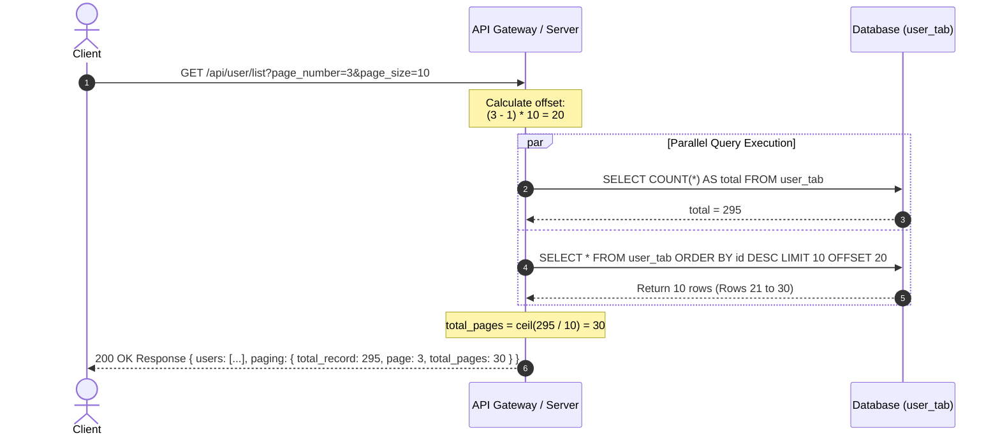
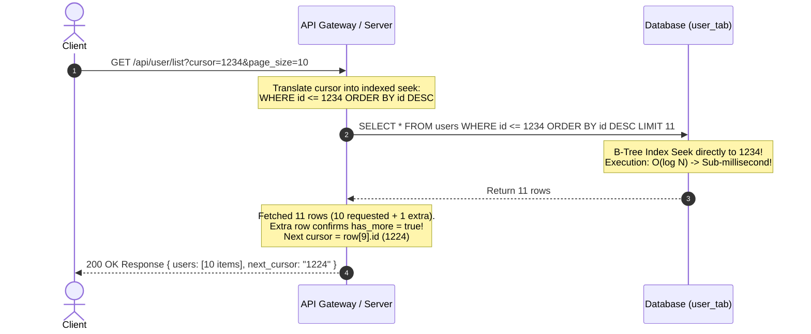
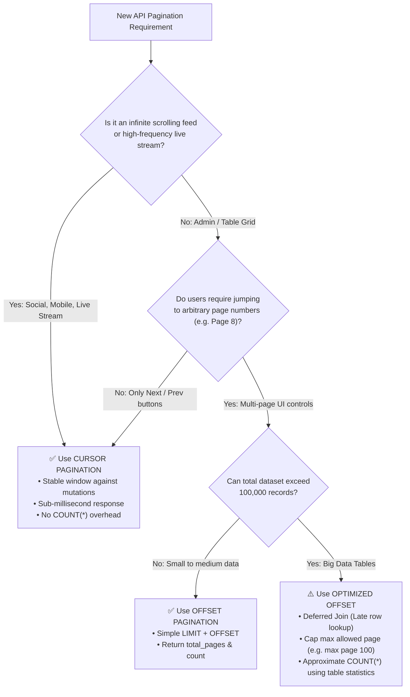

# API Pagination Architecture Master Cheat Sheet

A comprehensive, production-grade guide covering **Offset vs. Keyset vs. Cursor Pagination**, **SQL query performance ($O(N)$ vs $O(1)$)**, **Opaque Base64 compound tokens**, **Relay/GraphQL connection specs**, and **60 FPS frontend infinite stream caching**.

---

## Table of Contents

- [API Pagination Architecture Master Cheat Sheet](#api-pagination-architecture-master-cheat-sheet)
  - [Table of Contents](#table-of-contents)
  - [1. Architectural Overview \& Core Primitives](#1-architectural-overview--core-primitives)
  - [2. Pattern 1: Offset \& Limit Pagination](#2-pattern-1-offset--limit-pagination)
    - [2.1. How It Works \& Mermaid Pipeline](#21-how-it-works--mermaid-pipeline)
      - [Standard API Schema](#standard-api-schema)
    - [2.2. The $O(N)$ Deep Paging Inefficiency](#22-the-on-deep-paging-inefficiency)
    - [2.3. The Window Instability / Page Drift Problem](#23-the-window-instability--page-drift-problem)
      - [Scenario A: The Duplicate Item Hazard (Record Inserted)](#scenario-a-the-duplicate-item-hazard-record-inserted)
      - [Scenario B: The Missing Item Hazard (Record Deleted)](#scenario-b-the-missing-item-hazard-record-deleted)
    - [2.4. Optimization: Deferred Joins (Late Row Lookup)](#24-optimization-deferred-joins-late-row-lookup)
      - [Slow Naive Query (Scans full rows with all columns):](#slow-naive-query-scans-full-rows-with-all-columns)
      - [Fast Deferred Join (Covering Index Scan):](#fast-deferred-join-covering-index-scan)
    - [2.5. Pros and Cons of Offset Pagination](#25-pros-and-cons-of-offset-pagination)
      - [Advantages (Pros)](#advantages-pros)
      - [Disadvantages (Cons)](#disadvantages-cons)
  - [3. Pattern 2: Keyset \& Cursor-Based Pagination](#3-pattern-2-keyset--cursor-based-pagination)
    - [3.1. How It Works \& Mermaid Pipeline](#31-how-it-works--mermaid-pipeline)
    - [3.2. Common Approaches to Cursors: Evolution, Critiques \& Which is Best?](#32-common-approaches-to-cursors-evolution-critiques--which-is-best)
      - [Detailed Critique of Each Approach:](#detailed-critique-of-each-approach)
      - [🏆 The Verdict: Which Approach is Actually the Best in Production?](#-the-verdict-which-approach-is-actually-the-best-in-production)
    - [3.3. Step-by-Step Walkthrough: The `users` Table Example](#33-step-by-step-walkthrough-the-users-table-example)
      - [Step 1: Initial Query (First Page)](#step-1-initial-query-first-page)
      - [Step 2: Server-Side Processing for Initial Query](#step-2-server-side-processing-for-initial-query)
      - [Step 3: Fetching the Next Page](#step-3-fetching-the-next-page)
      - [Step 4: Server-Side Processing for Next Page](#step-4-server-side-processing-for-next-page)
      - [Server Response:](#server-response)
    - [3.4. Real-World Industry Case Studies](#34-real-world-industry-case-studies)
      - [A. Social Media Platforms (Twitter / X, Facebook, Instagram)](#a-social-media-platforms-twitter--x-facebook-instagram)
      - [B. The AWS DynamoDB Pattern (`LastEvaluatedKey` \& `ExclusiveStartKey`)](#b-the-aws-dynamodb-pattern-lastevaluatedkey--exclusivestartkey)
    - [3.5. Advantages \& Disadvantages of Cursor Pagination](#35-advantages--disadvantages-of-cursor-pagination)
      - [Advantages (Pros)](#advantages-pros-1)
      - [Disadvantages (Cons)](#disadvantages-cons-1)
    - [3.6. Why Query `LIMIT + 1`?](#36-why-query-limit--1)
    - [3.7. Sorting on Non-Unique Columns: The Tie-Breaker Demo](#37-sorting-on-non-unique-columns-the-tie-breaker-demo)
      - [Sample Dataset: `users`](#sample-dataset-users)
      - [Page 1: Fetch 2 records ordered by `first_name ASC`](#page-1-fetch-2-records-ordered-by-first_name-asc)
      - [❌ The Buggy Query (Naive Single-Column Cursor)](#-the-buggy-query-naive-single-column-cursor)
      - [✅ The Production Fix (Compound Keyset Tuple)](#-the-production-fix-compound-keyset-tuple)
    - [3.8. Opaque Base64 Encoding \& Payload Serialization](#38-opaque-base64-encoding--payload-serialization)
      - [Why Opaque Cursors are Mandatory:](#why-opaque-cursors-are-mandatory)
  - [4. Master Comparison Matrix](#4-master-comparison-matrix)
  - [5. Decision Tree: When to Use Which?](#5-decision-tree-when-to-use-which)
  - [6. API Design Standards](#6-api-design-standards)
    - [6.1. REST Cursor Specification](#61-rest-cursor-specification)
      - [Response Envelope:](#response-envelope)
    - [6.2. RFC 5988 Web Linking Header Standard](#62-rfc-5988-web-linking-header-standard)
    - [6.3. GraphQL Cursor Connections Specification (Relay Spec)](#63-graphql-cursor-connections-specification-relay-spec)
  - [7. Production Code Blueprints](#7-production-code-blueprints)
    - [7.1. Backend: High-Performance Compound Cursor Handler](#71-backend-high-performance-compound-cursor-handler)
    - [7.2. Frontend React: Infinite Cursor Feed with Duplicate Guards](#72-frontend-react-infinite-cursor-feed-with-duplicate-guards)
  - [8. Edge Cases, Pitfalls \& Production Rules of Engagement](#8-edge-cases-pitfalls--production-rules-of-engagement)
    - [Rule 1: The Index Mandate](#rule-1-the-index-mandate)
    - [Rule 2: Never Trust User Cursors](#rule-2-never-trust-user-cursors)
    - [Rule 3: Cap the Maximum Page Size](#rule-3-cap-the-maximum-page-size)
    - [Rule 4: Ban `COUNT(*)` in Cursor Feeds](#rule-4-ban-count-in-cursor-feeds)

---

## 1. Architectural Overview & Core Primitives

When returning large datasets (e.g. millions of rows), servers cannot serialize and transfer all records in a single HTTP response. **Pagination** partitions data into discrete, consumable batches.

```
┌──────────────────────────────────────────────────────────────────────────────────────────────────┐
│                                    PAGINATION PRIMITIVES                                         │
├───────────────────┬────────────────────────────────────────┬─────────────────────────────────────┤
│ Primitive         │ Definition                             │ Formula / Representation            │
├───────────────────┼────────────────────────────────────────┼─────────────────────────────────────┤
│ `limit` / `size`  │ Number of records to return per page   │ Default: 10 to 50 (Capped at 100)   │
├───────────────────┼────────────────────────────────────────┼─────────────────────────────────────┤
│ `page`            │ 1-indexed human-readable page number   │ Page 1, Page 2, Page 3...           │
├───────────────────┼────────────────────────────────────────┼─────────────────────────────────────┤
│ `offset` / `skip` │ Number of rows to skip before reading  │ $\text{offset} = (\text{page} - 1)  │
│                   │ records in the database                │ \times \text{limit}$                │
├───────────────────┼────────────────────────────────────────┼─────────────────────────────────────┤
│ `cursor`          │ An opaque pointer referencing the      │ Single: `1234`                      │
│                   │ exact boundary of the previous record  │ Compound: `eyJpZCI6MTIzNH0=`        │
├───────────────────┼────────────────────────────────────────┼─────────────────────────────────────┤
│ `has_more`        │ Boolean indicating whether more rows   │ Evaluated via `count > limit` or    │
│                   │ exist after the current batch          │ `LIMIT limit + 1` query trick       │
└───────────────────┴────────────────────────────────────────┴─────────────────────────────────────┘
```

---

## 2. Pattern 1: Offset & Limit Pagination

### 2.1. How It Works & Mermaid Pipeline

The client asks for a specific `page_number` and `page_size`. The server translates this into an SQL `LIMIT` and `OFFSET` clause, accompanied by a `COUNT(*)` query to calculate total pages.



#### Standard API Schema

```json
{
  "data": [
    { "id": 275, "name": "Alice" },
    { "id": 274, "name": "Bob" }
  ],
  "paging": {
    "total_records": 295,
    "page": 3,
    "page_size": 10,
    "total_pages": 30,
    "has_next": true,
    "has_prev": true
  }
}
```

---

### 2.2. The $O(N)$ Deep Paging Inefficiency

Why does `SELECT * FROM tbl ORDER BY id LIMIT 10 OFFSET 1000000;` take **10+ seconds**?

```
DATABASE DISK / INDEX SCAN (OFFSET 1,000,000):
┌─────────────────────────────────────────────────────────────┬─────────────┐
│ 1,000,000 Rows Read, Evaluated & DISCARDED!                 │ 10 Rows Kept│
│ ❌ Wasted disk I/O, B-tree traversal & memory allocation    │ ✅ Returned │
└─────────────────────────────────────────────────────────────┴─────────────┘
0                                                       1,000,000   1,000,010
```

1. The database engine **cannot jump directly** to row `1,000,000`.
2. It must traverse the index, load the pointers, read all `1,000,000` rows from disk into memory buffer, and **throw away 1,000,000 rows** just to return the remaining 10 rows!
3. Time complexity is **$O(N + M)$** where $N$ is the offset and $M$ is the limit. As $N \to \infty$, database CPU and memory crash.

---

### 2.3. The Window Instability / Page Drift Problem

Offset pagination assumes an immutable dataset. In high-velocity applications (Twitter, Instagram, Hotstar feeds), concurrent insertions or deletions break the pagination window:

#### Scenario A: The Duplicate Item Hazard (Record Inserted)

```
TIME T1 (User loads Page 1, items 1-3):
[Item 10, Item 9, Item 8] | [Item 7, Item 6, Item 5] ...
  └── Page 1 (Read) ──┘

TIME T2 (New item 11 inserted at the top of the database):
[Item 11, Item 10, Item 9, Item 8, Item 7, Item 6, Item 5] ...

TIME T3 (User requests Page 2: OFFSET 3 LIMIT 3):
Database skips 3 items [11, 10, 9] and returns:
[Item 8, Item 7, Item 6]
   ▲
   └── DUPLICATE! Item 8 was already seen by user on Page 1!
```

#### Scenario B: The Missing Item Hazard (Record Deleted)

- If an item on Page 1 is deleted before Page 2 is requested, the entire table shifts left by 1.
- The first item of Page 2 slides into Page 1's position and is **skipped completely**, never displayed to the user!

---

### 2.4. Optimization: Deferred Joins (Late Row Lookup)

If you **must** use Offset pagination (e.g., enterprise reporting grids requiring page numbers), use a **Deferred Join** (Late Row Lookup).

#### Slow Naive Query (Scans full rows with all columns):

```sql
-- ❌ Scans 1,000,010 full rows (20+ columns of text, json, blobs)
SELECT * FROM orders ORDER BY created_at DESC LIMIT 10 OFFSET 1000000;
```

#### Fast Deferred Join (Covering Index Scan):

```sql
-- ✅ Scans ONLY the compact 8-byte integer 'id' from index, then joins 10 rows!
SELECT o.*
FROM orders o
JOIN (
  SELECT id
  FROM orders
  ORDER BY created_at DESC
  LIMIT 10 OFFSET 1000000
) AS sub ON o.id = sub.id;
```

- **Performance Gain**: 5x to 10x faster because the inner subquery uses a **Covering Index** without touching the disk table data pages until the final 10 IDs are selected!

---

### 2.5. Pros and Cons of Offset Pagination

#### Advantages (Pros)

- **View Total Pages**: Allows clients to view the total number of records and total pages via `COUNT(*)` (e.g. `Page 3 of 30`).
- **Random Page Jumping**: Allows clients to jump directly to any arbitrary page by simply passing the target page number (e.g. `?page_number=5`).

#### Disadvantages (Cons)

- **Result Inconsistency (Unstable Pagination Window)**:
  - **Record Added**: If an item in a previous page is added, data shifts backward, causing some results to be duplicated.
  - **Record Deleted**: If an item in a previous page is deleted, data shifts forward, causing some results to be skipped completely.
- **Offset Inefficiency (Doesn't Scale Well with Large Datasets)**:
  - The database engine must scan and evaluate `(offset + limit)` total records before discarding the unwanted rows and returning only the remaining `limit` records.
  - Hence, query execution time increases drastically as the offset value increases (e.g. `OFFSET 1000000` takes seconds to execute and can cause query timeouts).

---

## 3. Pattern 2: Keyset & Cursor-Based Pagination

### 3.1. How It Works & Mermaid Pipeline

Instead of a row offset, the client sends an opaque pointer (**cursor**) referencing the last seen record. The database uses an indexed `WHERE` comparison (`WHERE id < :cursor` or `WHERE id > :cursor`) to seek directly to that spot in $O(\log N)$ or $O(1)$ time.



---

### 3.2. Common Approaches to Cursors: Evolution, Critiques & Which is Best?

Historically, engineers passed raw database primary keys over HTTP query parameters. In modern production systems, cursor architecture has evolved into secure, decoupled tokens.

```
┌──────────────────────────────────────────────────────────────────────────────────────────────────────────────────┐
│                                   5 CURSOR IMPLEMENTATION APPROACHES COMPARED                                    │
├───────────────────┬────────────────────────────────────────┬─────────────────────┬───────────────────────────────┤
│ Approach          │ Technical Mechanism                    │ Production Rating   │ Architectural Trade-off       │
├───────────────────┼────────────────────────────────────────┼─────────────────────┼───────────────────────────────┤
│ **1. Sequential** │ Raw database ID or timestamp:          │ ❌ **Anti-Pattern**  │ Leaks internal table schema,  │
│    **ID/Time**    │ `?cursor=1234` or `?cursor=1732272000` │ *(Public APIs)*     │ enables ID enumeration attacks│
├───────────────────┼────────────────────────────────────────┼─────────────────────┼───────────────────────────────┤
│ **2. Plain**      │ Unsigned Base64 of concatenated fields:│ ⚠️ **Fragile**       │ Trivial to decode (`atob()`); │
│    **Encoded**    │ `Buffer.from('10_Ron').toString('b64')`│ *(Internal Only)*   │ zero tamper protection        │
├───────────────────┼────────────────────────────────────────┼─────────────────────┼───────────────────────────────┤
│ **3. Opaque**     │ Abstract token representing position:  │ ✅ **Recommended**  │ Decouples client from schema; │
│    **Token**      │ `v1.eyJyZWYiOjEyMjQsInRzIjoxNzMwfQ==`  │ *(Standard)*        │ backend can refactor columns  │
├───────────────────┼────────────────────────────────────────┼─────────────────────┼───────────────────────────────┤
│ **4. Hash-Based / │ HMAC-SHA256 signed payload:            │ 🛡️ **Zero-Trust**   │ Prevents parameter tampering, │
│    **Signed**     │ `base64(payload) + '.' + hmac(secret)` │ *(Stripe/Shopify)*  │ fuzzed pagination & scraping  │
├───────────────────┼────────────────────────────────────────┼─────────────────────┼───────────────────────────────┤
│ **5. Composite**  │ Multi-column keyset tuple:             │ 🏆 **Database Gold**│ Solves duplicate timestamps & │
│    **Keyset**     │ `WHERE (created_at, id) < (:time, :id)`│ *(Data Engine)*     │ non-unique sort tie-breaking  │
└───────────────────┴────────────────────────────────────────┴─────────────────────┴───────────────────────────────┘
```

#### Detailed Critique of Each Approach:

1. **Sequential ID or Timestamp (`?cursor=1234`)**:
   - _How it works_: Passes raw auto-incrementing ID or timestamp directly in the URL query string.
   - _The Trap_:
     - **Security Leak**: Exposes business velocity (competitors can calculate total users or orders per day).
     - **Vulnerable to Injections/Enumeration**: Attackers can easily guess and scrape the next sequential records.
     - **Collision Failure**: If sorting by timestamp (`created_at`), duplicate timestamps cause records to be dropped.
2. **Plain Encoded Cursor (`?cursor=MTBfUm9u`)**:
   - _How it works_: Concatenates multiple fields (`id + name`) and Base64-encodes them into a single string.
   - _The Trap_: Base64 is **encoding, NOT encryption**. Any client can run `window.atob()`, alter the string, and inject manipulated values into server queries.
3. **Opaque Token Cursor**:
   - _How it works_: The server returns an arbitrary string token. The client has zero knowledge of whether the token represents an integer ID, a timestamp, a UUID, or a Redis cache key.
   - _Benefit_: Complete abstraction. You can migrate your primary key from MySQL `BIGINT` to MongoDB `ObjectId` or PostgreSQL `UUIDv7` without breaking frontend applications.
4. **Hash-Based / Signed Cursor (HMAC)**:
   - _How it works_: Encodes cursor metadata as JSON, Base64URL-encodes it, and appends a cryptographic signature (`HMAC_SHA256(cursorBody, SERVER_SECRET)`).
   - _Benefit_: High-security standard used by fintech APIs (Stripe, Adyen). Guarantees the cursor was generated by your server and has not been forged or tampered with.
5. **Composite Keyset Cursor**:
   - _How it works_: A multi-column tuple combining your intended sorting column with a guaranteed unique tie-breaker (e.g. `(created_at, id)`).
   - _Benefit_: In real production applications, feeds are rarely sorted purely by primary key `id`. They are sorted by `created_at`, `price`, or `relevance_score`. A composite cursor guarantees deterministic pagination even when hundreds of rows share identical timestamps or prices.

---

#### 🏆 The Verdict: Which Approach is Actually the Best in Production?

> [!IMPORTANT]
> **The Production Gold Standard is a Hybrid**:
> In enterprise systems, you do **NOT** pick just one approach in isolation. The industry best practice is a **3-tier combination**:
>
> $$\mathbf{Best\ Production\ Cursor} = \underbrace{\mathbf{Composite\ Keyset}}_{\text{Database Engine}} \;+\; \underbrace{\mathbf{Opaque\ Base64URL\ Envelope}}_{\text{Wire Abstraction}} \;+\; \underbrace{\mathbf{HMAC\ Signature}}_{\text{Security Shield}}$$

```
┌────────────────────────────────────────────────────────────────────────┐
│               THE PRODUCTION GOLD STANDARD CURSOR PIPELINE             │
├────────────────────────────────────────────────────────────────────────┤
│ 1. Database Tier:                                                      │
│    • Composite Index: CREATE INDEX idx_feed ON posts(created_at, id);  │
│    • Query: WHERE (created_at, id) < (:t, :id) ORDER BY ... LIMIT 11;  │
├────────────────────────────────────────────────────────────────────────┤
│ 2. Serialization Tier:                                                 │
│    • JSON Payload: { "v": 1, "t": 1732272000000, "id": 9845 }         │
│    • Base64URL: "eyJ2IjoxLCJ0IjoxNzMyMjcyMDAwMDAwLCJpZCI6OTg0NX0"     │
├────────────────────────────────────────────────────────────────────────┤
│ 3. Security Signing Tier:                                              │
│    • Signature: HMAC_SHA256(Base64URL, ENV["CURSOR_SECRET"])          │
│    • Final Opaque Token: "eyJ2Ijox...984NX0.e3b0c44298fc1c149afb...a"  │
└────────────────────────────────────────────────────────────────────────┘
```

- **Why this is the best**:
  1. **Sub-millisecond Speed**: Database uses a Composite B-Tree Index Seek ($O(\log N)$).
  2. **100% Deterministic**: Zero skipped or duplicate items on timestamp collisions.
  3. **Zero Schema Leaks**: Clients see only an opaque token; internal DB columns remain confidential.
  4. **Tamper-Proof**: Modifying even 1 byte in the token triggers a signature verification failure (`400 Bad Request`).

---

### 3.3. Step-by-Step Walkthrough: The `users` Table Example

Let’s trace a complete lifecycle with a standard `users` table:

```sql
CREATE TABLE users (
  id INT PRIMARY KEY,
  name VARCHAR(100) NOT NULL
);
```

#### Step 1: Initial Query (First Page)

The client requests the first page of 10 users:

```http
GET /users?limit=10
```

#### Step 2: Server-Side Processing for Initial Query

The server fetches the first 10 users ordered by `id ASC`:

```sql
SELECT * FROM users ORDER BY id ASC LIMIT 10;
```

The server returns 10 users and generates a cursor representing the last user (`id: 10`):

```json
{
  "users": [
    { "id": 1, "name": "Amelia" },
    { "id": 2, "name": "Harry" },
    { "id": 3, "name": "Hermoine" },
    { "id": 10, "name": "Ron" }
  ],
  "cursor": "10"
}
```

#### Step 3: Fetching the Next Page

The client passes the cursor received from the previous response:

```http
GET /users?cursor=10&limit=10
```

#### Step 4: Server-Side Processing for Next Page

The server establishes the starting seek point using an indexed `WHERE id > :cursor` filter:

```sql
SELECT * FROM users
WHERE id > :cursor
ORDER BY id ASC
LIMIT :limit;
```

#### Server Response:

```json
{
  "users": [
    { "id": 11, "name": "Robert" },
    { "id": 12, "name": "Ruby" },
    { "id": 20, "name": "Sophia" }
  ],
  "cursor": "20"
}
```

> [!TIP]
> **Stability Under Mutations**: Even if users 1 through 9 are deleted, or 50 new users with IDs 100+ are inserted concurrently, the query `WHERE id > 10` always returns users 11 through 20 with zero duplicates and zero skipped records!

---

### 3.4. Real-World Industry Case Studies

#### A. Social Media Platforms (Twitter / X, Facebook, Instagram)

- High-volume feeds process millions of writes per second.
- Offset pagination would produce constant duplicate posts on users' mobile feeds.
- Cursor pagination with Tweet IDs or Snowflake IDs ensures users scroll smoothly through chronological feeds without seeing repeated content.

#### B. The AWS DynamoDB Pattern (`LastEvaluatedKey` & `ExclusiveStartKey`)

Amazon DynamoDB implements cursor pagination as a native cloud standard:

1. When a DynamoDB `Query` or `Scan` operation exceeds the limit or the 1 MB page cap, it returns **`LastEvaluatedKey`** containing the primary key of the last evaluated item.
2. The client provides this exact object back as **`ExclusiveStartKey`** in the subsequent query.
3. DynamoDB begins reading directly after that key:

```json
// DynamoDB Response (Page 1)
{
  "Items": [ ... ],
  "Count": 25,
  "LastEvaluatedKey": {
    "UserId": { "S": "usr_9841" },
    "Timestamp": { "N": "1732272000" }
  }
}

// Next Client Request
{
  "TableName": "UserActivity",
  "Limit": 25,
  "ExclusiveStartKey": {
    "UserId": { "S": "usr_9841" },
    "Timestamp": { "N": "1732272000" }
  }
}
```

---

### 3.5. Advantages & Disadvantages of Cursor Pagination

| Dimension            | Advantages (Pros)                                                                                | Disadvantages (Cons)                                                                              |
| :------------------- | :----------------------------------------------------------------------------------------------- | :------------------------------------------------------------------------------------------------ |
| **User Experience**  | **Ideal for Infinite Scroll**: Seamless mobile & web scrolling feeds.                            | **No Random Page Access**: User cannot jump directly to "Page 15".                                |
| **Data Consistency** | **Stable Pagination Window**: Zero duplicate or skipped items when records are added or deleted. | **Bidirectional Complexity**: Traversing backwards requires maintaining reverse cursors.          |
| **System Scale**     | **High Performance ($O(1)$)**: Fast index seeks regardless of how deep the user scrolls.         | **Strict Index Requirement**: Cursor must align strictly with unique, sequential indexed columns. |
| **Complexity**       | **Eliminates `COUNT(*)`**: No table locks or full scans to calculate total page count.           | **Implementation Overhead**: More complex backend serialization & query logic than `OFFSET`.      |

#### Advantages (Pros)

- **Stable Pagination Window**: Since we are fetching from a stable reference point, the addition or deletion of records will not affect the pagination window.
- **Scales Well with Large Datasets**: The cursor is unique and indexed. The database jumps directly to the record without iterating through unwanted data. Hence, making it significantly more efficient ($O(\log N)$ index seek vs. $O(N)$ sequential table scan).
- **Ideal for Infinite Scroll**: The natural choice for mobile feeds, social networks, and live event streams.

#### Disadvantages (Cons)

- **No Random Page Access**: Cursor pagination doesn't allow clients to jump to a specific page.
- **Requires Unique and Sequential Column**: The cursor must come from a unique and sequential column (e.g. auto-increment ID or timestamp). Otherwise, some data will be skipped.
- **Limited Sort Features**: If the requirement is to sort based on a non-unique column (e.g. first name), it will be challenging to implement using cursor pagination. Concatenating multiple columns to get a unique key leads to slower time complexity unless dedicated composite B-Tree indexes exist.

---

### 3.6. Why Query `LIMIT + 1`?

Notice the SQL query asks for `LIMIT 11` when the client only requested `page_size = 10`.

```
QUERY ASKS FOR 11 ROWS:
[Row 1, Row 2, Row 3, Row 4, Row 5, Row 6, Row 7, Row 8, Row 9, Row 10, Row 11]
 └────────────────────── 10 Items Returned to Client ─────────────────┘    │
                                                                           ▼
                                                             11th Item exists!
                                                             has_next = TRUE
                                                             next_cursor = Row 10.id
```

- **The Problem**: How does the server know if another page exists without running an expensive `SELECT COUNT(*)` query?
- **The Trick**: Fetch `limit + 1` rows:
  - If the database returns **11 rows**: There is definitely more data! Pop the 11th row off, send the 10 rows to client, and set `has_more: true`.
  - If the database returns **$\le 10$ rows**: The feed has reached the end! Set `next_cursor: null` and `has_more: false`.
- **The Impact**: Completely eliminates the slow `COUNT(*)` database scan.

---

### 3.7. Sorting on Non-Unique Columns: The Tie-Breaker Demo

Sorting by non-unique columns (e.g. `first_name`, `created_at`, `price`) causes data drops unless paired with a unique tie-breaker:

#### Sample Dataset: `users`

```
┌────┬────────────┬──────────────┐
│ id │ first_name │ email        │
├────┼────────────┼──────────────┤
│ 1  │ Alice      │ a1@test.com  │
│ 2  │ Alice      │ a2@test.com  │
│ 3  │ Alice      │ a3@test.com  │
│ 4  │ Bob        │ b@test.com   │
│ 5  │ Charlie    │ c@test.com   │
└────┴────────────┴──────────────┘
```

#### Page 1: Fetch 2 records ordered by `first_name ASC`

- **Returned**: `[{ id: 1, first_name: "Alice" }, { id: 2, first_name: "Alice" }]`
- **Last Item**: `first_name = "Alice"`, `id = 2`.

---

#### ❌ The Buggy Query (Naive Single-Column Cursor)

```sql
-- Client passes last seen name: cursor = 'Alice'
SELECT * FROM users WHERE first_name > 'Alice' ORDER BY first_name ASC LIMIT 2;
```

- **Result**: Returns `Bob (4)` and `Charlie (5)`.
- **THE SILENT BUG**: **Alice (id 3) is completely skipped and lost forever!**

---

#### ✅ The Production Fix (Compound Keyset Tuple)

Always append the unique primary key `id` as the deterministic tie-breaker:

```sql
-- Row Value Constructor Syntax (PostgreSQL / MySQL 8.0+)
SELECT * FROM users
WHERE (first_name, id) > ('Alice', 2)
ORDER BY first_name ASC, id ASC
LIMIT 2;

-- Fallback for engines without row value support (e.g. older SQLite):
SELECT * FROM users
WHERE first_name > 'Alice'
   OR (first_name = 'Alice' AND id > 2)
ORDER BY first_name ASC, id ASC
LIMIT 2;
```

- **Result**: Returns `Alice (3)` and `Bob (4)`. **100% correct, zero data skipped!**

---

### 3.8. Opaque Base64 Encoding & Payload Serialization

**Never expose raw database columns in client URLs!** Clients should treat cursors as black-box tokens.

```
RAW SERVER DATA:
{ "id": 1224, "created_at": 1732272000000 }
                       │
                       ▼ JSON.stringify()
'{"id":1224,"created_at":1732272000000}'
                       │
                       ▼ Buffer.from(...).toString('base64url')
"eyJpZCI6MTIyNCwiY3JlYXRlZF9hdCI6MTczMjI3MjAwMDAwMH0" (Opaque Token)
```

#### Why Opaque Cursors are Mandatory:

1. **API Decoupling**: Database schema can migrate (e.g. `id` $\to$ `uuid`) without breaking client contracts.
2. **Tamper Prevention**: Obfuscates internal sequential primary keys from scrapers.
3. **Multi-Column Packing**: Packages 3+ composite sort fields into a single compact URL string.

---

## 4. Master Comparison Matrix

| Architectural Dimension             | Offset / Limit (`page`, `offset`)                 | Keyset / Cursor (`cursor`, `limit`)                  |
| :---------------------------------- | :------------------------------------------------ | :--------------------------------------------------- |
| **Database Query Complexity**       | **$O(N + M)$** (Scans and discards $N$ rows)      | **$O(M)$** (Direct B-Tree Index Seek in $O(\log N)$) |
| **Performance at 1,000,000+ Rows**  | ❌ Very Slow (Seconds to Minutes; timeouts)       | ✅ Instantaneous (1–5ms consistently)                |
| **Stability Under Mutations**       | ❌ Unstable (Duplicate/skipped rows on write)     | ✅ 100% Stable (Pinpoints boundary immutable)        |
| **Ability to Jump to Page N**       | ✅ Yes (`?page=42` jumps directly)                | ❌ No (Can only traverse sequentially next/prev)     |
| **Total Record Count (`COUNT(*)`)** | ✅ Yes (`total_pages`, `total_records`)           | ❌ No (Calculating total count violates $O(1)$)      |
| **Sorting Flexibility**             | ✅ Arbitrary (Any column, even unindexed)         | ⚠️ Strict (Must match composite index structure)     |
| **Bidirectional Traversal**         | ✅ Trivial (`page - 1`)                           | ⚠️ Requires bi-directional cursor pointers           |
| **Browser Caching Friendliness**    | ❌ Low (Page 2 contents change on new insert)     | ✅ High (Cursor boundary produces immutable page)    |
| **Primary Production Domain**       | **Internal Admin Portals, Search Engine Results** | **Social Media Feeds, Chat Apps, Streaming APIs**    |

---

## 5. Decision Tree: When to Use Which?



---

## 6. API Design Standards

### 6.1. REST Cursor Specification

```http
GET /api/v1/notifications?limit=20&cursor=eyJpZCI6MTIyNCwidHMiOjE3MzIyNzIwMDB9 HTTP/1.1
Host: api.hotstar.com
Authorization: Bearer <token>
```

#### Response Envelope:

```json
{
  "data": [
    { "id": 1224, "message": "IPL Final match starting now!" },
    { "id": 1223, "message": "Virat Kohli scored a boundary!" }
  ],
  "pagination": {
    "limit": 20,
    "next_cursor": "eyJpZCI6MTIwNCwidHMiOjE3MzIyNzE5MDB9",
    "has_more": true
  }
}
```

---

### 6.2. RFC 5988 Web Linking Header Standard

Used by GitHub and Stripe APIs to deliver pagination links in HTTP response headers:

```http
HTTP/1.1 200 OK
Content-Type: application/json
Link: <https://api.github.com/user/repos?cursor=v1_100&limit=10>; rel="next",
      <https://api.github.com/user/repos?cursor=v1_80&limit=10>; rel="prev"
```

---

### 6.3. GraphQL Cursor Connections Specification (Relay Spec)

The gold standard for enterprise cursor pagination:

```graphql
query GetComments($after: String, $first: Int) {
  post(id: "42") {
    comments(first: $first, after: $after) {
      edges {
        cursor
        node {
          id
          text
          author
        }
      }
      pageInfo {
        hasNextPage
        hasPreviousPage
        startCursor
        endCursor
      }
    }
  }
}
```

---

## 7. Production Code Blueprints

### 7.1. Backend: High-Performance Compound Cursor Handler

```typescript
import { Request, Response } from 'express';
import { db } from './database';

interface CursorPayload {
  createdAt: number;
  id: number;
}

// Helper: Encode internal values into opaque cursor
function encodeCursor(payload: CursorPayload): string {
  return Buffer.from(JSON.stringify(payload)).toString('base64url');
}

// Helper: Decode client cursor string safely
function decodeCursor(cursorStr?: string): CursorPayload | null {
  if (!cursorStr) return null;
  try {
    const raw = Buffer.from(cursorStr, 'base64url').toString('utf8');
    return JSON.parse(raw) as CursorPayload;
  } catch {
    return null; // Malformed cursor treated as start of feed
  }
}

export async function getFeedItems(req: Request, res: Response) {
  const limit = Math.min(Math.max(parseInt(req.query.limit as string) || 20, 1), 100);
  const cursor = decodeCursor(req.query.cursor as string);

  // 1. Fetch LIMIT + 1 to check for hasNextPage without COUNT(*)
  let query = `
    SELECT id, title, created_at
    FROM feed_items
  `;
  const params: any[] = [];

  if (cursor) {
    query += ` WHERE (created_at, id) < (to_timestamp($1), $2)`;
    params.push(cursor.createdAt / 1000, cursor.id);
  }

  query += ` ORDER BY created_at DESC, id DESC LIMIT $${params.length + 1}`;
  params.push(limit + 1);

  const rows = await db.query(query, params);

  // 2. Evaluate hasMore condition
  const hasMore = rows.length > limit;
  const items = hasMore ? rows.slice(0, limit) : rows;

  // 3. Generate next_cursor from the last item in the page
  let nextCursor: string | null = null;
  if (hasMore && items.length > 0) {
    const lastItem = items[items.length - 1];
    nextCursor = encodeCursor({
      createdAt: new Date(lastItem.created_at).getTime(),
      id: lastItem.id,
    });
  }

  return res.json({
    data: items,
    pagination: {
      limit,
      next_cursor: nextCursor,
      has_more: hasMore,
    },
  });
}
```

---

### 7.2. Frontend React: Infinite Cursor Feed with Duplicate Guards

```tsx
import React, { useState, useRef, useCallback, useEffect } from 'react';

interface FeedItem {
  id: number;
  title: string;
}

interface CursorPagingResponse {
  data: FeedItem[];
  pagination: {
    next_cursor: string | null;
    has_more: boolean;
  };
}

export const InfiniteCursorFeed: React.FC = () => {
  const [items, setItems] = useState<FeedItem[]>([]);
  const [nextCursor, setNextCursor] = useState<string | null>(null);
  const [hasMore, setHasMore] = useState<boolean>(true);
  const [isLoading, setIsLoading] = useState<boolean>(false);

  // Deduplication guard: tracks unique IDs across fetches
  const seenIdsRef = useRef<Set<number>>(new Set());
  // In-flight guard: blocks race conditions during scroll bursts
  const isFetchingRef = useRef<boolean>(false);
  const sentinelRef = useRef<HTMLDivElement | null>(null);

  const fetchBatch = useCallback(
    async (cursorToken: string | null) => {
      if (isFetchingRef.current || (!hasMore && cursorToken !== null)) return;

      isFetchingRef.current = true;
      setIsLoading(true);

      try {
        const url = cursorToken ? `/api/feed?limit=20&cursor=${encodeURIComponent(cursorToken)}` : `/api/feed?limit=20`;

        const res = await fetch(url);
        const json: CursorPagingResponse = await res.json();

        // Deduplicate received items
        const uniqueNewItems: FeedItem[] = [];
        for (const item of json.data) {
          if (!seenIdsRef.current.has(item.id)) {
            seenIdsRef.current.add(item.id);
            uniqueNewItems.push(item);
          }
        }

        setItems((prev) => [...prev, ...uniqueNewItems]);
        setNextCursor(json.pagination.next_cursor);
        setHasMore(json.pagination.has_more);
      } catch (err) {
        console.error('Failed to load feed chunk', err);
      } finally {
        isFetchingRef.current = false;
        setIsLoading(false);
      }
    },
    [hasMore],
  );

  // Initial load
  useEffect(() => {
    fetchBatch(null);
  }, [fetchBatch]);

  // Sentinel IntersectionObserver
  useEffect(() => {
    const sentinel = sentinelRef.current;
    if (!sentinel || !hasMore) return;

    const observer = new IntersectionObserver(
      (entries) => {
        if (entries[0].isIntersecting && !isFetchingRef.current && hasMore) {
          fetchBatch(nextCursor);
        }
      },
      { rootMargin: '200px' }, // Pre-fetch 200px before end
    );

    observer.observe(sentinel);
    return () => observer.disconnect();
  }, [nextCursor, hasMore, fetchBatch]);

  return (
    <div className="feed-container">
      {items.map((item) => (
        <div key={item.id} className="feed-card">
          <h4>{item.title}</h4>
        </div>
      ))}

      {hasMore && <div ref={sentinelRef} style={{ height: '1px', pointerEvents: 'none' }} />}

      {isLoading && <div className="spinner">Loading more items...</div>}
    </div>
  );
};
```

---

## 8. Edge Cases, Pitfalls & Production Rules of Engagement

### Rule 1: The Index Mandate

- A cursor query (`WHERE (created_at, id) < (:t, :id)`) is **only $O(1)$ if an exact composite index exists**:
  ```sql
  CREATE INDEX idx_feed_pagination ON feed_items (created_at DESC, id DESC);
  ```
- Without this composite index, the database performs a full table scan, making cursor pagination **slower** than offset pagination!

### Rule 2: Never Trust User Cursors

- Client-supplied cursors can be malformed, corrupted, or crafted by attackers.
- Always validate and wrap cursor deserialization in a `try/catch` block. If invalid, reject with `400 Bad Request` or fall back to the feed root.

### Rule 3: Cap the Maximum Page Size

- Always clamp the requested `limit`:
  ```typescript
  const safeLimit = Math.min(Math.max(req.query.limit || 20, 1), 100);
  ```
- Prevent malicious requests like `?limit=10000000` from exhausting database heap memory.

### Rule 4: Ban `COUNT(*)` in Cursor Feeds

- Never execute `SELECT COUNT(*)` on high-volume cursor feeds.
- If users ask "how many total posts exist?", use approximate estimates from database table statistics (e.g., PostgreSQL `pg_class.reltuples`) or cache the count in Redis.
