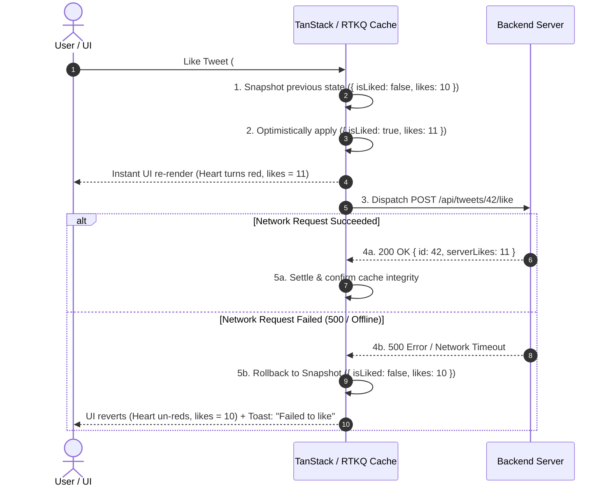

# Advanced Frontend State Architecture & Production Patterns

> **Companion Guide to [State Management Master Cheat Sheet](state-management.md)**  
> Covers **Atomic State & Signals**, **Form State Engineering**, **Optimistic UI & Offline Outbox Patterns**, **Cross-Tab Synchronization**, **SSR Hydration Mismatch Safety**, and **Production Performance Traps & Memory Leaks**.

---

## Table of Contents

1. [Architectural Taxonomy: The Advanced Tier](#architectural-taxonomy-the-advanced-tier)
2. [Atomic State & Signals (Bottom-Up vs. Top-Down)](#1-atomic-state--signals-bottom-up-vs-top-down)
   - [The Mental Model Shift](#11-the-mental-model-shift)
   - [Jotai Production Reference](#12-jotai-atomic-state-production-reference)
   - [Signals: Direct DOM Reactivity (VDOM Bypass)](#13-signals-direct-dom-reactivity-bypassing-virtual-dom)
3. [Form State Architecture (The Hardest Local State Problem)](#2-form-state-architecture-the-hardest-local-state-problem)
   - [The 60fps Keystroke Performance Bottleneck](#21-the-60fps-keystroke-performance-bottleneck)
   - [Production Pattern: React Hook Form + Zod](#22-production-pattern-react-hook-form--zod-schema-validation)
4. [Optimistic UI Updates & Offline Outbox Pattern](#3-optimistic-ui-updates--offline-outbox-pattern)
   - [The Optimistic Rollback Lifecycle (Mermaid Diagram)](#31-the-optimistic-rollback-lifecycle)
   - [TanStack Query Optimistic Update Code](#32-production-code-tanstack-query-optimistic-update)
   - [Offline Outbox Pattern (IndexedDB Queue)](#33-offline-outbox-pattern-indexeddb-queue--background-replay)
5. [Cross-Tab & Multi-Window Synchronization](#4-cross-tab--multi-window-synchronization)
   - [Low-Latency BroadcastChannel Pattern](#42-low-latency-broadcastchannel-pattern)
   - [Integrating into Global Store (Zustand Example)](#integrating-into-global-store-zustand-example)
6. [SSR, Streaming & Hydration Mismatch Safety](#5-ssr-streaming--hydration-mismatch-safety)
   - [The Hydration Mismatch Trap](#51-the-hydration-mismatch-trap)
   - [Safe Hydration via useSyncExternalStore](#52-safe-hydration-via-usesyncexternalstore)
   - [Server State Dehydration & Rehydration](#53-server-state-dehydration--rehydration-tanstack-query)
7. [Top 5 Production Performance Traps & Memory Leaks](#6-top-5-production-performance-traps--memory-leaks)
8. [Complete Frontend State Engineering Checklist (10-Point Rubric)](#7-complete-frontend-state-engineering-checklist)

---

## Architectural Taxonomy: The Advanced Tier

While classical state management models applications using **Top-Down stores** (Redux, Zustand) or **Local Closures** (`useState`), modern enterprise frontend engineering demands solutions for **high-frequency mutations**, **distributed browser tabs**, **network resilience**, and **zero-lag user input**.

```
                        ADVANCED FRONTEND STATE CAPABILITIES
                                         │
     ┌───────────────────┼───────────────────┼───────────────────┐
     ▼                   ▼                   ▼                   ▼
1. REACTIVITY       2. HIGH-FREQUENCY   3. NETWORK RESILIENCE  4. ENVIRONMENT
  PARADIGMS           INPUTS (FORMS)      & SYNC                 BOUNDARY
• Atoms (Jotai)     • Ref-based state   • Optimistic Rollbacks • Cross-Tab Sync
• Signals (Solid)   • Isolated fields   • Offline Outbox Queue • SSR Hydration
• VDOM Bypass       • Schema validation • Conflict Resolution  • useSyncExtStore
```

---

## 1. Atomic State & Signals (Bottom-Up vs. Top-Down)

### 1.1. The Mental Model Shift

- **Top-Down (Redux, Zustand)**: A single centralized state tree is sliced down into sub-branches. Components subscribe to branches using selectors.
- **Bottom-Up / Atomic (Jotai, Recoil)**: Tiny independent units of state called **Atoms** live at the bottom. Derived atoms combine primitives into a reactive dependency graph.
- **Direct Signals (Preact Signals, Solid.js, Angular Signals)**: State values wrap a getter/setter primitive. Subscribing DOM nodes bind directly to the signal. When the value mutates, **the DOM text node updates surgically without calling the component function or running Virtual DOM / React Fiber diffing**.

```
TOP-DOWN STORE (Zustand / Redux)        BOTTOM-UP ATOMS (Jotai)          DIRECT SIGNALS (Preact / Solid)
      ┌──────────────┐                       ┌───┐    ┌───┐                 ┌──────────────┐
      │ Global Store │                       │Atom│   │Atom│                │    Signal    │
      └──────┬───────┘                       └───┬┘   └─┬──┘                └──────┬───────┘
             │ (Selectors)                       ▼      ▼                          │ (Direct Subscription)
      ┌──────┴───────┐                       ┌───────────┐                         ▼
      ▼              ▼                       │DerivedAtom│                  ┌──────────────┐
  [ Comp A ]    [ Comp B ]                   └─────┬─────┘                  │ Exact DOM Node│
 (Fiber Render) (Fiber Render)                     ▼                        │ (Bypasses VDOM)│
                                               [ Comp C ]                   └──────────────┘
```

---

### 1.2. Jotai (Atomic State) Production Reference

```tsx
import { atom, useAtom, useAtomValue, useSetAtom } from 'jotai';

// 1. Primitive Atoms
export const textAtom = atom<string>('Hello');
export const countAtom = atom<number>(0);

// 2. Derived (Read-Only) Atom: Computes automatically when dependencies change
export const charCountAtom = atom((get) => get(textAtom).length);

// 3. Writable Derived Atom (Actions)
export const resetAllAtom = atom(
  null, // No read value
  (get, set) => {
    set(textAtom, '');
    set(countAtom, 0);
  }
);

// 4. Asynchronous Atom with Suspense Support
export const userProfileAtom = atom(async (get) => {
  const userId = get(countAtom);
  const response = await fetch(`/api/user/${userId}`);
  return response.json();
});

// 5. Component Usage: Fine-grained subscription
export function CharacterCounter() {
  // Re-renders ONLY when charCount changes, completely ignoring countAtom
  const charCount = useAtomValue(charCountAtom);
  return <div>Character Count: {charCount}</div>;
}

export function TextInput() {
  const [text, setText] = useAtom(textAtom);
  return <input value={text} onChange={(e) => setText(e.target.value)} />;
}
```

---

### 1.3. Signals: Direct DOM Reactivity (Bypassing Virtual DOM)

In standard React, updating state causes the entire component function to re-execute, recalculating the JSX virtual DOM tree. **Signals** eliminate virtual DOM diffing for localized values:

```tsx
import { signal, computed } from '@preact/signals-react';

// Signal lives outside React component hierarchy
export const count = signal(0);
export const double = computed(() => count.value * 2);

export function Counter() {
  console.log('Component rendered'); // Logged ONCE on initial mount

  return (
    <div>
      {/* 
        Passing signal directly to JSX text node attaches a DOM-level subscription.
        Clicking the button updates the DOM directly.
        Counter() function DOES NOT RE-RENDER!
      */}
      <p>Count: {count}</p>
      <p>Double: {double}</p>
      <button onClick={() => count.value++}>Increment</button>
    </div>
  );
}
```

---

## 2. Form State Architecture (The Hardest Local State Problem)

### 2.1. The 60fps Keystroke Performance Bottleneck

Putting form inputs into `useState` at the form root or into global state creates an immediate performance bottleneck:

$$\text{Keystroke (16ms budget)} \rightarrow \text{Root State Update} \rightarrow \text{Full Form Re-render (50+ inputs)} \rightarrow \text{Layout \& Paint} \rightarrow \text{Input Lag / Frame Drop}$$

```
ANTI-PATTERN: Controlled Form-Level State         BEST PRACTICE: Uncontrolled with Subscriptions
        ┌─────────────────┐                               ┌─────────────────┐
        │  Form (useState)│                               │ Form Container  │
        └───┬────┬────┬───┘                               └─────────────────┘
            │    │    │ (Every keystroke re-renders ALL)       │        │        │
            ▼    ▼    ▼                                        ▼        ▼        ▼
          [Input1][Input2][Input3]                        [Input1] [Input2] [Input3]
                                                         (Internal (Internal (Internal
                                                           DOM ref) DOM ref) DOM ref)
                                                               │
                                                               ▼ (Micro-subscription)
                                                          [Error Badge Only]
```

---

### 2.2. Production Pattern: React Hook Form + Zod Schema Validation

By utilizing native DOM `ref`s and micro-observer subscriptions, only the field actively changing and its error message re-render.

```tsx
import React from 'react';
import { useForm } from 'react-hook-form';
import { zodResolver } from '@hookform/resolvers/zod';
import { z } from 'zod';

// 1. Immutable Schema Specification
const registrationSchema = z.object({
  email: z.string().email('Invalid email address'),
  password: z.string().min(8, 'Password must be at least 8 characters'),
  confirmPassword: z.string(),
}).refine((data) => data.password === data.confirmPassword, {
  message: "Passwords don't match",
  path: ['confirmPassword'],
});

type RegistrationFormData = z.infer<typeof registrationSchema>;

export function RegistrationForm() {
  const {
    register,
    handleSubmit,
    formState: { errors, isSubmitting },
    reset,
  } = useForm<RegistrationFormData>({
    resolver: zodResolver(registrationSchema),
    mode: 'onBlur', // Validates on blur to save CPU cycles during rapid typing
  });

  const onSubmit = async (data: RegistrationFormData) => {
    await api.registerUser(data);
    reset();
  };

  return (
    <form onSubmit={handleSubmit(onSubmit)}>
      <div>
        <label>Email</label>
        {/* register attaches ref; no value/onChange re-renders at form level */}
        <input {...register('email')} />
        {errors.email && <span className="error">{errors.email.message}</span>}
      </div>

      <div>
        <label>Password</label>
        <input type="password" {...register('password')} />
        {errors.password && <span className="error">{errors.password.message}</span>}
      </div>

      <div>
        <label>Confirm Password</label>
        <input type="password" {...register('confirmPassword')} />
        {errors.confirmPassword && (
          <span className="error">{errors.confirmPassword.message}</span>
        )}
      </div>

      <button type="submit" disabled={isSubmitting}>
        {isSubmitting ? 'Registering...' : 'Submit'}
      </button>
    </form>
  );
}
```

---

## 3. Optimistic UI Updates & Offline Outbox Pattern

### 3.1. The Optimistic Rollback Lifecycle

$$\text{User Click} \rightarrow \text{Snapshot Current Cache} \rightarrow \text{Mutate Local Cache Instantly (Optimistic)} \rightarrow \text{Trigger HTTP Request} \rightarrow \begin{cases} \mathbf{Success:} & \text{Confirm \& Replace Temporary ID} \\ \mathbf{Failure:} & \text{Rollback Cache to Snapshot \& Toast Error} \end{cases}$$

#### Mermaid Sequence Diagram



---

### 3.2. Production Code: TanStack Query Optimistic Update

```tsx
import { useMutation, useQueryClient } from '@tanstack/react-query';

interface Todo {
  id: string;
  text: string;
}

export function useUpdateTodo() {
  const queryClient = useQueryClient();

  return useMutation({
    mutationFn: async (updatedTodo: Todo) => {
      const res = await fetch(`/api/todos/${updatedTodo.id}`, {
        method: 'PUT',
        body: JSON.stringify(updatedTodo),
      });
      if (!res.ok) throw new Error('Update failed');
      return res.json();
    },

    // When mutate is called:
    onMutate: async (newTodo) => {
      // 1. Cancel outgoing queries so they don't overwrite our optimistic update
      await queryClient.cancelQueries({ queryKey: ['todos'] });

      // 2. Snapshot the previous state
      const previousTodos = queryClient.getQueryData<Todo[]>(['todos']);

      // 3. Optimistically update the cache
      queryClient.setQueryData<Todo[]>(['todos'], (old = []) =>
        old.map((todo) => (todo.id === newTodo.id ? { ...todo, ...newTodo } : todo))
      );

      // 4. Return context containing the snapshot
      return { previousTodos };
    },

    // If mutation fails, rollback to previous snapshot:
    onError: (err, newTodo, context) => {
      if (context?.previousTodos) {
        queryClient.setQueryData(['todos'], context.previousTodos);
      }
    },

    // Always refetch in background to ensure 100% server sync
    onSettled: () => {
      queryClient.invalidateQueries({ queryKey: ['todos'] });
    },
  });
}
```

---

### 3.3. Offline Outbox Pattern (IndexedDB Queue + Background Replay)

When users perform actions offline (e.g. mobile app, field operations), mutations must not fail. Instead, they are buffered to an **Offline Outbox**:

```
[ User Action ]
       │
       ▼
 [ Online? ] ─── Yes ───► [ Immediate API Call ]
       │
       No
       ▼
[ Save to IndexedDB Outbox Table ]
       │
       ▼ (Event: window.addEventListener('online'))
[ Outbox Replay Worker ]
       │
       ├─ 1. Read transactions FIFO
       ├─ 2. Inject Idempotency-Key header
       ├─ 3. Replay against Server
       └─ 4. On Success: Clear Outbox row & invalidate local query cache
```

---

## 4. Cross-Tab & Multi-Window Synchronization

### 4.1. The Desynchronization Hazard

A user has **Tab A (Cart)** and **Tab B (Settings)** open:
- In Tab B, the user clicks **Logout**.
- In Tab A, stale authentication tokens remain in memory. The user attempts to checkout, triggering unauthorized API exceptions or corrupted orders.

---

### 4.2. Low-Latency BroadcastChannel Pattern

`BroadcastChannel` provides a zero-overhead message bus between all same-origin tabs and workers:

```tsx
// authSyncChannel.ts
export type AuthMessage =
  | { type: 'LOGOUT' }
  | { type: 'TOKEN_REFRESHED'; token: string }
  | { type: 'CART_UPDATED'; itemCount: number };

const channel = typeof window !== 'undefined'
  ? new BroadcastChannel('app_state_sync_bus')
  : null;

export const broadcastStateChange = (message: AuthMessage) => {
  channel?.postMessage(message);
};

export const subscribeToCrossTabSync = (callback: (msg: AuthMessage) => void) => {
  if (!channel) return () => {};

  const handler = (event: MessageEvent<AuthMessage>) => {
    callback(event.data);
  };

  channel.addEventListener('message', handler);
  return () => channel.removeEventListener('message', handler);
};
```

#### Integrating into Global Store (Zustand Example)

```tsx
import { create } from 'zustand';
import { broadcastStateChange, subscribeToCrossTabSync } from './authSyncChannel';

interface AuthStore {
  token: string | null;
  logout: (broadcast?: boolean) => void;
  setToken: (token: string, broadcast?: boolean) => void;
}

export const useAuthStore = create<AuthStore>((set) => ({
  token: null,

  logout: (broadcast = true) => {
    set({ token: null });
    if (broadcast) {
      broadcastStateChange({ type: 'LOGOUT' });
    }
  },

  setToken: (token, broadcast = true) => {
    set({ token });
    if (broadcast) {
      broadcastStateChange({ type: 'TOKEN_REFRESHED', token });
    }
  },
}));

// Initialize listener in root layout/index:
subscribeToCrossTabSync((message) => {
  if (message.type === 'LOGOUT') {
    useAuthStore.getState().logout(false); // Update without re-broadcasting loop
  } else if (message.type === 'TOKEN_REFRESHED') {
    useAuthStore.getState().setToken(message.token, false);
  }
});
```

---

## 5. SSR, Streaming & Hydration Mismatch Safety

### 5.1. The Hydration Mismatch Trap

When building with Next.js, Remix, or Astro, server-rendered HTML must match client-rendered HTML down to the exact text character during the initial hydration pass.

```tsx
// ❌ CRITICAL BUG: Hydration mismatch error
export function ThemeToggle() {
  // Server renders 'light' (no window/localStorage)
  // Client renders 'dark' (reads from localStorage)
  // React throws: "Text content did not match. Server: 'light' Client: 'dark'"
  const [theme, setTheme] = useState(
    typeof window !== 'undefined'
      ? localStorage.getItem('theme') || 'light'
      : 'light'
  );

  return <div>Active Theme: {theme}</div>;
}
```

---

### 5.2. Safe Hydration via `useSyncExternalStore`

React 18 and 19 provide `useSyncExternalStore` with a required third argument: `getServerSnapshot`.

```tsx
import { useSyncExternalStore } from 'react';

// Pure store reading from localStorage
function subscribe(callback: () => void) {
  window.addEventListener('storage', callback);
  return () => window.removeEventListener('storage', callback);
}

function getClientSnapshot(): string {
  return localStorage.getItem('theme') || 'light';
}

function getServerSnapshot(): string {
  // Always returns deterministic server default
  return 'light';
}

export function useThemeSync() {
  return useSyncExternalStore(subscribe, getClientSnapshot, getServerSnapshot);
}

// Component safely mounts without hydration errors
export function SafeThemeDisplay() {
  const theme = useThemeSync();
  return <div>Active Theme: {theme}</div>;
}
```

---

### 5.3. Server State Dehydration & Rehydration (TanStack Query)

```tsx
// app/users/page.tsx (Next.js Server Component)
import { dehydrate, HydrationBoundary, QueryClient } from '@tanstack/react-query';
import UsersList from './UsersList';

export default async function Page() {
  const queryClient = new QueryClient();

  // Prefetch data on the server during streaming/SSG
  await queryClient.prefetchQuery({
    queryKey: ['users'],
    queryFn: fetchUsersFromDatabase,
  });

  return (
    // Dehydrate passes serialized cache down via HTML script tag
    <HydrationBoundary state={dehydrate(queryClient)}>
      <UsersList />
    </HydrationBoundary>
  );
}

// app/users/UsersList.tsx (Client Component)
('use client');
import { useQuery } from '@tanstack/react-query';

export default function UsersList() {
  // Instantly reads from pre-seeded dehydrated cache with ZERO network fetch on mount!
  const { data: users } = useQuery({ queryKey: ['users'], queryFn: fetchUsersFromAPI });

  return (
    <ul>
      {users?.map((u) => (
        <li key={u.id}>{u.name}</li>
      ))}
    </ul>
  );
}
```

---

## 6. Top 5 Production Performance Traps & Memory Leaks

### Trap 1: The Unstable Selector Reference (Infinite Re-render / Perf Degradation)

```tsx
// ❌ WRONG: Array.filter() returns a BRAND NEW array reference every render tick.
// useSelector detects prev !== next by reference, forcing component to re-render indefinitely or unnecessarily.
const activeUsers = useAppSelector((state) =>
  state.users.items.filter((u) => u.isActive)
);

// ✅ CORRECT FIX: Memoize using createSelector or useShallow
const selectActiveUsers = createSelector(
  [(state: RootState) => state.users.items],
  (items) => items.filter((u) => u.isActive) // Recalculates ONLY when items array reference changes
);
const activeUsers = useAppSelector(selectActiveUsers);
```

---

### Trap 2: Direct Object Identity Breakdown in Zustand

```tsx
// ❌ WRONG: Returning an inline object creates a new reference on every store update
const { name, email } = useUserStore((state) => ({
  name: state.name,
  email: state.email,
}));

// ✅ CORRECT FIX: Wrap selector with useShallow
import { useShallow } from 'zustand/react/shallow';

const { name, email } = useUserStore(
  useShallow((state) => ({
    name: state.name,
    email: state.email,
  }))
);
```

---

### Trap 3: Memory Leak from Dangling Outside-React Subscriptions

```tsx
// ❌ WRONG: Subscribing to external store without cleanup creates memory leaks on unmount
function BadComponent() {
  useEffect(() => {
    myStore.subscribe((state) => {
      console.log('Update:', state);
    });
    // Missing return unsubscribe!
  }, []);
}

// ✅ CORRECT FIX: Clean up listener on unmount
function GoodComponent() {
  useEffect(() => {
    const unsubscribe = myStore.subscribe((state) => {
      console.log('Update:', state);
    });
    return () => unsubscribe();
  }, []);
}
```

---

### Trap 4: Hoisting Local Widget State to Global Stores

```tsx
// ❌ WRONG: Hoisting input drafts or modal states to Redux/Zustand
// Every keystroke triggers store reducers, middleware checks, and re-renders unrelated listeners.
const searchInput = useGlobalStore((state) => state.searchInput);

// ✅ CORRECT FIX: Keep localized to widget
const [searchInput, setSearchInput] = useState('');
```

---

### Trap 5: Unbounded Cache Accumulation in Memory

```tsx
// ❌ WRONG: Storing indefinitely growing dictionary keys without eviction policy
const cache: Record<string, LargeData> = {};

// ✅ CORRECT FIX: Bound memory using an LRU (Least Recently Used) Cache
import { LRUCache } from 'lru-cache';

const safeCache = new LRUCache<string, LargeData>({
  max: 100, // Maximum 100 items
  ttl: 1000 * 60 * 5, // 5 minutes TTL
});
```

---

## 7. Complete Frontend State Engineering Checklist

Before approving any frontend architectural PR, verify against this 10-point rubric:

- [ ] **1. Separation**: Is Server data handled by Query cache and NOT duplicated in global stores?
- [ ] **2. Locality**: Does local UI state (`isModalOpen`, `draftText`) die cleanly with its component?
- [ ] **3. Shareability**: Are active table filters, pagination, and sorting mirrored in the URL?
- [ ] **4. Input Isolation**: Are high-frequency form inputs isolated via uncontrolled `ref`s or atomic signals?
- [ ] **5. Re-render Precision**: Are selectors memoized or protected with shallow equality?
- [ ] **6. Cleanup**: Are all custom event listeners, timers, and outside-store subscriptions cleaned up?
- [ ] **7. Race Safety**: Do async effects handle `AbortController` cancellation or use race-safe query libraries?
- [ ] **8. Multi-Tab**: Does logout or permission revocation synchronize across open tabs?
- [ ] **9. SSR Compatibility**: Are client-only storage values guarded against hydration mismatch?
- [ ] **10. Optimistic Resilience**: Do optimistic mutations rollback safely with user notifications on failure?
