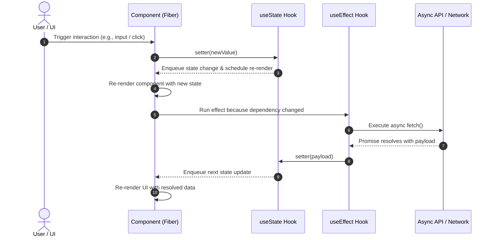
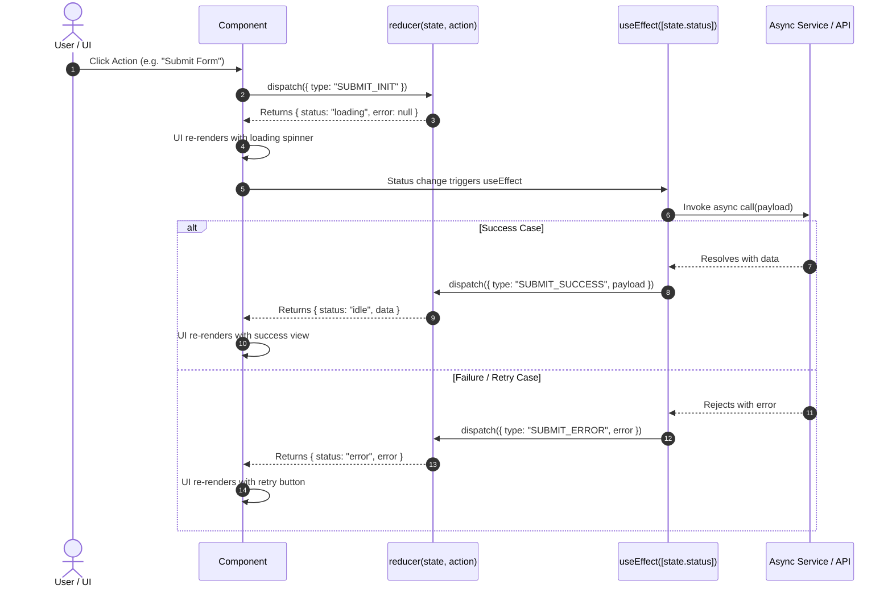
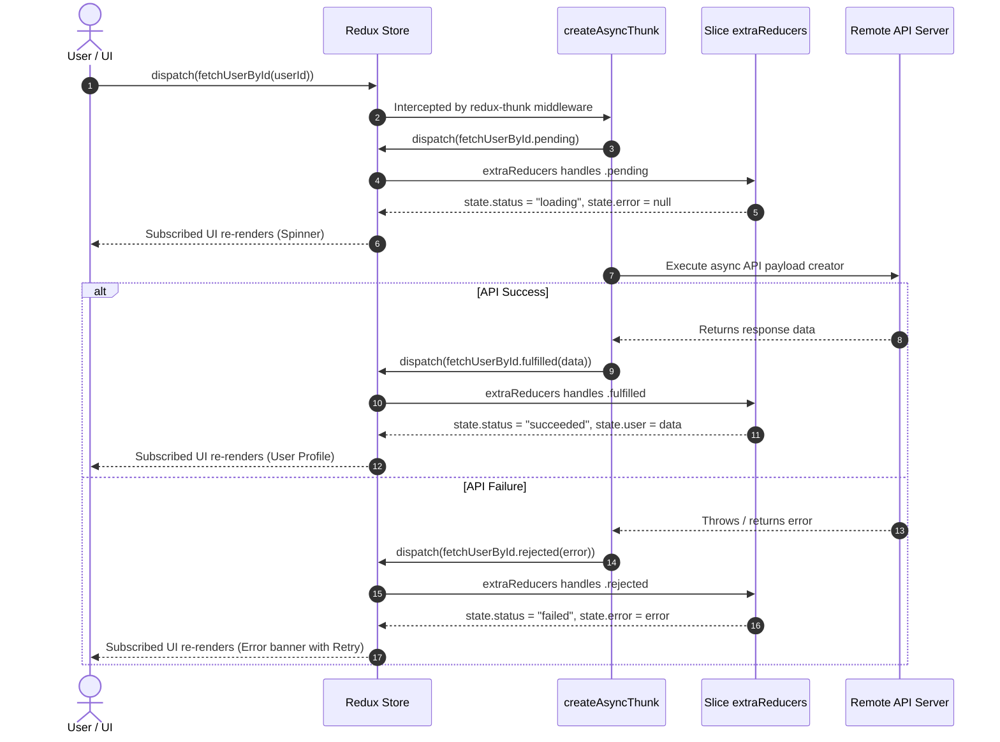
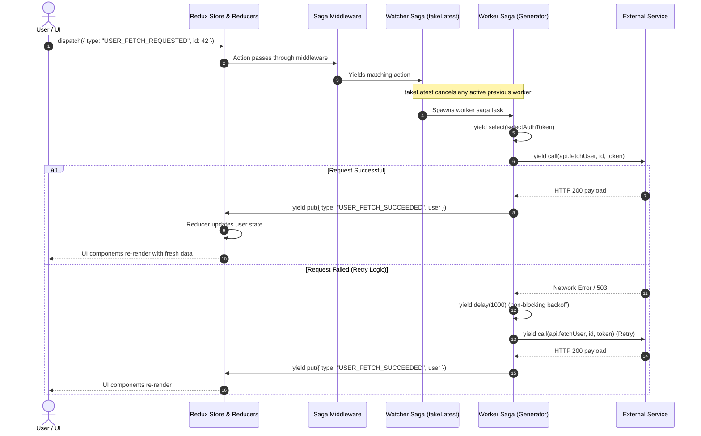
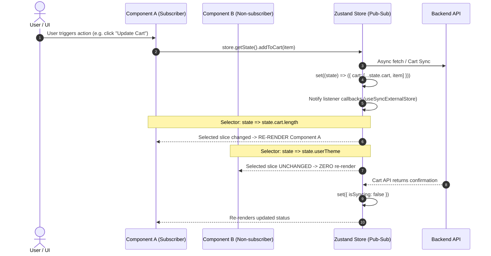
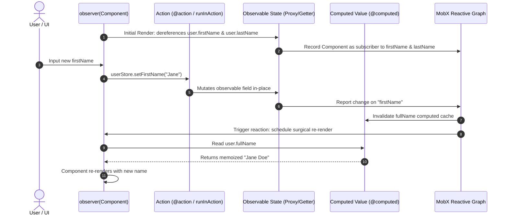
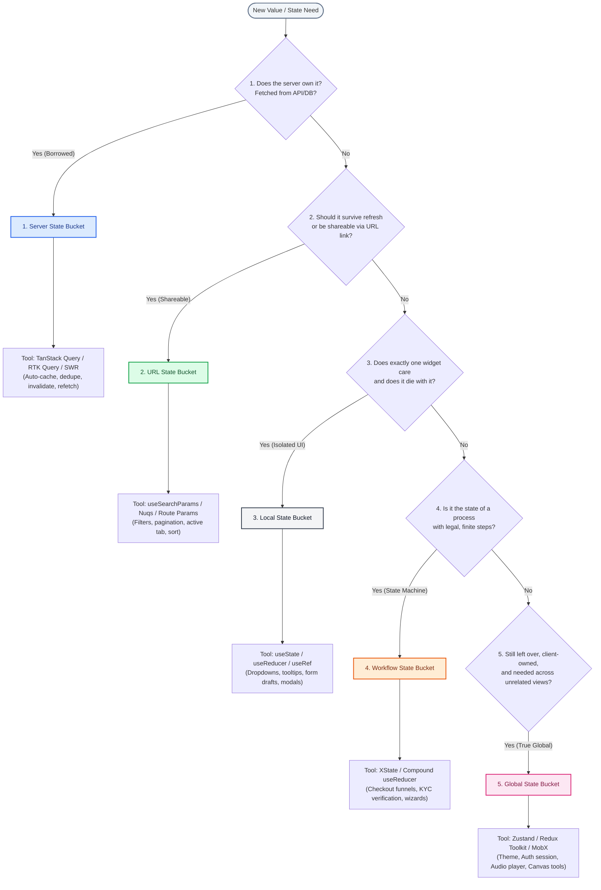
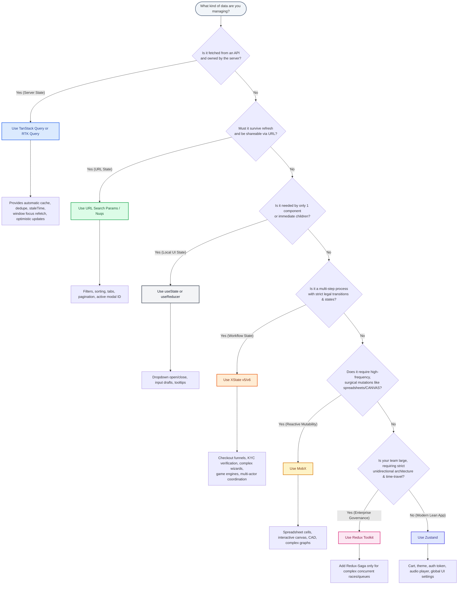

# State Management Architectural Framework & Master Cheat Sheet

A comprehensive, production-grade guide covering **State Taxonomy**, the **5-Question Interrogation Framework**, the **5 State Buckets**, **Execution Lifecycles & Flow Pipelines** (with Mermaid diagrams), complete technical references for **Redux Toolkit (RTK)**, **Redux-Saga**, **Zustand**, **MobX**, and **XState (v5/v6)**, and an exhaustive **"Which & When to Use" Architectural Decision Guide**.

> 🚀 **Advanced Companion Guide:** For deep dives on **Atomic State & Signals (Jotai/Solid)**, **Form State Architecture (60fps keystroke isolation)**, **Optimistic UI Updates & Offline Outbox Queue**, **Cross-Tab Synchronization (BroadcastChannel)**, **SSR Hydration Safety**, and **Performance Anti-Patterns**, visit [Advanced Frontend State Architecture](state-management-advanced.md).

---

## Table of Contents

1. [The Core Philosophy: "State" is a Lazy Word](#1-the-core-philosophy-state-is-a-lazy-word)
   - [The 5 Interrogation Questions](#the-5-interrogation-questions)
   - [Underlying Runtime Primitives](#-none-of-this-needed-a-library)
2. [Five Buckets, Side by Side](#2-five-buckets-side-by-side)
   - [Deep Dive Breakdown](#deep-dive-five-buckets-breakdown)
3. [Server State: You Don't Own It, You're Borrowing a Copy](#3-server-state-you-dont-own-it-youre-borrowing-a-copy)
4. [Execution Lifecycles & Flow Pipelines (Sequence Diagrams)](#4-execution-lifecycles--flow-pipelines)
   - [4.1. useState (Native Local State)](#41-usestate-native-local-state)
   - [4.2. useReducer (Deterministic State Transitions)](#42-usereducer-local-deterministic-state-transitions)
   - [4.3. Redux Slice (createSlice + createAsyncThunk)](#43-redux-slice-createslice--createasyncthunk)
   - [4.4. Redux-Saga (Generator Side-Effect Orchestration)](#44-redux-saga-generator-driven-side-effect-orchestration)
   - [4.5. Zustand (Minimalist Pub-Sub Global State)](#45-zustand-minimalist-pub-sub-global-state)
   - [4.6. MobX (Transparent Functional Reactive Programming)](#46-mobx-transparent-functional-reactive-programming---tfrp)
   - [4.7. XState (v5/v6 Actor Model & Statecharts)](#47-xstate-v5v6-actor-model--statecharts)
5. [The 5-Step Elimination Ladder](#5-the-5-step-elimination-ladder-run-every-new-value-through-this-order)
   - [Architectural Elimination Flowchart](#architectural-elimination-flowchart)
6. [Redux Toolkit (RTK) Complete Reference](#6-redux-toolkit-rtk-complete-reference)
   - [Store & Typed Hooks](#61-store-configuration--typed-hooks)
   - [createSlice & Async Thunk](#62-createslice--createasyncthunk)
   - [Memoized Selectors (createSelector)](#63-memoized-selectors-createselector)
   - [Normalized Collections (createEntityAdapter)](#64-normalized-collections-createentityadapter)
   - [Listener Middleware](#65-reactive-listener-middleware)
   - [RTK Query (Cache Layer)](#66-rtk-query-network-data-caching-layer)
7. [Redux-Saga (Complex Async Orchestration)](#7-redux-saga-complex-async-orchestration)
8. [Zustand Complete Reference](#8-zustand-complete-reference)
9. [MobX Complete Reference](#9-mobx-complete-reference)
10. [XState (v5/v6 Actor Model) Complete Reference](#10-xstate-v5v6-actor-model-complete-reference)
    - [React Context vs. XState Context Comparison](#103-react-context-vs-xstate-context-architectural-comparison)
11. ["Which & When To Use" Master Architectural Guide](#11-which--when-to-use-master-architectural-guide)
    - [Master Comparison Matrix](#111-master-comparison-matrix)
    - [Architectural Decision Tree](#112-architectural-decision-tree)
    - [Recommended Golden Stack Coexistence](#113-recommended-modern-production-architecture-the-golden-stack)

---

## 1. The Core Philosophy: "State" is a Lazy Word

In modern frontend architecture, most bugs, performance bottlenecks, and accidental coupling come from treating all data as generic "State" and tossing it into a single global bucket.

```
                                 INTERROGATE YOUR STATE
                                           │
         ┌─────────────────────────────────┼─────────────────────────────────┐
         ▼                                 ▼                                 ▼
   1. OWNERSHIP                      2. LIFETIME                       3. CARDINALITY
 Who is source of truth?          Does it die with a               Needed in 1 place or
(Client, Server, or URL?)       component, page, session?        many unrelated widgets?
         │                                 │                                 │
         └─────────────────────────────────┼─────────────────────────────────┘
                                           ▼
                                   4. PERSISTENCE
                            Must it survive refresh,
                             link share, navigation?
                                           ▼
                                   5. MUTABILITY
                            Does the user change it,
                              or does the world?
```

### The 5 Interrogation Questions

1. **Ownership**: Who is the authoritative source of truth? (Server database, browser URL, or local client memory?)
2. **Lifetime**: When does this data expire or get destroyed? (Component unmount, page route change, tab close, or user logout?)
3. **Cardinality**: How many components need this data? (Single component tree vs. 10 unrelated views across the app?)
4. **Persistence**: Does it need to survive a page refresh, browser back button, or link sharing via URL?
5. **Mutability**: Who mutates it? (User keystrokes/toggles vs. asynchronous external background updates?)

> **Core Rule:** Answer these five questions and the value **sorts itself into the correct bucket**.

---

### 💡 None of this Needed a Library

> **"Libraries change the ergonomics, never the categories."**

```
┌──────────────────────────────────────────────────────────────────────────────────┐
│ useState ➔ local   │   TanStack Query ➔ server   │   XState ➔ workflow          │
└──────────────────────────────────────────────────────────────────────────────────┘
```

The 5 state categories exist naturally in the browser runtime. Libraries simply provide ergonomic developer APIs around fundamental primitives:

- `useState` is an ergonomic wrapper over **JavaScript closures**.
- `TanStack Query` is an ergonomic wrapper over a **keyed in-memory async cache**.
- `React Router / Nuqs` is an ergonomic wrapper over **browser `URLSearchParams` and history API**.
- `Zustand / Redux` is an ergonomic wrapper over a **pub-sub event emitter**.
- `MobX` is an ergonomic wrapper over **Transparent Functional Reactive Programming (TFRP) / Proxy observables**.
- `XState` is an ergonomic wrapper over a **mathematical finite state machine & actor model**.

**Architectural Law:** If you place Server State into a Global store, migrating from Redux to Zustand, Recoil, or Jotai will not fix your bugs. Libraries only improve syntax—they cannot fix a value living in the wrong category.

---

## 2. Five Buckets, Side by Side

> _"Same five lenses, whatever framework you land in."_

```
┌───────────────────────────────────────────────────────────────────────────────────────────────────────────────────────┐
│                                                FIVE BUCKETS, SIDE BY SIDE                                             │
├───────────────────┬─────────────────┬───────────────────┬───────────────────┬───────────────────┬─────────────────────┤
│ Dimension / Lens  │ Local           │ Server            │ URL               │ Global            │ Workflow            │
│                   │ (one widget)    │ (borrowed)        │ (shareable)       │ (app-wide)        │ (a process)         │
├───────────────────┼─────────────────┼───────────────────┼───────────────────┼───────────────────┼─────────────────────┤
│ OWNED BY          │ one component   │ the server        │ the address bar   │ the client app    │ the process         │
│ LIFETIME          │ the instance    │ until invalidated │ until URL changes │ the session       │ until it completes  │
│ SURVIVES REFRESH  │ no              │ refetched         │ natively          │ if persisted      │ if mirrored         │
│ BUILT WITH        │ closure         │ keyed cache       │ URLSearchParams   │ pub-sub store     │ state machine       │
│ TOOLING           │ useState/useRef │ TanStack / RTKQ   │ React/TanStackRouter│ Zustand/RTK/MobX│ XState / useReducer │
└───────────────────┴─────────────────┴───────────────────┴───────────────────┴───────────────────┴─────────────────────┤
```

### Deep Dive: Five Buckets Breakdown

| Bucket          | Ownership & Source  | Lifetime & Survival                                                        | Underlying Primitive                                         | Anti-Pattern Trap                                                                  |
| :-------------- | :------------------ | :------------------------------------------------------------------------- | :----------------------------------------------------------- | :--------------------------------------------------------------------------------- |
| **1. Local**    | **One component**   | Bound to the component instance; does **not** survive refresh              | JavaScript closure (`useState`, `useReducer`, `useRef`)      | Putting `isDropdownOpen`, `modalOpen`, or input drafts into Redux/Zustand.         |
| **2. Server**   | **The server** (DB) | Lives until invalidated; **refetched** on refresh                          | Keyed async cache (`TanStack Query`, `RTK Query`, `SWR`)     | Manually fetching inside `useEffect` and dumping raw JSON into a global store.     |
| **3. URL**      | **The address bar** | Lives until URL changes; survives refresh **natively**                     | Browser URL & `URLSearchParams` (`nuqs`, React Router)       | Storing active filters, search queries, pagination, or tab IDs in component state. |
| **4. Global**   | **The client app**  | Lives for active session; survives refresh **if persisted** (storage)      | In-memory pub-sub store (`Zustand`, `Redux Toolkit`, `MobX`) | Hoisting local state "just in case" (creating hidden producer/consumer coupling).  |
| **5. Workflow** | **The process**     | Lives until process completes; survives refresh **if mirrored** to backend | Finite state machine (`XState`, compound reducers)           | Managing multi-step checkout/KYC flows with boolean flags (`isStep1 && isStep2`).  |

---

## 3. Server State: You Don't Own It, You're Borrowing a Copy

Server data (user profile, product list, shopping cart) is **not your state** — it is a cached local snapshot of remote database records. It can be changed by another user, a background worker, or a webhook at any millisecond.

```
       Server                     Fetch                    Your App
┌──────────────────┐  ──────────────────────────►  ┌───────────────────────┐
│ Source of Truth  │                               │  Cached Copy (STALE!) │
└──────────────────┘  ◄──────────────────────────  └───────────────────────┘
                                Mutate
```

### What a Proper Server-State Layer Owes You

```
┌─────────────────────────────────────────────────────────────────────────────────┐
│ 01. Caching          Don't refetch what is still fresh (staleTime configuration)│
│ 02. Deduplication    3 components mount simultaneously -> exactly 1 HTTP request│
│ 03. Invalidation     After mutation -> automatically mark affected tags stale   │
│ 04. Refetching       Background stale-while-revalidate on window focus / network│
│ 05. Race Safety      Older network responses must never overwrite newer requests│
│ 06. Status as State  Modelled discriminated union: { status, isFetching, error }│
└─────────────────────────────────────────────────────────────────────────────────┘
```

---

## 4. Execution Lifecycles & Flow Pipelines

Understanding the exact sequence of events, side-effect boundaries, and re-render triggers across state paradigms is essential for building bug-free, high-performance user interfaces.

---

### 4.1. `useState` (Native Local State)

#### Flow Pipeline Formula

$$\text{UI} \xrightarrow{\text{setter(newValue)}} \text{State updates} \xrightarrow{\text{Fiber schedule}} \text{UI re-renders} \xrightarrow{\text{useEffect(..., [dep]) runs fetch}} \text{Promise resolves} \xrightarrow{\text{setter(data)}} \text{UI re-renders} \xrightarrow{\text{dep change}} \text{useEffect re-runs}$$

#### Sequence Diagram



#### Detailed Explanation & Edge Cases

- **Reactivity Mechanism**: React fiber reconciliation. Calling `setState` triggers a scheduled re-render of the declaring component and its descendants (unless memoized with `React.memo`).
- **Async Handling**: Side effects cannot run during render; they must be deferred to `useEffect`.
- **Pitfalls & Gotchas**:
  - **Stale Closures**: Callbacks captured in previous renders reference stale state values.
  - **Race Conditions**: If dependency changes rapidly, responses from earlier requests may resolve _after_ newer requests, overwriting fresh data with stale results (requires `AbortController` or cancellation flag cleanup).
  - **Waterfall Requests**: Nesting child components that fetch inside `useEffect` causes sequential network waterfalls.

---

### 4.2. `useReducer` (Local Deterministic State Transitions)

#### Flow Pipeline Formula

$$\text{UI} \xrightarrow{\text{dispatch(action)}} \text{reducer(state, action)} \xrightarrow{\text{pure compute}} \text{Next state computed} \xrightarrow{} \text{UI re-renders} \xrightarrow{\text{useEffect(..., [status])}} \text{Async side effect} \xrightarrow{\text{dispatch(nextAction)}} \text{reducer(state, nextAction)} \xrightarrow{} \text{UI re-renders / retries}$$

#### Sequence Diagram



#### Detailed Explanation & Edge Cases

- **Reactivity Mechanism**: Pure state transition function `(state, action) => newState`. State transitions are centralized and deterministic.
- **Side Effect Boundary**: Reducers must remain 100% pure (no API calls, no timers, no uuid generation). Side effects are orchestrated via `useEffect` synchronizing on state flags (e.g., `state.status === "loading"`).
- **Strengths**: Eliminates out-of-sync multi-boolean states (`isLoading`, `isError`, `isSuccess`) through discriminated unions.

---

### 4.3. Redux Slice (`createSlice` + `createAsyncThunk`)

#### Flow Pipeline Formula

$$\text{UI} \xrightarrow{\text{dispatch(thunk(arg))}} \text{Thunk dispatches pending} \xrightarrow{} \text{extraReducers sets loading} \xrightarrow{} \text{UI re-renders} \xrightarrow{\text{Async finishes/fails}} \text{Thunk dispatches fulfilled/rejected} \xrightarrow{} \text{extraReducers updates data/error} \xrightarrow{} \text{UI re-renders} \xrightarrow{\text{UI re-dispatch}} \text{Retrigger}$$

#### Sequence Diagram



#### Detailed Explanation & Edge Cases

- **Reactivity Mechanism**: Unidirectional data flow through a single centralized store. RTK uses **Immer** under the hood, allowing developers to write direct mutations (`state.user = data`) that safely produce immutable updates.
- **Re-render Optimization**: Components subscribe using `useSelector(selector)`. A component re-renders _only_ if the selector's returned value changes by reference equality (`===`) or via custom memoized selectors (`createSelector`).
- **Cancellation**: `createAsyncThunk` provides an `AbortController` signal accessible via the thunk API: `signal.aborted`.

---

### 4.4. Redux-Saga (Generator-Driven Side-Effect Orchestration)

#### Flow Pipeline Formula

$$\text{UI} \xrightarrow{\text{dispatch(action)}} \text{Store} \xrightarrow{\text{Middleware intercepts}} \text{Saga watcher matches action} \xrightarrow{} \text{Saga worker runs effects (call/put/select/retry)} \xrightarrow{\text{yield put}} \text{Dispatches result action} \xrightarrow{} \text{Reducers update state} \xrightarrow{} \text{UI re-renders}$$

#### Sequence Diagram



#### Detailed Explanation & Edge Cases

- **Reactivity Mechanism**: Decouples async logic entirely from UI and reducers using ES6 Generator functions (`function*`). The UI dispatches pure intent actions; sagas intercept, coordinate, and dispatch resolution actions.
- **Key Capabilities**:
  - Declarative effect descriptions (`call`, `put`, `race`, `fork`, `cancel`) allow 100% deterministic unit testing without mocking `fetch` or `axios`.
  - Advanced concurrency: `race` handles timeout vs response, `takeLatest` cancels inflight requests automatically on new input, and `actionChannel` queues rapid events sequentially.

---

### 4.5. Zustand (Minimalist Pub-Sub Global State)

#### Flow Pipeline Formula

$$\text{UI} \xrightarrow{\text{action / set(updater)}} \text{Store state updates} \xrightarrow{\text{Pub-sub notification}} \text{useSyncExternalStore / selector checks equality} \xrightarrow{} \text{Only subscribing component re-renders} \xrightarrow{\text{Async action resolves}} \text{set(newData)} \xrightarrow{} \text{Subscribers re-render}$$

#### Sequence Diagram



#### Detailed Explanation & Edge Cases

- **Reactivity Mechanism**: Pure JavaScript closure store with an event listener `Set`. Uses React 18/19's `useSyncExternalStore` under the hood. No React Context Providers needed.
- **Re-render Optimization**: Fine-grained atomic subscriptions. A component only subscribes to the exact slice returned by its selector (`useStore(state => state.foo)`). Changes to other store properties cause zero overhead.
- **Outside-React Access**: Can read and write state anywhere in JavaScript (`useStore.getState()`, `useStore.setState()`), ideal for API interceptors, WebSockets, and non-React scripts.

---

### 4.6. MobX (Transparent Functional Reactive Programming - TFRP)

#### Flow Pipeline Formula

$$\text{UI (Observer)} \xrightarrow{\text{User action / method}} \text{Action mutates @observable property} \xrightarrow{} \text{MobX Dependency Graph detects mutation} \xrightarrow{} \text{Computed values lazily recalculate} \xrightarrow{} \text{Reactions / observer components auto-track dereferenced properties} \xrightarrow{} \text{Micro-level surgical re-render of exact component only}$$

#### Sequence Diagram



#### Detailed Explanation & Edge Cases

- **Reactivity Mechanism**: Automatic runtime dependency tracking using ES6 Proxies and property getters/setters. There are no manual selectors and no `useSelector` dependency arrays. If a component reads `store.foo` during render, MobX marks that component as a subscriber to `foo`.
- **Re-render Optimization**: Surgical micro-renders. If a list has 10,000 items and item #4 mutates, only the sub-component rendering item #4 re-renders. The parent list component does not re-render.
- **Strict Mode (`enforceActions: "always"`)**: State mutations outside of explicit `@action` or `runInAction` blocks throw runtime errors, ensuring predictable trace logs.

---

### 4.7. XState (v5/v6 Actor Model & Statecharts)

#### Flow Pipeline Formula

$$\text{UI} \xrightarrow{\text{actor.send(event)}} \text{Actor} \xrightarrow{} \text{Machine (reads current state + context + event)} \xrightarrow{} \text{Transition fn checks conditions \& returns } \{ \text{target}, \text{context} \} + \text{enq(...) effects} \xrightarrow{} \text{Actor commits snapshot \& context} \xrightarrow{} \text{Actor executes effects (API / spawn / emit / sendTo)} \xrightarrow{} \text{Async/external result emits new event} \xrightarrow{\text{actor.send(nextEvent)}} \text{Machine transitions to next state / retry} \xrightarrow{} \text{UI re-renders}$$

#### Sequence Diagram

```mermaid
sequenceDiagram
    autonumber
    actor User as User / UI
    participant Actor as State Machine Actor
    participant Engine as Transition Engine (Pure)
    participant EffectQ as Enqueued Actions Queue
    participant Ext as External Service / Child Actor

    User->>Actor: actor.send({ type: "SUBMIT_PAYMENT", amount: 100 })
    Actor->>Engine: Evaluate: (currentState="idle", context, event)
    Engine->>Engine: Validate guards (isAmountValid === true)
    Engine-->>Actor: Returns { target: "authorizing", context, actions: [enq.assign, enq.sendTo] }
    Actor->>Actor: Commit snapshot { value: "authorizing", context }
    Actor-->>User: UI re-renders (Displays Authorization Progress)
    Actor->>EffectQ: Flush & execute enqueued side effects
    EffectQ->>Ext: Invoke payment gateway API / spawn actor
    alt Payment Authorized
        Ext-->>Actor: Emits event: { type: "PAYMENT_SUCCESS", txId: "tx_123" }
        Actor->>Engine: Evaluate: (currentState="authorizing", event)
        Engine-->>Actor: Returns { target: "confirmed", context }
        Actor->>Actor: Commit snapshot { value: "confirmed" }
        Actor-->>User: UI re-renders (Receipt & Success Screen)
    else Payment Declined / Network Error
        Ext-->>Actor: Emits event: { type: "PAYMENT_FAILURE", error: "Card Expired" }
        Actor->>Engine: Evaluate: (currentState="authorizing", event)
        Engine-->>Actor: Returns { target: "failed", context: { error } }
        Actor->>Actor: Commit snapshot { value: "failed", context }
        Actor-->>User: UI re-renders (Error banner + Retry action)
    end
```

#### Detailed Explanation & Edge Cases

- **Reactivity Mechanism**: Mathematical Statechart / Actor Model. State is modeled as a discrete finite set of qualitative values (`idle`, `authorizing`, `confirmed`, `failed`) accompanied by extended quantitative `context`.
- **v5/v6 Actor Architecture**:
  - The transition logic is a pure function returning next snapshot + enqueued actions.
  - The Actor runtime owns state persistence, message queuing, and effect execution.
  - Unhandled events in a given state are safely ignored, completely eliminating impossible state bugs (e.g. double-click payment submission is impossible if the machine is already in `authorizing` state).

---

## 5. The 5-Step Elimination Ladder: Run Every New Value Through This Order

Never ask _"Should this go into Redux/Global store?"_ first. Global state is the **final fallback (Step 5)** after everything else is eliminated.

```
┌──────────────────────────────────────────────────────────────────────────────────────────────────┐
│                             RUN EVERY NEW VALUE THROUGH THIS ORDER                               │
├────┬────────────────────────────────────────────────────────┬───────────┬────────────────────────┤
│ #  │ Interrogation Filter                                   │ Target    │ Recommended Tooling    │
├────┼────────────────────────────────────────────────────────┼───────────┼────────────────────────┤
│ 1  │ Does the server own it?                                │ ➔ Server  │ TanStack Query / RTKQ  │
│ 2  │ Should it survive a refresh or be shareable via link?  │ ➔ URL     │ URL Search/Path Params │
│ 3  │ Does exactly one widget care, and die with it?         │ ➔ Local   │ useState / useReducer  │
│ 4  │ Is it the state of a process, with legal finite steps? │ ➔ Workflow│ XState / useReducer    │
│ 5  │ Still left over, client-owned, and needed widely?      │ ➔ Global  │ Zustand / RTK / MobX   │
└────┴────────────────────────────────────────────────────────┴───────────┴────────────────────────┘
```

### Architectural Elimination Flowchart



---

## 6. Redux Toolkit (RTK) Complete Reference

Modern Redux applications use Redux Toolkit (RTK) to eliminate boilerplate code and enforce immutability via Immer.

```text
UI Trigger -> dispatch(action) -> middleware -> reducer(previousState, action) -> next state -> UI re-renders
```

### 6.1. Store Configuration & Typed Hooks

```tsx
import { configureStore } from '@reduxjs/toolkit';
import { useDispatch, useSelector } from 'react-redux';
import authReducer from './authSlice';
import usersReducer from './usersSlice';

export const store = configureStore({
  reducer: {
    auth: authReducer,
    users: usersReducer,
  },
  middleware: (getDefaultMiddleware) =>
    getDefaultMiddleware({
      serializableCheck: true,
      immutableCheck: true,
    }),
});

export type RootState = ReturnType<typeof store.getState>;
export type AppDispatch = typeof store.dispatch;

export const useAppDispatch = useDispatch.withTypes<AppDispatch>();
export const useAppSelector = useSelector.withTypes<RootState>();
```

### 6.2. `createSlice` & `createAsyncThunk`

```tsx
import { createSlice, createAsyncThunk, type PayloadAction } from '@reduxjs/toolkit';

interface User {
  id: string;
  name: string;
}

interface UserState {
  data: User | null;
  status: 'idle' | 'loading' | 'succeeded' | 'failed';
  error: string | null;
}

const initialState: UserState = {
  data: null,
  status: 'idle',
  error: null,
};

export const fetchUserById = createAsyncThunk(
  'users/fetchById',
  async (userId: string, { signal, rejectWithValue }) => {
    try {
      const response = await fetch(`/api/users/${userId}`, { signal });
      if (!response.ok) throw new Error('Failed to fetch user');
      return (await response.json()) as User;
    } catch (err: any) {
      return rejectWithValue(err.message || 'Unknown network error');
    }
  },
);

export const userSlice = createSlice({
  name: 'user',
  initialState,
  reducers: {
    clearUser(state) {
      state.data = null;
      state.status = 'idle';
    },
    updateUserName(state, action: PayloadAction<string>) {
      if (state.data) {
        state.data.name = action.payload; // Safe mutation via Immer
      }
    },
  },
  extraReducers: (builder) => {
    builder
      .addCase(fetchUserById.pending, (state) => {
        state.status = 'loading';
        state.error = null;
      })
      .addCase(fetchUserById.fulfilled, (state, action) => {
        state.status = 'succeeded';
        state.data = action.payload;
      })
      .addCase(fetchUserById.rejected, (state, action) => {
        state.status = 'failed';
        state.error = (action.payload as string) || 'Could not load user';
      });
  },
});

export const { clearUser, updateUserName } = userSlice.actions;
export default userSlice.reducer;
```

### 6.3. Memoized Selectors (`createSelector`)

```tsx
import { createSelector } from '@reduxjs/toolkit';
import type { RootState } from './store';

const selectUsers = (state: RootState) => state.users.items;
const selectFilterRole = (state: RootState) => state.users.filterRole;

export const selectFilteredUsers = createSelector([selectUsers, selectFilterRole], (users, role) =>
  users.filter((u) => u.role === role),
);
```

### 6.4. Normalized Collections (`createEntityAdapter`)

Normalizes collection structures into `{ ids: [], entities: {} }` format and provides pre-built CRUD reducers and selectors.

```tsx
import { createEntityAdapter, createSlice } from '@reduxjs/toolkit';

interface User {
  id: string;
  name: string;
}

const usersAdapter = createEntityAdapter<User>();

const usersSlice = createSlice({
  name: 'users',
  initialState: usersAdapter.getInitialState(),
  reducers: {
    userAdded: usersAdapter.addOne,
    userUpdated: usersAdapter.updateOne,
    userRemoved: usersAdapter.removeOne,
  },
});

export const { selectAll: selectAllUsers, selectById: selectUserById } = usersAdapter.getSelectors(
  (state: RootState) => state.users,
);
```

### 6.5. Reactive Listener Middleware

Lightweight, reactive callback controller. Ideal for handling state side-effects and cross-slice synchronizations without bringing in Redux-Saga.

```tsx
import { createListenerMiddleware } from '@reduxjs/toolkit';

export const listenerMiddleware = createListenerMiddleware();

listenerMiddleware.startListening({
  actionCreator: userSlice.actions.userAdded,
  effect: async (action, listenerApi) => {
    await listenerApi.delay(200);
    console.log('User added successfully:', action.payload);
  },
});
```

### 6.6. RTK Query (Network Data Caching Layer)

Purpose-built network-state management layer that handles caching, deduping, cache invalidation, and request status tracking automatically.

```tsx
import { createApi, fetchBaseQuery } from '@reduxjs/toolkit/query/react';

export const apiSlice = createApi({
  reducerPath: 'api',
  baseQuery: fetchBaseQuery({ baseUrl: '/api' }),
  tagTypes: ['User'],
  endpoints: (builder) => ({
    getUser: builder.query<User, string>({
      query: (id) => `/users/${id}`,
      providesTags: (result, error, id) => [{ type: 'User', id }],
    }),
    updateUser: builder.mutation<User, User>({
      query: (user) => ({
        url: `/users/${user.id}`,
        method: 'PUT',
        body: user,
      }),
      invalidatesTags: (result, error, user) => [{ type: 'User', id: user.id }],
    }),
  }),
});

export const { useGetUserQuery, useUpdateUserMutation } = apiSlice;
```

---

## 7. Redux-Saga (Complex Async Orchestration)

Orchestrates complex, asynchronous side-effects using ES6 generator functions.

```tsx
import {
  call,
  put,
  takeLatest,
  takeEvery,
  delay,
  all,
  fork,
  select,
  race,
  cancel,
  actionChannel,
} from 'redux-saga/effects';
```

### 7.1. Core Effects Summary

- **`call(fn, ...args)`**: Non-blocking effect description to call a promise or function. Enables declarative unit tests without mocking.
- **`put(action)`**: Saga's mechanism to dispatch an action into the Redux store pipeline.
- **`select(selector)`**: Reads data synchronously from the current Redux store snapshot.
- **`take(pattern)`**: Suspends saga execution until an action matching `pattern` is dispatched.
- **`takeLatest(pattern, worker)`**: Cancels any currently executing worker saga if a new matching action triggers.
- **`race({ a, b })`**: Runs effects concurrently; the first effect that resolves wins and automatically cancels the others.

### 7.2. Production Saga Worker & Watcher Pattern

```tsx
import { call, put, takeLatest, race, delay } from 'redux-saga/effects';

function* handleFetchUser(action: { type: string; payload: string }) {
  try {
    // 5-second timeout race condition
    const { response, timeout } = yield race({
      response: call(api.fetchUser, action.payload),
      timeout: delay(5000),
    });

    if (timeout) {
      yield put({ type: 'USER_FETCH_TIMEOUT', error: 'Request timed out after 5s' });
    } else {
      yield put({ type: 'USER_FETCH_SUCCESS', payload: response });
    }
  } catch (err: any) {
    yield put({ type: 'USER_FETCH_FAILED', error: err.message });
  }
}

export function* userSagaWatcher() {
  yield takeLatest('USER_FETCH_REQUESTED', handleFetchUser);
}
```

---

## 8. Zustand Complete Reference

Zustand is an ultra-lightweight (1.2kb), unopinionated global state manager built on a simple pub-sub store and `useSyncExternalStore`.

### 8.1. Store Creation with Async Actions & Middleware

```tsx
import { create } from 'zustand';
import { devtools, persist, createJSONStorage } from 'zustand/middleware';
import { immer } from 'zustand/middleware/immer';

interface CartItem {
  id: string;
  qty: number;
}

interface CartState {
  items: CartItem[];
  isLoading: boolean;
  addItem: (item: CartItem) => void;
  checkout: () => Promise<void>;
  reset: () => void;
}

export const useCartStore = create<CartState>()(
  devtools(
    persist(
      immer((set, get) => ({
        items: [],
        isLoading: false,

        // Synchronous action with Immer support
        addItem: (item) =>
          set((state) => {
            const existing = state.items.find((i) => i.id === item.id);
            if (existing) {
              existing.qty += item.qty;
            } else {
              state.items.push(item);
            }
          }),

        // Asynchronous action built directly into the store
        checkout: async () => {
          set({ isLoading: true });
          try {
            await api.postCheckout(get().items);
            set({ items: [], isLoading: false });
          } catch (err) {
            set({ isLoading: false });
            throw err;
          }
        },

        reset: () => set({ items: [], isLoading: false }),
      })),
      {
        name: 'shopping-cart-storage',
        storage: createJSONStorage(() => localStorage),
        partialize: (state) => ({ items: state.items }), // Persist only items
      },
    ),
  ),
);
```

### 8.2. Consuming in React with Fine-Grained Selectors

```tsx
import { useCartStore } from './cartStore';
import { useShallow } from 'zustand/react/shallow';

// Component A subscribes ONLY to items count
export function CartBadge() {
  const count = useCartStore((state) => state.items.reduce((acc, i) => acc + i.qty, 0));
  return <span>{count}</span>;
}

// Component B extracts multiple properties without unnecessary re-renders
export function CheckoutButton() {
  const { isLoading, checkout } = useCartStore(
    useShallow((state) => ({
      isLoading: state.isLoading,
      checkout: state.checkout,
    })),
  );

  return (
    <button onClick={checkout} disabled={isLoading}>
      {isLoading ? 'Processing...' : 'Checkout'}
    </button>
  );
}

// Access outside React (e.g. in Axios interceptors or WebSockets)
export function logCartLength() {
  const items = useCartStore.getState().items;
  console.log('Current cart length:', items.length);
}
```

---

## 9. MobX Complete Reference

MobX uses Transparent Functional Reactive Programming (TFRP) to turn objects into observable state trees.

### 9.1. Reactive Store (`makeAutoObservable`)

```tsx
import { makeAutoObservable, runInAction } from 'mobx';

export class OrderStore {
  items: { id: string; price: number; quantity: number }[] = [];
  status: 'idle' | 'processing' | 'error' = 'idle';

  constructor() {
    makeAutoObservable(this, {}, { autoBind: true });
  }

  // Computed property: automatically memoized, recalculates only when items change
  get totalPrice(): number {
    return this.items.reduce((sum, item) => sum + item.price * item.quantity, 0);
  }

  get totalItemsCount(): number {
    return this.items.reduce((sum, item) => sum + item.quantity, 0);
  }

  // Action
  addItem(id: string, price: number, quantity = 1) {
    this.items.push({ id, price, quantity });
  }

  // Async Action with runInAction
  async submitOrder() {
    this.status = 'processing';
    try {
      await api.submitOrder(this.items);
      runInAction(() => {
        this.items = [];
        this.status = 'idle';
      });
    } catch (error) {
      runInAction(() => {
        this.status = 'error';
      });
    }
  }
}

export const orderStore = new OrderStore();
```

### 9.2. React Integration (`observer`)

```tsx
import React from 'react';
import { observer } from 'mobx-react-lite';
import { orderStore } from './orderStore';

// Observer wrapper automatically tracks dereferenced observables during render
export const OrderSummary = observer(() => {
  return (
    <div>
      <h3>Items: {orderStore.totalItemsCount}</h3>
      <h3>Total: ${orderStore.totalPrice.toFixed(2)}</h3>
      <button onClick={orderStore.submitOrder} disabled={orderStore.status === 'processing'}>
        {orderStore.status === 'processing' ? 'Submitting...' : 'Place Order'}
      </button>
    </div>
  );
});
```

---

## 10. XState (v5/v6 Actor Model) Complete Reference

XState models complex application logic as explicit statecharts using the **Actor Model**.

### 10.1. Machine Definition with Enqueued Actions & Guards

```tsx
import { setup, assign, fromPromise } from 'xstate';

interface AuthContext {
  userId: string | null;
  retries: number;
  errorMessage: string | null;
}

type AuthEvent = { type: 'LOGIN'; userId: string } | { type: 'RETRY' } | { type: 'LOGOUT' };

// Define asynchronous actor logic
const authenticateUser = fromPromise(async ({ input }: { input: { userId: string } }) => {
  const res = await fetch(`/api/auth/${input.userId}`);
  if (!res.ok) throw new Error('Authentication Rejected');
  return res.json();
});

export const authMachine = setup({
  types: {
    context: {} as AuthContext,
    events: {} as AuthEvent,
    input: {} as { defaultRetries?: number },
  },
  actors: {
    authService: authenticateUser,
  },
  guards: {
    canRetry: ({ context }) => context.retries < 3,
  },
  actions: {
    logFailure: ({ context }) => {
      console.warn(`Auth failed. Attempt #${context.retries}`);
    },
  },
}).createMachine({
  id: 'auth',
  initial: 'idle',
  context: ({ input }) => ({
    userId: null,
    retries: input.defaultRetries ?? 0,
    errorMessage: null,
  }),
  states: {
    idle: {
      on: {
        LOGIN: {
          target: 'authenticating',
          actions: assign({ userId: ({ event }) => event.userId }),
        },
      },
    },
    authenticating: {
      invoke: {
        id: 'authActor',
        src: 'authService',
        input: ({ context }) => ({ userId: context.userId! }),
        onDone: {
          target: 'authenticated',
          actions: assign({ retries: 0, errorMessage: null }),
        },
        onError: {
          target: 'evaluatingFailure',
          actions: [
            assign({
              retries: ({ context }) => context.retries + 1,
              errorMessage: ({ event }) => (event.error as Error).message,
            }),
            'logFailure',
          ],
        },
      },
    },
    evaluatingFailure: {
      always: [{ guard: 'canRetry', target: 'idle' }, { target: 'lockedOut' }],
    },
    authenticated: {
      on: {
        LOGOUT: {
          target: 'idle',
          actions: assign({ userId: null }),
        },
      },
    },
    lockedOut: {
      type: 'final',
    },
  },
});
```

### 10.2. Consuming in React with `@xstate/react`

```tsx
import React from 'react';
import { useActor } from '@xstate/react';
import { authMachine } from './authMachine';

export function LoginScreen() {
  const [snapshot, send] = useActor(authMachine);

  return (
    <div>
      <h2>State: {snapshot.value}</h2>

      {snapshot.matches('idle') && <button onClick={() => send({ type: 'LOGIN', userId: 'user_42' })}>Sign In</button>}

      {snapshot.matches('authenticating') && <p>Checking credentials...</p>}

      {snapshot.matches('authenticated') && (
        <div>
          <p>Welcome, User #{snapshot.context.userId}!</p>
          <button onClick={() => send({ type: 'LOGOUT' })}>Sign Out</button>
        </div>
      )}

      {snapshot.matches('lockedOut') && <p className="error">Account locked. Max retry limit reached.</p>}
    </div>
  );
}
```

### 10.3. React Context vs. XState Context (Architectural Comparison)

| Dimension | React Context (`React.createContext`) | XState Context (`machine.context`) |
| :--- | :--- | :--- |
| **What it is** | A **transport / dependency injection pipe** to avoid prop drilling. | The **extended quantitative memory** of a Finite State Machine / Actor. |
| **State Logic** | None. It passes whatever raw state/setter you provide. | Strict, deterministic transitions governed by states, guards, and pure `assign()` actions. |
| **Re-render Scope** | **All consumers re-render** when the context reference changes (no built-in selectors). | **Surgical re-renders** via `useSelector(actor, s => s.context.prop)`. |
| **Runtime Boundary** | Bound 100% to the **React Component Tree** hierarchy. | **Framework-agnostic**. Lives in the Actor runtime (Node.js, Workers, React). |
| **Mutations** | Arbitrary setter functions (`setState`, `dispatch`). | Explicit **Events** evaluated against machine transition rules. |

#### The Synergy Pattern: Providing an XState Actor via React Context
The recommended production approach combines both primitives: React Context provides the **stable Actor reference** down the component tree (zero re-renders), while child components read from the Actor using **`useSelector`** for fine-grained re-renders.

```tsx
import React, { createContext, useContext } from 'react';
import { useActorRef, useSelector } from '@xstate/react';
import type { ActorRefFrom } from 'xstate';
import { authMachine } from './authMachine';

type AuthActorRef = ActorRefFrom<typeof authMachine>;
const AuthActorContext = createContext<AuthActorRef | null>(null);

export function AuthProvider({ children }: { children: React.ReactNode }) {
  const actorRef = useActorRef(authMachine);
  return (
    <AuthActorContext.Provider value={actorRef}>
      {children}
    </AuthActorContext.Provider>
  );
}

// Selector hook: only re-renders when userId changes
export function useCurrentUserId() {
  const actorRef = useContext(AuthActorContext);
  if (!actorRef) throw new Error('Missing AuthProvider');
  return useSelector(actorRef, (s) => s.context.userId);
}
```

---

## 11. "Which & When To Use" Master Architectural Guide

Choosing the wrong state management tool costs thousands of developer hours in unnecessary boilerplate or architectural rewrites.

### 11.1. Master Comparison Matrix

| Technology                    | Reactivity Paradigm                     | Re-render Scope                       | Async Handling                         | Boilerplate | Bundle Size     | Best Fit                                                                  | Avoid When                                                           |
| :---------------------------- | :-------------------------------------- | :------------------------------------ | :------------------------------------- | :---------- | :-------------- | :------------------------------------------------------------------------ | :------------------------------------------------------------------- |
| **`useState` / `useReducer`** | Pull / Fiber scheduler                  | Declaring component & children        | `useEffect` hooks                      | Lowest      | 0 kb (Built-in) | Form inputs, toggles, modal open/close, single widgets                    | Global state shared across distant hierarchy branches                |
| **URL Params (`nuqs`)**       | Browser History / URL push              | Router subscriber components          | Browser navigation                     | Very Low    | ~1.5 kb         | Search filters, pagination, sort keys, active tabs                        | Private session tokens, high-frequency continuous mutations (60fps)  |
| **TanStack Query / RTKQ**     | Keyed Async Cache                       | Subscribers of matching query key     | Declarative query/mutation hooks       | Low         | ~11 kb          | All REST/GraphQL/gRPC server data caching & deduping                      | Pure client UI state (theme, sidebar collapse)                       |
| **Zustand**                   | Push / Pub-Sub (`useSyncExternalStore`) | Selector-filtered components only     | Built-in async actions                 | Low         | ~1.2 kb         | Global client state: audio players, canvas settings, cart, theme          | Complex multi-step finite workflows with strict legal transitions    |
| **Redux Toolkit (RTK)**       | Push / Unidirectional Pub-Sub           | Selector-filtered components (`===`)  | `createAsyncThunk` / RTK Query         | Medium      | ~11 kb          | Large enterprise apps, large teams, strict auditing, devtools             | Simple CRUD apps; apps where TanStack Query already handles API data |
| **Redux-Saga**                | Generator Middleware Interceptor        | Via Redux store reducers              | Generator functions (`yield call/put`) | High        | ~8 kb (+ Redux) | Complex concurrent flows: action debouncing, queues, races, cancellations | Standard GET/POST requests that can be handled by Query or Thunk     |
| **MobX**                      | TFRP / Observable Proxies               | Surgical property-level micro-renders | `runInAction` / async actions          | Low         | ~16 kb          | High-frequency continuous mutations, CAD, spreadsheets, dashboards        | Strict serialized state requirements or time-travel replay needs     |
| **XState**                    | Finite State Machine & Actor Model      | State/context snapshot changes        | Invoked actors, promises, callbacks    | Medium      | ~14 kb          | Multi-step workflows: checkout funnels, auth onboarding, wizards          | Simple boolean toggles and standard CRUD forms                       |

---

### 11.2. Architectural Decision Tree



---

### 11.3. Recommended Modern Production Architecture (The "Golden Stack")

In 2026 and modern frontend design, world-class production systems rarely use a single tool for everything. Instead, they compose specialized primitives:

```
┌─────────────────────────────────────────────────────────────────────────────────┐
│                       MODERN COEXISTENCE ARCHITECTURE                           │
├─────────────────────────┬───────────────────────────────────────────────────────┤
│ Server State Layer      │ TanStack Query (or RTK Query)                         │
│ Shareable / View State  │ Nuqs / React Router / TanStack Router (URL State)     │
│ Global Client State     │ Zustand (Auth, Cart, UI theme, Player, Notifications) │
│ Multi-Step Funnels      │ XState (Checkout, KYC, Complex Onboarding Wizards)    │
│ Isolated Component UI   │ useState / useReducer / useRef                        │
└─────────────────────────┴───────────────────────────────────────────────────────┘
```

By decoupling state into its natural runtime buckets, codebases remain modular, scalable, and radically easier to maintain.
